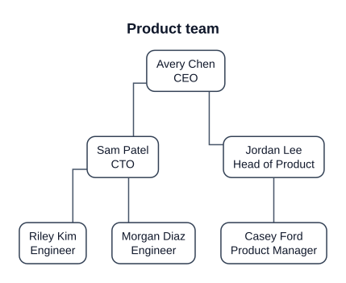

# JTDDiagrammar

Diagrams as structured text. Write JSON and get SVG back, from an API or a web app. You can also let Claude draft the diagram from a document.

The main target is the **cross-functional flowchart** (lanes × phases, as in Visio). The engine is built for multiple diagram types: each type is a plugin, and everything downstream of the plugin is type-agnostic.

## Status

| Phase | Scope | State |
|-------|-------|-------|
| P0 | Monorepo, CI, type registry, Graph IR, schemas, validation, README pipeline | **Done** |
| P1 | Flowchart layout + SVG rendering, README images | **Done** |
| P2 | Cross-functional layout (lanes × phases) | **Done** |
| P3 | REST API + web app (editor, live preview, SVG export) | **Done** |
| P4 | AI generation from documents (Claude) | **Done** |
| P5 | State diagrams (composite states) | **Done** |
| P6 | Layout quality, styling and themes | **Done** |
| P7 | Extras (see URS Should/Could items) | Next |

Today you can write **state diagrams** (with composite states), **org charts** and flowcharts, including **cross-functional flowcharts** (lanes × phases, `LR` or `TB`), in a web editor with live preview and SVG export, or render them through the REST API. You can also have Claude draft one from documents or notes. Layouts avoid running edges through nodes and keep labels off nodes and each other; colours and a dark theme are available.

## Diagram types

The examples and images below are generated from the registered types (`pnpm docs:build`) by the same renderer the API will use. CI fails if any of them go stale, and each example also has to pass validation.

<!-- BEGIN GENERATED: examples (pnpm docs:build) -->

### Flowchart

`type: flowchart` · A plain flowchart: nodes and directed edges.


<details><summary>Source</summary>

```json
{
  "version": "1",
  "type": "flowchart",
  "title": "Password reset",
  "direction": "TB",
  "nodes": [
    {
      "id": "start",
      "shape": "terminator",
      "label": "Start"
    },
    {
      "id": "request",
      "label": "Request reset link"
    },
    {
      "id": "known",
      "shape": "decision",
      "label": "Email known?"
    },
    {
      "id": "send",
      "label": "Send link"
    },
    {
      "id": "end",
      "shape": "terminator",
      "label": "End"
    }
  ],
  "edges": [
    {
      "from": "start",
      "to": "request"
    },
    {
      "from": "request",
      "to": "known"
    },
    {
      "from": "known",
      "to": "send",
      "label": "Yes"
    },
    {
      "from": "known",
      "to": "end",
      "label": "No"
    },
    {
      "from": "send",
      "to": "end"
    }
  ]
}
```

</details>

### Cross-functional flowchart

`type: flowchart` · The same flowchart type with `lanes` (functions) and `phases`.


<details><summary>Source</summary>

```json
{
  "version": "1",
  "type": "flowchart",
  "title": "Order fulfilment",
  "direction": "LR",
  "lanes": [
    {
      "id": "customer",
      "label": "Customer"
    },
    {
      "id": "sales",
      "label": "Sales"
    },
    {
      "id": "warehouse",
      "label": "Warehouse"
    }
  ],
  "phases": [
    {
      "id": "order",
      "label": "Order"
    },
    {
      "id": "fulfil",
      "label": "Fulfil"
    }
  ],
  "nodes": [
    {
      "id": "start",
      "shape": "terminator",
      "label": "Start",
      "lane": "customer",
      "phase": "order"
    },
    {
      "id": "place",
      "label": "Place order",
      "lane": "customer",
      "phase": "order"
    },
    {
      "id": "stock",
      "shape": "decision",
      "label": "In stock?",
      "lane": "sales",
      "phase": "order"
    },
    {
      "id": "ship",
      "label": "Ship order",
      "lane": "warehouse",
      "phase": "fulfil"
    },
    {
      "id": "notify",
      "label": "Notify backorder",
      "lane": "sales",
      "phase": "fulfil"
    },
    {
      "id": "end",
      "shape": "terminator",
      "label": "End",
      "lane": "customer",
      "phase": "fulfil"
    }
  ],
  "edges": [
    {
      "from": "start",
      "to": "place"
    },
    {
      "from": "place",
      "to": "stock"
    },
    {
      "from": "stock",
      "to": "ship",
      "label": "Yes"
    },
    {
      "from": "stock",
      "to": "notify",
      "label": "No"
    },
    {
      "from": "ship",
      "to": "end"
    },
    {
      "from": "notify",
      "to": "end"
    }
  ]
}
```

</details>

### State diagram

`type: state` · States, pseudostates and transitions labelled `event [guard] / action`.


<details><summary>Source</summary>

```json
{
  "version": "1",
  "type": "state",
  "title": "Support ticket",
  "states": [
    {
      "id": "start",
      "kind": "initial"
    },
    {
      "id": "open",
      "label": "Open"
    },
    {
      "id": "progress",
      "label": "In progress"
    },
    {
      "id": "waiting",
      "label": "Waiting on customer"
    },
    {
      "id": "closed",
      "label": "Closed"
    },
    {
      "id": "end",
      "kind": "final"
    }
  ],
  "transitions": [
    {
      "from": "start",
      "to": "open"
    },
    {
      "from": "open",
      "to": "progress",
      "event": "assign"
    },
    {
      "from": "progress",
      "to": "waiting",
      "event": "ask",
      "action": "notify customer"
    },
    {
      "from": "waiting",
      "to": "progress",
      "event": "reply"
    },
    {
      "from": "progress",
      "to": "closed",
      "event": "resolve",
      "guard": "fix verified"
    },
    {
      "from": "closed",
      "to": "end"
    }
  ]
}
```

</details>

### Composite state diagram

`type: state` · Nested states, a transition out of an inner state, and a self-transition.


<details><summary>Source</summary>

```json
{
  "version": "1",
  "type": "state",
  "title": "Media player",
  "states": [
    {
      "id": "init",
      "kind": "initial"
    },
    {
      "id": "stopped",
      "label": "Stopped"
    },
    {
      "id": "active",
      "label": "Active",
      "states": [
        {
          "id": "a0",
          "kind": "initial"
        },
        {
          "id": "playing",
          "label": "Playing"
        },
        {
          "id": "paused",
          "label": "Paused"
        }
      ]
    },
    {
      "id": "error",
      "label": "Error"
    }
  ],
  "transitions": [
    {
      "from": "init",
      "to": "stopped"
    },
    {
      "from": "stopped",
      "to": "active",
      "event": "play"
    },
    {
      "from": "a0",
      "to": "playing"
    },
    {
      "from": "playing",
      "to": "paused",
      "event": "pause"
    },
    {
      "from": "paused",
      "to": "playing",
      "event": "resume"
    },
    {
      "from": "playing",
      "to": "playing",
      "event": "tick",
      "action": "advance"
    },
    {
      "from": "active",
      "to": "stopped",
      "event": "stop"
    },
    {
      "from": "playing",
      "to": "error",
      "event": "decode failure"
    }
  ]
}
```

</details>

### Org chart

`type: orgchart` · People and reporting lines, top to bottom.



<details><summary>Source</summary>

```json
{
  "version": "1",
  "type": "orgchart",
  "title": "Product team",
  "people": [
    {
      "id": "ceo",
      "name": "Avery Chen",
      "title": "CEO"
    },
    {
      "id": "cto",
      "name": "Sam Patel",
      "title": "CTO",
      "manager": "ceo"
    },
    {
      "id": "cpo",
      "name": "Jordan Lee",
      "title": "Head of Product",
      "manager": "ceo"
    },
    {
      "id": "eng1",
      "name": "Riley Kim",
      "title": "Engineer",
      "manager": "cto"
    },
    {
      "id": "eng2",
      "name": "Morgan Diaz",
      "title": "Engineer",
      "manager": "cto"
    },
    {
      "id": "pm",
      "name": "Casey Ford",
      "title": "Product Manager",
      "manager": "cpo"
    }
  ]
}
```

</details>

<!-- END GENERATED: examples -->

## Language

Diagrams are JSON, XML or YAML documents describing the same model. The tables below are generated from the schemas (`pnpm docs:build`), so they always match what the validator accepts.

<!-- BEGIN GENERATED: reference (pnpm docs:build) -->

Fields every diagram has:

| Field | Type | Required | Description |
|-------|------|----------|-------------|
| `$schema` | string |  | Optional schema URL for editor tooling. |
| `version` | string | yes | Schema version; major 1 (e.g. "1", "1.2"). |
| `type` | `flowchart` \| `state` \| `orgchart` | yes | Diagram type. |
| `title` | string |  | Title shown above the diagram. |
| `theme` | `default` \| `dark` |  | Colour theme; element styles override it. |

### `flowchart`

Flowcharts. Add lanes (and optional phases) for a cross-functional flowchart.

| Field | Type | Required | Description |
|-------|------|----------|-------------|
| `direction` | `LR` \| `TB` |  | Flow direction: left to right (default) or top to bottom. |
| `lanes` | list of objects |  | Functional bands (rows for `LR`). Present → cross-functional flowchart. |
| `lanes[].id` | string | yes | Unique id: a letter or `_`, then letters, digits, `_`, `.` or `-`. |
| `lanes[].label` | string | yes | Header text. |
| `lanes[].style` | object |  | Colour and dash overrides (see Styling). |
| `phases` | list of objects |  | Stages across the lanes. Require lanes. |
| `phases[].id` | string | yes | Unique id: a letter or `_`, then letters, digits, `_`, `.` or `-`. |
| `phases[].label` | string | yes | Header text. |
| `phases[].style` | object |  | Colour and dash overrides (see Styling). |
| `nodes` | list of objects | yes | Steps, decisions and other shapes. |
| `nodes[].id` | string | yes | Unique id: a letter or `_`, then letters, digits, `_`, `.` or `-`. |
| `nodes[].shape` | `process` \| `decision` \| `terminator` \| `document` \| `data` \| `subprocess` \| `connector` |  | Default `process`. |
| `nodes[].label` | string |  | Defaults to the id. `\n` breaks lines; long text wraps. |
| `nodes[].lane` | string |  | Lane id; required when the diagram has lanes. |
| `nodes[].phase` | string |  | Phase id; required when the diagram has phases. |
| `nodes[].order` | integer |  | Hint: nodes in the same column and lane are placed in ascending order. |
| `nodes[].quote` | string |  | Supporting excerpt from the source material; shown as a tooltip. |
| `nodes[].style` | object |  | Colour and dash overrides (see Styling). |
| `edges` | list of objects |  | Directed connections. |
| `edges[].id` | string |  | Optional; generated when absent. |
| `edges[].from` | string | yes | Source node id. |
| `edges[].to` | string | yes | Target node id. |
| `edges[].label` | string |  | Text on the edge. |
| `edges[].fromSide` | `N` \| `E` \| `S` \| `W` |  | Side to leave the source by (N, E, S, W); default follows the flow. |
| `edges[].toSide` | `N` \| `E` \| `S` \| `W` |  | Side to enter the target by; default follows the flow. |
| `edges[].quote` | string |  | Supporting excerpt from the source material; shown as a tooltip. |
| `edges[].style` | object |  | Colour and dash overrides (see Styling). |
| `notes` | list of objects |  | Annotations, drawn as folded-corner notes. |
| `notes[].id` | string |  | Optional; generated when absent. |
| `notes[].text` | string | yes | Note text; `\n` breaks lines. |
| `notes[].for` | string |  | Node the note is attached to (dotted line, no arrow). |
| `notes[].lane` | string |  | Lane, for a free-standing note in a cross-functional flowchart; attached notes use their node’s. |
| `notes[].phase` | string |  | Phase, likewise. |
| `notes[].style` | object |  | Colour and dash overrides (see Styling). |

### `state`

States and the transitions between them, with composite (nested) states. For lifecycles and modes.

| Field | Type | Required | Description |
|-------|------|----------|-------------|
| `direction` | `LR` \| `TB` |  | Flow direction: left to right (default) or top to bottom. |
| `states` | list of objects | yes | Top-level states. |
| `states[].id` | string | yes | Unique id: a letter or `_`, then letters, digits, `_`, `.` or `-`. |
| `states[].kind` | `state` \| `initial` \| `final` \| `choice` |  | `state` (default) or a pseudostate; pseudostates draw no label and cannot contain states. |
| `states[].label` | string |  | Defaults to the id for ordinary states. |
| `states[].states` | list of objects |  | Nested states make this a composite state. Same fields as `states[]`. |
| `states[].quote` | string |  | Supporting excerpt from the source material; shown as a tooltip. |
| `states[].style` | object |  | Colour and dash overrides (see Styling). |
| `transitions` | list of objects |  | Drawn as `event [guard] / action`; endpoints may be any state, composite or nested. |
| `transitions[].id` | string |  | Optional; generated when absent. |
| `transitions[].from` | string | yes | Source state id. |
| `transitions[].to` | string | yes | Target state id. |
| `transitions[].event` | string |  | Trigger. |
| `transitions[].guard` | string |  | Condition, shown in brackets. |
| `transitions[].action` | string |  | Effect, shown after a slash. |
| `transitions[].quote` | string |  | Supporting excerpt from the source material; shown as a tooltip. |
| `transitions[].style` | object |  | Colour and dash overrides (see Styling). |

### `orgchart`

People and who they report to. For teams and organisations.

| Field | Type | Required | Description |
|-------|------|----------|-------------|
| `direction` | `TB` \| `LR` |  | Top to bottom (default) or left to right. |
| `people` | list of objects | yes | Everyone in the chart. |
| `people[].id` | string | yes | Unique id: a letter or `_`, then letters, digits, `_`, `.` or `-`. |
| `people[].name` | string | yes | Shown first, on its own line. |
| `people[].title` | string |  | Role, shown under the name. |
| `people[].manager` | string |  | Id of the person this person reports to; omit at the top. |
| `people[].quote` | string |  | Supporting excerpt from the source material; shown as a tooltip. |
| `people[].style` | object |  | Colour and dash overrides (see Styling). |

<!-- END GENERATED: reference -->

**XML** uses attributes for scalars and child elements for objects and lists, with any item name:

```xml
<diagram version="1" type="flowchart" title="Refunds">
  <lanes><lane id="cs" label="Support"/></lanes>
  <nodes>
    <node id="ask" shape="terminator" label="Request" lane="cs"><style fill="#dbeafe"/></node>
    <node id="pay" label="Pay" lane="cs"/>
  </nodes>
  <edges><edge from="ask" to="pay"/></edges>
</diagram>
```

**YAML** is the JSON structure written as YAML.

Flowchart rules: with lanes, every node needs a `lane`; with phases, every node also needs a `phase`. State rules: at most one `initial` per region (the top level or a composite), with no incoming transitions; `final` states have no outgoing transitions; pseudostates cannot contain states. Ids are unique across all levels.

### Styling

Any node, edge, lane, phase, state or transition can take a `style`:

```json
{ "fill": "#dcfce7", "stroke": "#14532d", "text": "#14532d", "dash": "dashed" }
```

Colours are hex (`#rgb` or `#rrggbb`); `dash` is `solid`, `dashed` or `dotted`. On edges, `stroke` also colours the arrowhead. Set `"theme": "dark"` on the diagram for the dark palette; styles override either theme.

### Diagnostics

Validation reports **every** problem, not only the first. Each one carries a JSON Pointer to its location in the source:

```json
{ "severity": "error", "code": "ref.lane", "message": "node 'ship' references unknown lane 'wh'", "path": "/nodes/3" }
```

## Quick start

Requires Node ≥ 22.12 and pnpm 10.

```bash
pnpm install
```

Build the web app and start the API, which also serves the web app, at http://localhost:8080:

```bash
pnpm --filter @jtd/web build
```

```bash
pnpm dev:api
```

For web development with hot reload (Vite, http://localhost:5173), run this alongside the API:

```bash
pnpm dev:web
```

Or run everything in one container:

```bash
docker build -t jtd .
```

```bash
docker run -p 8080:8080 jtd
```

Configuration is through environment variables; see [`.env.example`](.env.example).

### Web app


Edit JSON on the left, and the preview updates as you type. Errors are underlined in the editor and listed below it, with their JSON Pointer. The preview keeps the last valid diagram until the errors are fixed. **Export SVG** downloads exactly what the API would return for the same source. The example picker loads every registered example. Rendering happens in the browser with the same core library the API uses.

### Library

```ts
import { createRegistry, parseJson, render } from '@jtd/core';

const { value } = parseJson(text);
const { svg, diagnostics } = render(value, createRegistry()); // svg is undefined if there are errors
```

Output is standalone SVG 1.1. Text uses `Arial, Liberation Sans, Helvetica, sans-serif`; the first two have identical metrics, so text fits its boxes without embedding a font. Elements carry ids and classes for styling and scripting: `n-<id>` / `jtd-node jtd-shape-<shape>` for nodes, and `e-<id>` / `jtd-edge` for edges.

## API

| Method | Path | Returns |
|--------|------|---------|
| POST | `/v1/render` | `image/svg+xml`, or `{ svg, diagnostics }` with `Accept: application/json`. Body as JSON, XML (`application/xml`) or YAML (`application/yaml`) |
| GET | `/v1/render?src=…` | SVG for `` embedding; `src` is the JSON document, base64url-encoded |
| POST | `/v1/validate` | `{ valid, diagnostics }`; JSON, XML or YAML |
| GET | `/v1/types` | Registered diagram types and their examples |
| GET | `/v1/schema`, `/v1/schema/{type}` | JSON Schema (2020-12), combined or per type |
| POST | `/v1/refine` | Changes an existing diagram from an instruction (see [AI generation](#ai-generation)) |
| POST | `/v1/generate` | Diagram source generated by Claude from text and/or documents (see [AI generation](#ai-generation)) |
| GET | `/v1/ai` | `{ enabled, model? }`: whether AI generation is configured |
| GET | `/v1/openapi.json` | OpenAPI 3.1, generated from the route table |
| GET | `/health` | `{ status: "ok" }` |

```bash
curl -X POST localhost:8080/v1/render -H 'content-type: application/json' --data @diagram.json -o diagram.svg
```

Errors come back as `{ diagnostics: [...] }` (shape as in [Diagnostics](#diagnostics)):

| Status | When |
|--------|------|
| 400 | Invalid JSON or invalid diagram |
| 413 | Body over `BODY_LIMIT`, or more than `MAX_NODES` / `MAX_EDGES` |
| 415 | Body is not `application/json` |
| 422 | Rendering took longer than `RENDER_TIMEOUT_MS`, so the render was stopped |

Rendering runs in worker threads, so one slow diagram can't stall the server. Request bodies are never logged. SVG responses carry `Content-Security-Policy: default-src 'none'`.

## AI generation

Give it a process description, meeting notes or a procedure, as pasted text or as PDF, DOCX, HTML, TXT or MD files. Claude drafts the diagram source, and you review and edit it like anything else.


```bash
curl -X POST localhost:8080/v1/generate -F type=auto -F files=@procedure.pdf -F 'text=Focus on the approval steps'
```

Images (PNG, JPEG, GIF, WebP: whiteboard photos, screenshots of old diagrams) work too.

The response is `{ type, reason?, source, valid, diagnostics, attempts, usage, svg? }`. `usage` includes token counts and an estimated `costUsd` (published prices; override with `AI_PRICES`).

**Refine** an existing diagram with a plain-language instruction. Styles, hints, notes and ids are kept:

```bash
curl -X POST localhost:8080/v1/refine -H 'content-type: application/json' --data '{"source": {...}, "instruction": "Add a manager approval step before payment"}'
```

**Progress:** send `Accept: text/event-stream` to either endpoint for `progress` events (`ingest`, `select`, `generate`, `validate`, `repair`), then one `result` or `error` event.

**Provenance:** generated nodes and edges carry a short `quote` from the material; it shows as a tooltip when you hover the element in the SVG.

**How it stays correct:**
1. Claude's reply is constrained to the diagram type's generation schema (structured outputs).
2. The reply then passes the **same validation as hand-written source**: schema, references, lanes and phases, and a real layout.
3. If anything fails, the diagnostics go back to Claude for correction, up to `AI_MAX_REPAIRS` times (default 2).
4. If it still fails, you get the best attempt with `valid: false` and its diagnostics. A failed attempt is never presented as valid.

**Setup:**
- Set `ANTHROPIC_API_KEY` on the server. Without it, generation returns `503` and the web panel says it's unavailable.
- The default model is `claude-opus-5-5` (`AI_MODEL`), at effort `high` (`AI_EFFORT`).
- Each client IP gets `AI_RATE_LIMIT` AI requests per minute (default 10); then `429` with `Retry-After`.
- Server-side refusal fallbacks are on; set `AI_FALLBACKS=off` to disable them.
- Limits on file count, file size, total size and input tokens are in [`.env.example`](.env.example). Input is checked with token counting *before* any generation spend.

**Safety:**
- The key is read only by the SDK on the server. The browser never sees it, and lint rules stop the web app from importing AI code.
- Uploaded material is treated as data. It's wrapped and can't close its own wrapper, Claude gets no tools, and the server fixes the type and schema. Any text that ends up in the diagram is escaped when rendered.
- Material and results are not logged or stored.
- Closing the request (or **Cancel** in the web app) aborts the Claude call.

**Status:** CI tests generation end to end against a deterministic mock, never the live API. `pnpm ai:live` runs three real cases (cross-functional, plain, prompt injection) with pass/fail checks; its first run (2026-11-11, `claude-opus-5-5`) passed all three, each valid on the first attempt, with the cached prefix read on repeat calls. A full accuracy evaluation with reference diagrams (URS-AI-018) is still to do.

## Architecture

```
packages/core/src
  registry/     DiagramType + LayoutEngine contracts, Registry
  diagrams/     one folder per diagram type (the only type-specific code)
  ir/           shared Graph IR
  schema/       shared schema fragments, combined schema
  validate/     envelope, JSON Schema (Ajv), common IR rules
  adapters/     source formats (JSON)
  measure/      text metrics from a generated font table (no DOM)
  shapes/       shape library: size, outline, ports
  layout/       layered engine: cycles → rank → order → place → route
  render/svg/   geometry → SVG string
packages/ai/src    Claude client (SDK + mock), ingest, prompts, generate + repair loop
packages/api/src   Fastify server: route table → routes + OpenAPI, worker-thread render pool
packages/web/src   Vite + React + CodeMirror: editor, live preview, export
scripts/docs/   README generation + checks
scripts/fonts/  font metrics generator
```

Pipeline: `parse → envelope → type schema → type rules + IR + common rules → layout engine → geometry → SVG`.

Enforced boundaries (lint + tests):
- `core` has no DOM and no Node built-ins, so it runs in the browser and on the server.
- `layout/` and `render/` never import diagram types.
- Only `packages/ai` imports the Anthropic SDK, and the web app never imports AI code.

Full design: [docs/ARCHITECTURE.md](docs/ARCHITECTURE.md). Requirements: [docs/URS.md](docs/URS.md).

## Development

| Script | Does |
|--------|------|
| `pnpm check` | lint + typecheck + tests + docs check (what CI runs) |
| `pnpm test` | Vitest (unit, layout invariants, golden SVGs) |
| `pnpm test -u` | Accept changed golden SVGs. Review the diff first. |
| `pnpm e2e` | Playwright tests: built web app against the real API, and every generated SVG opened in Chromium and Firefox (`playwright install firefox` once) |
| `pnpm licences` | Production dependency licences against the permissive allowlist |
| `pnpm docs:build` | Regenerate README examples and `docs/img/*.svg` |
| `pnpm docs:screens` | Regenerate web app screenshots (`docs/img/*.png`) |
| `pnpm quality` | Layout quality table (crossings, overlaps, label collisions, timing) over all fixtures; `--update` lowers the baseline that CI enforces |
| `pnpm ai:eval` | Accuracy evaluation over a 6-document corpus (valid rate, node/edge recall, lane accuracy). Needs `ANTHROPIC_API_KEY`; writes `.live/eval.json` |
| `pnpm ai:live` | Live check of AI generation against the real API. Needs `ANTHROPIC_API_KEY`, costs a few cents, never runs in CI; outputs go to `.live/` |
| `pnpm fonts:metrics` | Regenerate `measure/font-metrics.ts` from Liberation Sans |

Every change cites URS IDs and includes an impact assessment in the commit body ([URS §5](docs/URS.md)).

### Adding a diagram type

1. Create `packages/core/src/diagrams/<type>/` with a schema (unique `$id`), model, `toIR`, optional `validate`, ≥ 1 example, and AI assets: a generation schema in the structured-outputs subset, `fromGenerated`, a guide and few-shot examples.
2. Register it in `packages/core/src/builtins.ts`.
3. Run `pnpm docs:build`.

Nothing else changes. The test-only `checklist` type (`packages/core/test/fixture-type.ts`) proves it.

## Licence

[MIT](LICENSE). Font metrics are derived from Liberation Sans (SIL Open Font License 1.1); no font files are distributed.
