# JTDDiagrammar

Diagrams, notes and tables in one workspace in your browser. Describe a diagram as structured text, or let the AI draft it from your notes, and watch it drawn as you type. Alongside your diagrams keep Markdown notes, CSV tables and text files. Every save is kept, and any two versions can be compared.

Diagram types: **flowcharts** and **cross-functional (swimlane) flowcharts**, **state diagrams**, **org charts**, **object lifecycles** (as in Veeva Vault), **Gantt charts**, **SAP status and workflow** diagrams and **process models**. Layout is automatic: you say what connects to what, and the app places everything.

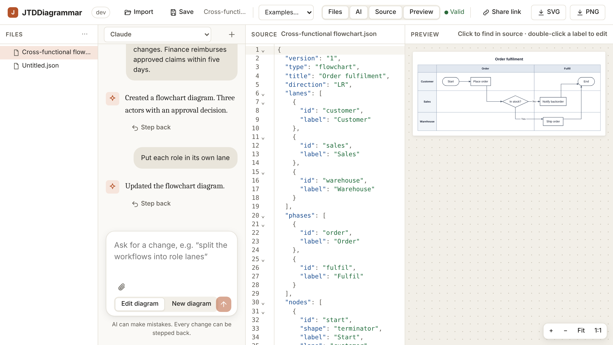

**Contents:** [Install and start](#install-and-start) · [The workspace](#the-workspace) · [Drafting with AI](#drafting-with-ai) · [Keyboard shortcuts](#keyboard-shortcuts) · [Diagram types](#diagram-types) · [Writing diagrams](#writing-diagrams)

> Setting the app up for others, configuring AI, or using the HTTP API? See the [administrator guide](docs/ADMIN.md). Working on the code? See [CONTRIBUTING.md](CONTRIBUTING.md).

## Install and start

### Windows

In PowerShell (no admin rights needed):

```powershell
irm https://github.com/jtddigital/JTDDiagrammar/releases/latest/download/install.ps1 | iex
```

This installs the app (and Node.js, if you don't have it) and adds a **JTDDiagrammar** shortcut to the Start Menu and the desktop. Double-click it: a console window starts the app and opens it in your browser at http://localhost:8080. Close the window to stop it.

### Linux and macOS

You need Node.js 22.18 or later. Then:

```bash
curl -fsSL https://github.com/jtddigital/JTDDiagrammar/releases/latest/download/install.sh | bash
```

Run `jtddiagrammar` to start the app and open your browser; Ctrl+C stops it. On Linux there's also a desktop entry.

### Updating and other commands

When a newer version is out, the toolbar shows **Update to vX.Y.Z**. Click it: the app installs the update, restarts and reloads the page, keeping your work. You can also run any of these:

| Command | Does |
|---------|------|
| `jtddiagrammar` | Start the app and open the browser |
| `jtddiagrammar --port 9000` | Start on another port |
| `jtddiagrammar update` | Install the latest version |
| `jtddiagrammar restart` | Stop the app and start it again |
| `jtddiagrammar stop` | Stop the app |
| `jtddiagrammar version` | Show the installed version |
| `jtddiagrammar uninstall` | Windows: remove the app and its shortcuts |

If your organisation runs JTDDiagrammar on a server, just open the address you were given: there is nothing to install.

## The workspace

The workspace has four panes: **Files**, **AI**, **Source** and **Preview**. A fifth, **Compare**, appears while you compare two files. Show or hide each pane with the buttons in the toolbar, and drag the line between two panes to resize them.

**Arrange the panes like an IDE.** Drag a pane by its header onto the edge of another pane. Drop it on the left or right edge to give it a column of its own, or on the top or bottom edge to stack it with that pane, for example Files above Source. The highlighted half shows where it will go; Escape cancels. From the keyboard, Alt+Shift+arrow keys move the pane you are in. The app remembers your layout. Light and dark themes follow your system.

### Files

Your files and folders live in this browser, on this computer. Nothing is stored on the server, so use **Export workspace** (in the **⋯** menu at the top of the Files pane) to back them up or move them to another computer.

Right-click a file, a folder or the empty space (or press Shift+F10) for:

- **New folder**, **New diagram** (from any example), and new **Markdown**, **text** or **CSV** files;
- **Rename** (F2), **Duplicate** and **Delete**. Deleted files go to the **Trash** at the bottom of the pane, where you can restore them; right after a delete, **Undo** brings the file back;
- **Compare with…** and **Compare with saved** (see [Compare](#compare));
- **Import** files from your computer, and **Export** a file, a folder (as a `.zip`), a file **as PDF**, or a CSV file **as Excel**.

Drag files to move them, or drop files from your computer onto a folder to import them. You can import diagrams in JSON, YAML or XML (YAML and XML are converted to JSON), Markdown, text and CSV files.

**Saving and history.** Unsaved changes are marked with • and are kept even if you switch files or close the browser, until you save. **Save** (Ctrl+S) keeps a new version of the file, and every version is kept. Click **History** at the top of the Files pane to list the open file's versions. The list follows whichever file you open. Click a version to show it read-only; **Compare** sets it against your current text, and **Restore** makes it the newest version, so nothing is ever lost.

### Source

The Source pane is the text of the open file. For a diagram it completes field names and values as you type (Ctrl+Space), underlines mistakes and lists them below; click a problem to jump to it. Until a mistake is fixed, the Preview keeps showing the last version that worked.

**Examples**, at the top of the Source pane, opens any example of any diagram type. It is not added to your files unless you save it; press **Save** to keep it as a file of your own.

### Preview

**Diagrams.** Scroll to zoom, drag to pan, or use **Fit** and **1:1**. Click an element to find its source: the editor jumps to it and puts it at the top. The element your cursor is in is outlined, and hovering a node highlights its connections. Double-click a label to edit it in place. Hover an element the AI generated to see the passage from your material it came from. A diagram with mistakes is still drawn, as far as it can be: whatever a problem points at is left out, a note says so, and you can keep clicking and editing it while you fix the problems listed under the editor.

**Markdown** renders here with no plug-ins needed:

- GitHub-style Markdown: tables, task lists, strikethrough, footnotes and links that appear automatically;
- callouts (`> [!NOTE]`, `> [!TIP]`, `> [!IMPORTANT]`, `> [!WARNING]`, `> [!CAUTION]`) and front matter;
- a table of contents: `[[toc]]`, `[TOC]` or `<!-- toc -->` on a line of its own;
- highlighted code, and maths with `$…$` and `$$…$$`;
- collapsible sections with `<details>` and `<summary>`, which fold everything up to `</details>`, code included;
- diagrams written right in the page, in a ```` ```jtd ```` code block;
- links to other files in the workspace, which open when clicked.

**Embed a file** by putting `![[file name]]` (or `![[file name|caption]]`, or ``) on a line of its own. A diagram is drawn in place, a CSV file shows as a table, a Markdown file appears in full and a text file as it is. Paths are relative to the Markdown file, so `![[../plans/flow.json]]` works too.

**CSV** files show as a table. Click a column header to sort the view; your file doesn't change. Any problems, such as a row with too many fields, are listed above the table. **Text** files have nothing to preview, so the Preview pane steps aside while one is open.

### Editing from the diagram (experimental)

Above the drawing, a toolbar edits the diagram directly; every change is written into the source, so you can see and undo it there.

- **Add** a shape: drag one from the palette (a step, decision or start/end in a flowchart, a state, a person, a task or milestone) onto the drawing, or click it and then click where it goes. It stays exactly where you put it, dashed, as a **draft**: it isn't in the source yet, and you can drag it around. **Apply** (or Enter) puts it in the source, and the layout then gives it its place. Put it in a lane, phase or column and it goes in that one. **✕** (or Delete) discards it. From the keyboard, a palette button adds the shape straight away.
- **Connect:** drag one shape onto another; the line goes from the one you dragged to the one you dropped it on. Drag a draft onto a shape, or a shape onto a draft, and the draft goes into the source connected. Let go anywhere else and the shape goes back, since the layout decides where shapes sit. Or click **Connect**, then the shape to connect from, then the one to connect to; Escape cancels.
- **Delete** removes the selected element, or the selected draft.
- **Details** opens a pane, under the drawing, with every setting of the element you last clicked, in sections you can fold: General, Connections, Placement, Schedule, Notes and sources, Appearance. Each section says how many of its settings are set, and the pane remembers which you keep open. Change a field and the diagram follows as soon as you pause typing; clear it to go back to the default. Settings that point at other elements, such as a lane, a connection's target or a manager, are picked from a list. A value that doesn't fit (a colour that isn't one, a number out of range) or that would break the diagram (removing a lane every node needs) is not written: the field keeps it and says why, so you can fix it. Connections, lanes and phases have details too.

Every diagram type can add and connect: steps and decisions, states and transitions, people and their managers, tasks and dependencies, lifecycle states, workflow steps and user actions, SAP statuses and documents, process states and workflow nodes.

### Compare

Right-click a file and choose **Compare with saved** to see your unsaved changes, or **Compare with…** and then click the other file. In the Compare pane either side can be switched to any saved version, so you can compare any two files or any two versions. ⇄ swaps the sides and ✕ closes the pane.

- **Text** comparisons show side by side or as one list, with the changed words marked and unchanged stretches folded. Use ↑ and ↓ to step through the changes.
- **Markdown** files can be compared as rendered pages, with added, removed and changed paragraphs, list items and table rows marked.
- **CSV** files are compared as a table. Rows are matched by position or by a column you choose (such as an id); changed cells show the old and the new value.
- **Diagrams** are drawn side by side, each laid out as it really is. Removed elements are marked red in the earlier version, added ones green in the later, and changed ones amber in both; in a Gantt chart's table each changed cell is highlighted, such as a new owner. Pan and zoom move both drawings together. Below them every change is listed in words, with the line in the source; click one to outline it in both drawings.

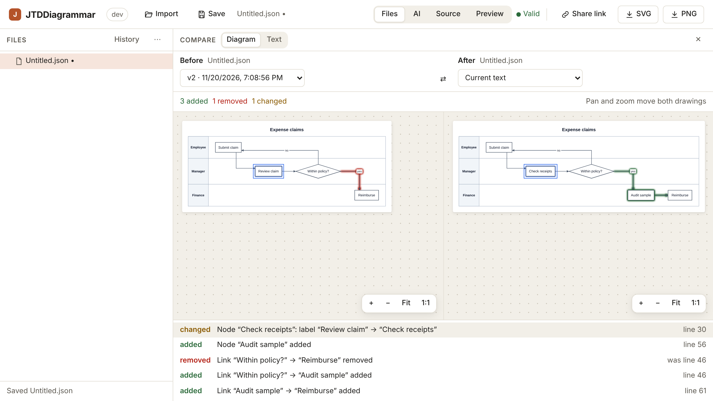

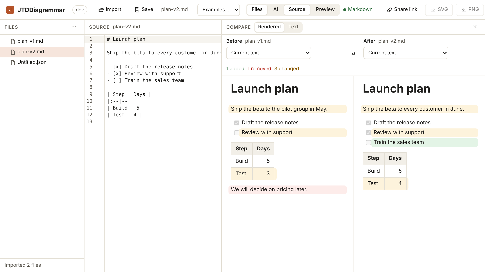

### Export and share

The toolbar exports what is on screen:

- **SVG** saves the diagram as a vector image; **PNG** saves it as a picture at twice screen size.
- **PDF** works for any file. A diagram becomes sharp vectors on a page its own size. A Markdown file is laid out on A4 pages, embedded diagrams and tables included; a CSV file becomes a table, and a text file prints as it is.
- Some diagram types export to other formats too, such as **BPMN** for process models.

**Share link** copies a link that carries the diagram itself; nothing is uploaded. Whoever opens it gets the diagram as a new file, `Shared.json`, in their workspace.

## Drafting with AI

Use the AI pane to have a diagram drafted or changed for you.

- **New diagram:** paste a process description, meeting notes or a procedure, or attach documents (PDF, Word, HTML, text, Markdown, or pictures such as a whiteboard photo). Choose a diagram type or let the AI pick one. It drafts the source, checks it as the app checks yours, fixes what fails, and shows the result.
- **Edit diagram:** ask for a change to the diagram in the editor, for example *"put each role in its own lane"* or *"add a manager approval before payment"*. The AI changes only what you ask.
- Every change the AI makes has a **Step back** button that restores the diagram from before it. **Stop** cancels a request that is still running.

Pick the AI at the top of the pane:

- **Microsoft 365 Copilot** needs a Copilot licence. Choose it, click **Sign in**, and enter the code shown at the Microsoft page it links to. Copilot reads text only, so attach PDFs and pictures with Claude instead.
- **Claude** is available when your administrator has set it up.

The AI can make mistakes: review what it drafts like anything else. The app sends your material to the AI for that request only, and keeps no copy.

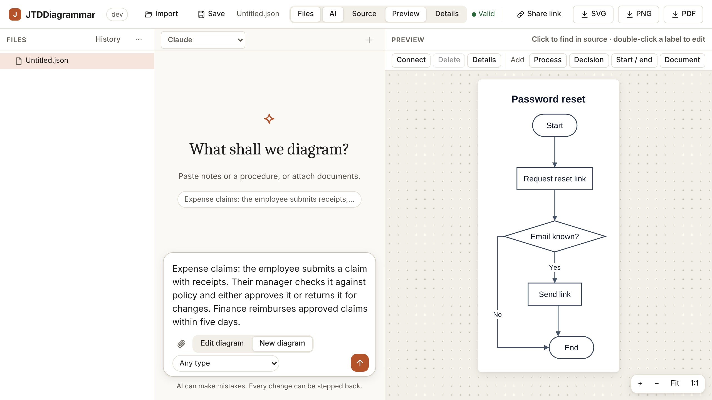

## Keyboard shortcuts

| Keys | Does |
|------|------|
| Ctrl+S | Save a version of the open file (or keep an example as a file) |
| Ctrl+O | Import files |
| Ctrl+Shift+S | Download the open file |
| Ctrl+Space | Complete a field name or value in the Source pane |
| Shift+F10 or the menu key | Open the menu of the selected file or folder |
| F2 / Delete | Rename / delete the selected file or folder |
| ↑ ↓ ← → Enter | Move through the file tree, open and close folders, open files |
| Alt+Shift+arrow keys | Move the pane you are in |
| Arrow keys on a pane divider | Resize the panes beside it |
| Escape | Close a menu, cancel a rename or a pane drag |

## Diagram types

Every example below is drawn by the app itself. To start from one, pick it from **Examples** in the Source pane and press **Save**.

<!-- BEGIN GENERATED: examples (pnpm docs:build) -->

### Flowchart

`type: flowchart` · A plain flowchart: nodes, each listing the nodes it connects `to`.

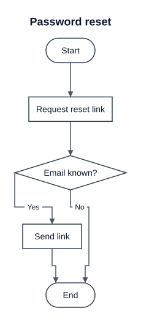

<details><summary>Source</summary>

```json
{
  "version": "1",
  "type": "flowchart",
  "title": "Password reset",
  "direction": "TB",
  "nodes": [
    {
      "id": "start",
      "shape": "terminator",
      "label": "Start",
      "to": [
        {
          "node": "request"
        }
      ]
    },
    {
      "id": "request",
      "label": "Request reset link",
      "to": [
        {
          "node": "known"
        }
      ]
    },
    {
      "id": "known",
      "shape": "decision",
      "label": "Email known?",
      "to": [
        {
          "node": "send",
          "label": "Yes"
        },
        {
          "node": "end",
          "label": "No"
        }
      ]
    },
    {
      "id": "send",
      "label": "Send link",
      "to": [
        {
          "node": "end"
        }
      ]
    },
    {
      "id": "end",
      "shape": "terminator",
      "label": "End"
    }
  ]
}
```

</details>

### Cross-functional flowchart

`type: flowchart` · The same flowchart type with `lanes` (functions) and `phases`.

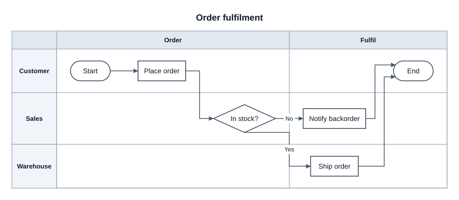

<details><summary>Source</summary>

```json
{
  "version": "1",
  "type": "flowchart",
  "title": "Order fulfilment",
  "direction": "LR",
  "lanes": [
    {
      "id": "customer",
      "label": "Customer"
    },
    {
      "id": "sales",
      "label": "Sales"
    },
    {
      "id": "warehouse",
      "label": "Warehouse"
    }
  ],
  "phases": [
    {
      "id": "order",
      "label": "Order"
    },
    {
      "id": "fulfil",
      "label": "Fulfil"
    }
  ],
  "nodes": [
    {
      "id": "start",
      "shape": "terminator",
      "label": "Start",
      "lane": "customer",
      "phase": "order",
      "to": [
        {
          "node": "place"
        }
      ]
    },
    {
      "id": "place",
      "label": "Place order",
      "lane": "customer",
      "phase": "order",
      "to": [
        {
          "node": "stock"
        }
      ]
    },
    {
      "id": "stock",
      "shape": "decision",
      "label": "In stock?",
      "lane": "sales",
      "phase": "order",
      "to": [
        {
          "node": "ship",
          "label": "Yes"
        },
        {
          "node": "notify",
          "label": "No"
        }
      ]
    },
    {
      "id": "ship",
      "label": "Ship order",
      "lane": "warehouse",
      "phase": "fulfil",
      "to": [
        {
          "node": "end"
        }
      ]
    },
    {
      "id": "notify",
      "label": "Notify backorder",
      "lane": "sales",
      "phase": "fulfil",
      "to": [
        {
          "node": "end"
        }
      ]
    },
    {
      "id": "end",
      "shape": "terminator",
      "label": "End",
      "lane": "customer",
      "phase": "fulfil"
    }
  ]
}
```

</details>

### Section styles and callout labels

`type: flowchart` · Defaults per section in `styles` and for every connection in `edgeStyle`, overridden per item. Nodes keep a standard size; labels that do not fit go into callouts (`label: auto`).

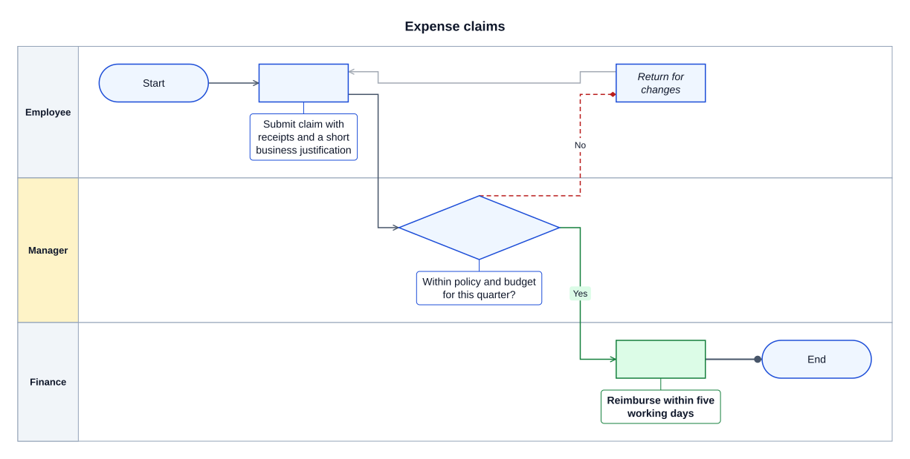

<details><summary>Source</summary>

```json
{
  "version": "1",
  "type": "flowchart",
  "title": "Expense claims",
  "styles": {
    "nodes": {
      "label": "auto",
      "fill": "#eff6ff",
      "stroke": "#1d4ed8"
    },
    "lanes": {
      "fill": "#f1f5f9"
    }
  },
  "edgeStyle": {
    "stroke": "#475569",
    "arrowhead": "open"
  },
  "lanes": [
    {
      "id": "emp",
      "label": "Employee"
    },
    {
      "id": "mgr",
      "label": "Manager",
      "style": {
        "fill": "#fef3c7"
      }
    },
    {
      "id": "fin",
      "label": "Finance"
    }
  ],
  "nodes": [
    {
      "id": "start",
      "shape": "terminator",
      "label": "Start",
      "lane": "emp",
      "to": [
        {
          "node": "submit"
        }
      ]
    },
    {
      "id": "submit",
      "label": "Submit claim with receipts and a short business justification",
      "lane": "emp",
      "to": [
        {
          "node": "check"
        }
      ]
    },
    {
      "id": "check",
      "shape": "decision",
      "label": "Within policy and budget for this quarter?",
      "lane": "mgr",
      "to": [
        {
          "node": "pay",
          "label": "Yes",
          "style": {
            "stroke": "#15803d",
            "labelFill": "#dcfce7"
          }
        },
        {
          "node": "return",
          "label": "No",
          "style": {
            "stroke": "#b91c1c",
            "dash": "dashed",
            "arrowhead": "diamond"
          }
        }
      ]
    },
    {
      "id": "return",
      "label": "Return for changes",
      "lane": "emp",
      "style": {
        "italic": true
      },
      "to": [
        {
          "node": "submit",
          "style": {
            "opacity": 0.5
          }
        }
      ]
    },
    {
      "id": "pay",
      "label": "Reimburse within five working days",
      "lane": "fin",
      "style": {
        "bold": true,
        "fill": "#dcfce7",
        "stroke": "#15803d"
      },
      "to": [
        {
          "node": "end",
          "style": {
            "arrowhead": "circle",
            "lineWidth": 2
          }
        }
      ]
    },
    {
      "id": "end",
      "shape": "terminator",
      "label": "End",
      "lane": "fin"
    }
  ]
}
```

</details>

### State diagram

`type: state` · States, pseudostates and transitions (each state lists its outgoing ones in `to`), labelled `event [guard] / action`.

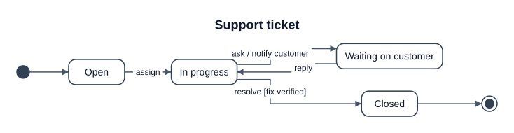

<details><summary>Source</summary>

```json
{
  "version": "1",
  "type": "state",
  "title": "Support ticket",
  "states": [
    {
      "id": "start",
      "kind": "initial",
      "to": [
        {
          "state": "open"
        }
      ]
    },
    {
      "id": "open",
      "label": "Open",
      "to": [
        {
          "state": "progress",
          "event": "assign"
        }
      ]
    },
    {
      "id": "progress",
      "label": "In progress",
      "to": [
        {
          "state": "waiting",
          "event": "ask",
          "action": "notify customer"
        },
        {
          "state": "closed",
          "event": "resolve",
          "guard": "fix verified"
        }
      ]
    },
    {
      "id": "waiting",
      "label": "Waiting on customer",
      "to": [
        {
          "state": "progress",
          "event": "reply"
        }
      ]
    },
    {
      "id": "closed",
      "label": "Closed",
      "to": [
        {
          "state": "end"
        }
      ]
    },
    {
      "id": "end",
      "kind": "final"
    }
  ]
}
```

</details>

### Composite state diagram

`type: state` · Nested states, a transition out of an inner state, and a self-transition.

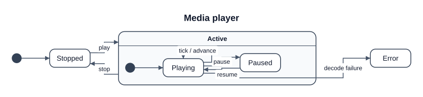

<details><summary>Source</summary>

```json
{
  "version": "1",
  "type": "state",
  "title": "Media player",
  "states": [
    {
      "id": "init",
      "kind": "initial",
      "to": [
        {
          "state": "stopped"
        }
      ]
    },
    {
      "id": "stopped",
      "label": "Stopped",
      "to": [
        {
          "state": "active",
          "event": "play"
        }
      ]
    },
    {
      "id": "active",
      "label": "Active",
      "states": [
        {
          "id": "a0",
          "kind": "initial",
          "to": [
            {
              "state": "playing"
            }
          ]
        },
        {
          "id": "playing",
          "label": "Playing",
          "to": [
            {
              "state": "paused",
              "event": "pause"
            },
            {
              "state": "playing",
              "event": "tick",
              "action": "advance"
            },
            {
              "state": "error",
              "event": "decode failure"
            }
          ]
        },
        {
          "id": "paused",
          "label": "Paused",
          "to": [
            {
              "state": "playing",
              "event": "resume"
            }
          ]
        }
      ],
      "to": [
        {
          "state": "stopped",
          "event": "stop"
        }
      ]
    },
    {
      "id": "error",
      "label": "Error"
    }
  ]
}
```

</details>

### Org chart

`type: orgchart` · People and reporting lines, top to bottom.

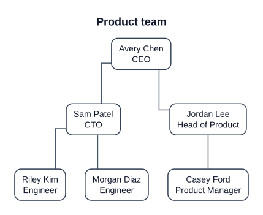

<details><summary>Source</summary>

```json
{
  "version": "1",
  "type": "orgchart",
  "title": "Product team",
  "people": [
    {
      "id": "ceo",
      "name": "Avery Chen",
      "title": "CEO"
    },
    {
      "id": "cto",
      "name": "Sam Patel",
      "title": "CTO",
      "manager": "ceo"
    },
    {
      "id": "cpo",
      "name": "Jordan Lee",
      "title": "Head of Product",
      "manager": "ceo"
    },
    {
      "id": "eng1",
      "name": "Riley Kim",
      "title": "Engineer",
      "manager": "cto"
    },
    {
      "id": "eng2",
      "name": "Morgan Diaz",
      "title": "Engineer",
      "manager": "cto"
    },
    {
      "id": "pm",
      "name": "Casey Ford",
      "title": "Product Manager",
      "manager": "cpo"
    }
  ]
}
```

</details>

### Org chart, stacked teams

`type: orgchart` · `stack: true`: each team hangs in a column under its manager. The leadership team keeps its row with `stack: false` on its manager.

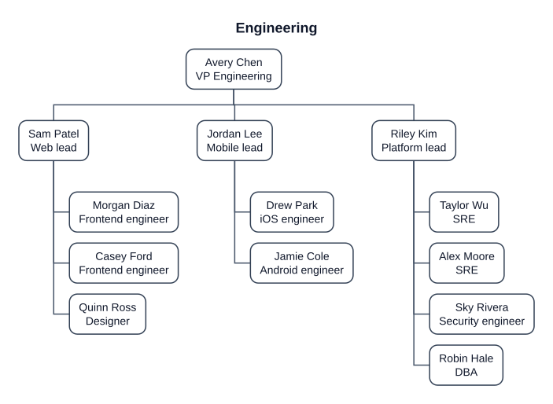

<details><summary>Source</summary>

```json
{
  "version": "1",
  "type": "orgchart",
  "title": "Engineering",
  "stack": true,
  "people": [
    {
      "id": "vp",
      "name": "Avery Chen",
      "title": "VP Engineering",
      "stack": false
    },
    {
      "id": "web",
      "name": "Sam Patel",
      "title": "Web lead",
      "manager": "vp"
    },
    {
      "id": "app",
      "name": "Jordan Lee",
      "title": "Mobile lead",
      "manager": "vp"
    },
    {
      "id": "ops",
      "name": "Riley Kim",
      "title": "Platform lead",
      "manager": "vp"
    },
    {
      "id": "w1",
      "name": "Morgan Diaz",
      "title": "Frontend engineer",
      "manager": "web"
    },
    {
      "id": "w2",
      "name": "Casey Ford",
      "title": "Frontend engineer",
      "manager": "web"
    },
    {
      "id": "w3",
      "name": "Quinn Ross",
      "title": "Designer",
      "manager": "web"
    },
    {
      "id": "a1",
      "name": "Drew Park",
      "title": "iOS engineer",
      "manager": "app"
    },
    {
      "id": "a2",
      "name": "Jamie Cole",
      "title": "Android engineer",
      "manager": "app"
    },
    {
      "id": "o1",
      "name": "Taylor Wu",
      "title": "SRE",
      "manager": "ops"
    },
    {
      "id": "o2",
      "name": "Alex Moore",
      "title": "SRE",
      "manager": "ops"
    },
    {
      "id": "o3",
      "name": "Sky Rivera",
      "title": "Security engineer",
      "manager": "ops"
    },
    {
      "id": "o4",
      "name": "Robin Hale",
      "title": "DBA",
      "manager": "ops"
    }
  ]
}
```

</details>

### Org chart, departments

`type: orgchart` · `department` on each person boxes everyone in it; `departments` styles the boxes and nests Product Design inside Product.

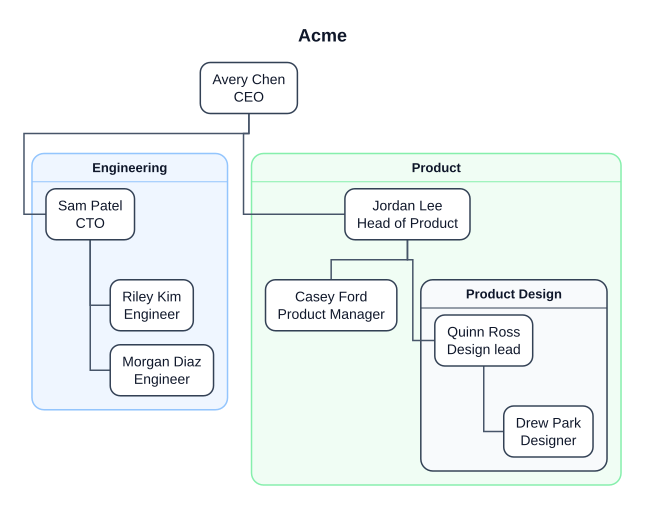

<details><summary>Source</summary>

```json
{
  "version": "1",
  "type": "orgchart",
  "title": "Acme",
  "stack": true,
  "styles": {
    "departments": {
      "fill": "#f8fafc"
    }
  },
  "departments": [
    {
      "name": "Engineering",
      "style": {
        "fill": "#eff6ff",
        "stroke": "#93c5fd"
      }
    },
    {
      "name": "Product",
      "style": {
        "fill": "#f0fdf4",
        "stroke": "#86efac"
      }
    },
    {
      "name": "Product Design",
      "parent": "Product"
    }
  ],
  "people": [
    {
      "id": "ceo",
      "name": "Avery Chen",
      "title": "CEO",
      "stack": false
    },
    {
      "id": "cto",
      "name": "Sam Patel",
      "title": "CTO",
      "manager": "ceo",
      "department": "Engineering"
    },
    {
      "id": "e1",
      "name": "Riley Kim",
      "title": "Engineer",
      "manager": "cto",
      "department": "Engineering"
    },
    {
      "id": "e2",
      "name": "Morgan Diaz",
      "title": "Engineer",
      "manager": "cto",
      "department": "Engineering"
    },
    {
      "id": "cpo",
      "name": "Jordan Lee",
      "title": "Head of Product",
      "manager": "ceo",
      "department": "Product",
      "stack": false
    },
    {
      "id": "pm",
      "name": "Casey Ford",
      "title": "Product Manager",
      "manager": "cpo",
      "department": "Product"
    },
    {
      "id": "dl",
      "name": "Quinn Ross",
      "title": "Design lead",
      "manager": "cpo",
      "department": "Product Design"
    },
    {
      "id": "d1",
      "name": "Drew Park",
      "title": "Designer",
      "manager": "dl",
      "department": "Product Design"
    }
  ]
}
```

</details>

### Org chart, a team in two columns

`type: orgchart` · `multi: 2` on a manager: their team is stacked in two columns.

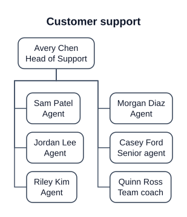

<details><summary>Source</summary>

```json
{
  "version": "1",
  "type": "orgchart",
  "title": "Customer support",
  "people": [
    {
      "id": "lead",
      "name": "Avery Chen",
      "title": "Head of Support",
      "multi": 2
    },
    {
      "id": "s1",
      "name": "Sam Patel",
      "title": "Agent",
      "manager": "lead"
    },
    {
      "id": "s2",
      "name": "Jordan Lee",
      "title": "Agent",
      "manager": "lead"
    },
    {
      "id": "s3",
      "name": "Riley Kim",
      "title": "Agent",
      "manager": "lead"
    },
    {
      "id": "s4",
      "name": "Morgan Diaz",
      "title": "Agent",
      "manager": "lead"
    },
    {
      "id": "s5",
      "name": "Casey Ford",
      "title": "Senior agent",
      "manager": "lead"
    },
    {
      "id": "s6",
      "name": "Quinn Ross",
      "title": "Team coach",
      "manager": "lead"
    }
  ]
}
```

</details>

### Org chart, tags

`type: orgchart` · `tags` on people, styled once at the top: contractors dashed, open roles faded. A person's own `style` still wins.

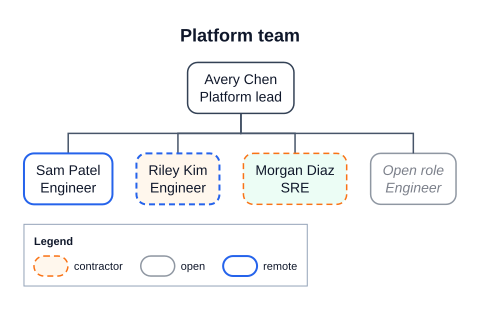

<details><summary>Source</summary>

```json
{
  "version": "1",
  "type": "orgchart",
  "title": "Platform team",
  "tags": {
    "contractor": {
      "dash": "dashed",
      "fill": "#fff7ed",
      "stroke": "#f97316"
    },
    "open": {
      "opacity": 0.55,
      "italic": true
    },
    "remote": {
      "stroke": "#2563eb",
      "lineWidth": 2
    }
  },
  "people": [
    {
      "id": "lead",
      "name": "Avery Chen",
      "title": "Platform lead"
    },
    {
      "id": "p1",
      "name": "Sam Patel",
      "title": "Engineer",
      "manager": "lead",
      "tags": [
        "remote"
      ]
    },
    {
      "id": "p2",
      "name": "Riley Kim",
      "title": "Engineer",
      "manager": "lead",
      "tags": [
        "contractor",
        "remote"
      ]
    },
    {
      "id": "p3",
      "name": "Morgan Diaz",
      "title": "SRE",
      "manager": "lead",
      "tags": [
        "contractor"
      ],
      "style": {
        "fill": "#ecfdf5"
      }
    },
    {
      "id": "p4",
      "name": "Open role",
      "title": "Engineer",
      "manager": "lead",
      "tags": [
        "open"
      ]
    }
  ]
}
```

</details>

### Org chart, saving space

`type: orgchart` · `compact: "both"`: department boxes and teams are rearranged into balanced columns to make the chart small; `horizontal` keeps it narrow, `vertical` short.

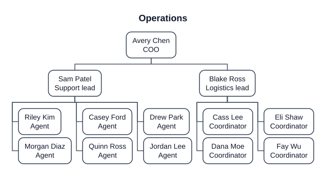

<details><summary>Source</summary>

```json
{
  "version": "1",
  "type": "orgchart",
  "title": "Operations",
  "compact": "both",
  "styles": {
    "departments": {
      "fill": "#f8fafc"
    }
  },
  "people": [
    {
      "id": "coo",
      "name": "Avery Chen",
      "title": "COO"
    },
    {
      "id": "lead0",
      "name": "Sam Patel",
      "title": "Support lead",
      "manager": "coo",
      "department": "Support"
    },
    {
      "id": "p00",
      "name": "Riley Kim",
      "title": "Specialist",
      "manager": "lead0",
      "department": "Support"
    },
    {
      "id": "p01",
      "name": "Morgan Diaz",
      "title": "Specialist",
      "manager": "lead0",
      "department": "Support"
    },
    {
      "id": "p02",
      "name": "Casey Ford",
      "title": "Specialist",
      "manager": "lead0",
      "department": "Support"
    },
    {
      "id": "p03",
      "name": "Quinn Ross",
      "title": "Specialist",
      "manager": "lead0",
      "department": "Support"
    },
    {
      "id": "lead1",
      "name": "Blake Ross",
      "title": "Logistics lead",
      "manager": "coo",
      "department": "Logistics"
    },
    {
      "id": "p10",
      "name": "Cass Lee",
      "title": "Specialist",
      "manager": "lead1",
      "department": "Logistics"
    },
    {
      "id": "p11",
      "name": "Dana Moe",
      "title": "Specialist",
      "manager": "lead1",
      "department": "Logistics"
    },
    {
      "id": "p12",
      "name": "Eli Shaw",
      "title": "Specialist",
      "manager": "lead1",
      "department": "Logistics"
    },
    {
      "id": "lead2",
      "name": "Jordan Lee",
      "title": "Facilities lead",
      "manager": "coo",
      "department": "Facilities"
    },
    {
      "id": "p20",
      "name": "Fay Wu",
      "title": "Specialist",
      "manager": "lead2",
      "department": "Facilities"
    },
    {
      "id": "p21",
      "name": "Gus Hart",
      "title": "Specialist",
      "manager": "lead2",
      "department": "Facilities"
    },
    {
      "id": "lead3",
      "name": "Drew Park",
      "title": "Procurement lead",
      "manager": "coo",
      "department": "Procurement"
    },
    {
      "id": "p30",
      "name": "Hana Ito",
      "title": "Specialist",
      "manager": "lead3",
      "department": "Procurement"
    },
    {
      "id": "p31",
      "name": "Ivan Roe",
      "title": "Specialist",
      "manager": "lead3",
      "department": "Procurement"
    },
    {
      "id": "p32",
      "name": "Jo Kemp",
      "title": "Specialist",
      "manager": "lead3",
      "department": "Procurement"
    }
  ]
}
```

</details>

### Object lifecycle

`type: lifecycle` · States as columns grouped by lifecycle stage, workflows as rows. Task verdicts with eSignature, due time and participants; a parallel split and join; a system action setting fields; entry gates and annotations; a child record made on approval; a shared Cancel action; what starts each workflow; the main path in bold; security, title block and legend.

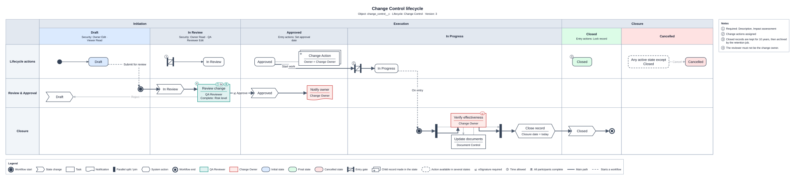

<details><summary>Source</summary>

```json
{
  "version": "1",
  "type": "lifecycle",
  "title": "Change Control lifecycle",
  "object": "change_control__c",
  "info": {
    "Lifecycle": "Change Control",
    "Version": "3"
  },
  "annotate": {
    "gates": true
  },
  "styleBy": {
    "owner": {
      "QA Reviewer": {
        "fill": "#e0f2f1",
        "stroke": "#00897b"
      },
      "Change Owner": {
        "fill": "#fdecea",
        "stroke": "#c62828"
      }
    }
  },
  "stages": [
    {
      "id": "initiation",
      "label": "Initiation",
      "states": [
        "draft",
        "in_review"
      ]
    },
    {
      "id": "execution",
      "label": "Execution",
      "states": [
        "approved",
        "in_progress"
      ]
    },
    {
      "id": "closure",
      "label": "Closure",
      "states": [
        "closed",
        "cancelled"
      ]
    }
  ],
  "states": [
    {
      "id": "draft",
      "label": "Draft",
      "stateType": "initial",
      "security": {
        "Owner": "Edit",
        "Viewer": "Read"
      }
    },
    {
      "id": "in_review",
      "label": "In Review",
      "gate": {
        "fields": [
          "Description",
          "Impact assessment"
        ]
      },
      "security": {
        "Owner": "Read",
        "QA Reviewer": "Edit"
      }
    },
    {
      "id": "approved",
      "label": "Approved",
      "entryActions": [
        "Set approval date"
      ],
      "records": [
        {
          "record": "Change Action",
          "fields": [
            "Owner = Change Owner"
          ]
        }
      ],
      "to": [
        {
          "state": "in_progress",
          "label": "Start work",
          "main": true
        }
      ]
    },
    {
      "id": "in_progress",
      "label": "In Progress",
      "gate": {
        "criteria": [
          "Change actions assigned"
        ]
      }
    },
    {
      "id": "closed",
      "label": "Closed",
      "stateType": "final",
      "entryActions": [
        "Lock record"
      ],
      "annotation": "Closed records are kept for 10 years, then archived by the retention job."
    },
    {
      "id": "cancelled",
      "label": "Cancelled",
      "stateType": "cancelled"
    }
  ],
  "sharedActions": [
    {
      "state": "cancelled",
      "label": "Cancel",
      "except": [
        "closed"
      ]
    }
  ],
  "workflows": [
    {
      "id": "review",
      "label": "Review & Approval",
      "start": {
        "state": "draft",
        "action": "Submit for review"
      },
      "steps": [
        {
          "id": "r_start",
          "kind": "start",
          "state": "draft",
          "to": [
            {
              "step": "r_submit",
              "main": true
            }
          ]
        },
        {
          "id": "r_submit",
          "kind": "stateChange",
          "target": "in_review",
          "to": [
            {
              "step": "r_review",
              "main": true
            }
          ]
        },
        {
          "id": "r_review",
          "label": "Review change",
          "owner": "QA Reviewer",
          "state": "in_review",
          "due": "5d",
          "completion": "all",
          "fields": [
            "Risk level"
          ],
          "annotation": "The reviewer must not be the change owner.",
          "verdicts": [
            {
              "name": "Approve",
              "step": "r_approve",
              "signature": true,
              "main": true
            },
            {
              "name": "Reject",
              "step": "r_return",
              "reasons": [
                "Incomplete",
                "Out of scope"
              ],
              "comment": true
            }
          ]
        },
        {
          "id": "r_approve",
          "kind": "stateChange",
          "target": "approved",
          "to": [
            {
              "step": "r_notify",
              "main": true
            }
          ]
        },
        {
          "id": "r_notify",
          "kind": "notification",
          "label": "Notify owner",
          "owner": "Change Owner",
          "state": "approved"
        },
        {
          "id": "r_return",
          "kind": "stateChange",
          "target": "draft"
        }
      ]
    },
    {
      "id": "closure",
      "label": "Closure",
      "start": {
        "state": "in_progress",
        "by": "entry"
      },
      "steps": [
        {
          "id": "c_start",
          "kind": "start",
          "state": "in_progress",
          "to": [
            {
              "step": "c_split",
              "main": true
            }
          ]
        },
        {
          "id": "c_split",
          "kind": "parallel",
          "state": "in_progress",
          "to": [
            {
              "step": "c_verify",
              "main": true
            },
            {
              "step": "c_docs"
            }
          ]
        },
        {
          "id": "c_verify",
          "label": "Verify effectiveness",
          "owner": "Change Owner",
          "state": "in_progress",
          "signature": true,
          "to": [
            {
              "step": "c_join",
              "main": true
            }
          ]
        },
        {
          "id": "c_docs",
          "label": "Update documents",
          "owner": "Document Control",
          "state": "in_progress",
          "to": [
            {
              "step": "c_join"
            }
          ]
        },
        {
          "id": "c_join",
          "kind": "join",
          "state": "in_progress",
          "to": [
            {
              "step": "c_fields",
              "main": true
            }
          ]
        },
        {
          "id": "c_fields",
          "kind": "system",
          "label": "Close record",
          "fields": [
            "Closure date = today"
          ],
          "state": "in_progress",
          "to": [
            {
              "step": "c_close",
              "main": true
            }
          ]
        },
        {
          "id": "c_close",
          "kind": "stateChange",
          "target": "closed",
          "to": [
            {
              "step": "c_end",
              "main": true
            }
          ]
        },
        {
          "id": "c_end",
          "kind": "end",
          "state": "closed"
        }
      ]
    }
  ]
}
```

</details>

### Object lifecycle, workflows split by role

`type: lifecycle` · `roleLanes: true`: each workflow is a group over one band per role, in the order owners appear; steps without an owner go in System. The bands name the owners, so `showOwners: false` leaves them off the steps, `annotate` puts task fields into annotations, `annotationTarget: id` names what each is attached to, and `annotationGroups` lists the notes by type, then owner.

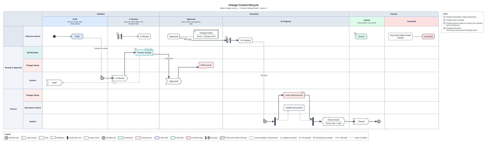

<details><summary>Source</summary>

```json
{
  "version": "1",
  "type": "lifecycle",
  "title": "Change Control lifecycle",
  "object": "change_control__c",
  "info": {
    "Lifecycle": "Change Control",
    "Version": "3"
  },
  "annotate": {
    "gates": true,
    "task": true
  },
  "styleBy": {
    "owner": {
      "QA Reviewer": {
        "fill": "#e0f2f1",
        "stroke": "#00897b"
      },
      "Change Owner": {
        "fill": "#fdecea",
        "stroke": "#c62828"
      }
    }
  },
  "stages": [
    {
      "id": "initiation",
      "label": "Initiation",
      "states": [
        "draft",
        "in_review"
      ]
    },
    {
      "id": "execution",
      "label": "Execution",
      "states": [
        "approved",
        "in_progress"
      ]
    },
    {
      "id": "closure",
      "label": "Closure",
      "states": [
        "closed",
        "cancelled"
      ]
    }
  ],
  "states": [
    {
      "id": "draft",
      "label": "Draft",
      "stateType": "initial",
      "security": {
        "Owner": "Edit",
        "Viewer": "Read"
      }
    },
    {
      "id": "in_review",
      "label": "In Review",
      "gate": {
        "fields": [
          "Description",
          "Impact assessment"
        ]
      },
      "security": {
        "Owner": "Read",
        "QA Reviewer": "Edit"
      }
    },
    {
      "id": "approved",
      "label": "Approved",
      "entryActions": [
        "Set approval date"
      ],
      "records": [
        {
          "record": "Change Action",
          "fields": [
            "Owner = Change Owner"
          ]
        }
      ],
      "to": [
        {
          "state": "in_progress",
          "label": "Start work",
          "main": true
        }
      ]
    },
    {
      "id": "in_progress",
      "label": "In Progress",
      "gate": {
        "criteria": [
          "Change actions assigned"
        ]
      }
    },
    {
      "id": "closed",
      "label": "Closed",
      "stateType": "final",
      "entryActions": [
        "Lock record"
      ],
      "annotation": "Closed records are kept for 10 years, then archived by the retention job."
    },
    {
      "id": "cancelled",
      "label": "Cancelled",
      "stateType": "cancelled"
    }
  ],
  "sharedActions": [
    {
      "state": "cancelled",
      "label": "Cancel",
      "except": [
        "closed"
      ]
    }
  ],
  "workflows": [
    {
      "id": "review",
      "label": "Review & Approval",
      "start": {
        "state": "draft",
        "action": "Submit for review"
      },
      "steps": [
        {
          "id": "r_start",
          "kind": "start",
          "state": "draft",
          "to": [
            {
              "step": "r_submit",
              "main": true
            }
          ]
        },
        {
          "id": "r_submit",
          "kind": "stateChange",
          "target": "in_review",
          "to": [
            {
              "step": "r_review",
              "main": true
            }
          ]
        },
        {
          "id": "r_review",
          "label": "Review change",
          "owner": "QA Reviewer",
          "state": "in_review",
          "due": "5d",
          "completion": "all",
          "fields": [
            "Risk level"
          ],
          "annotation": "The reviewer must not be the change owner.",
          "verdicts": [
            {
              "name": "Approve",
              "step": "r_approve",
              "signature": true,
              "main": true
            },
            {
              "name": "Reject",
              "step": "r_return",
              "reasons": [
                "Incomplete",
                "Out of scope"
              ],
              "comment": true
            }
          ]
        },
        {
          "id": "r_approve",
          "kind": "stateChange",
          "target": "approved",
          "to": [
            {
              "step": "r_notify",
              "main": true
            }
          ]
        },
        {
          "id": "r_notify",
          "kind": "notification",
          "label": "Notify owner",
          "owner": "Change Owner",
          "state": "approved"
        },
        {
          "id": "r_return",
          "kind": "stateChange",
          "target": "draft"
        }
      ]
    },
    {
      "id": "closure",
      "label": "Closure",
      "start": {
        "state": "in_progress",
        "by": "entry"
      },
      "steps": [
        {
          "id": "c_start",
          "kind": "start",
          "state": "in_progress",
          "to": [
            {
              "step": "c_split",
              "main": true
            }
          ]
        },
        {
          "id": "c_split",
          "kind": "parallel",
          "state": "in_progress",
          "to": [
            {
              "step": "c_verify",
              "main": true
            },
            {
              "step": "c_docs"
            }
          ]
        },
        {
          "id": "c_verify",
          "label": "Verify effectiveness",
          "owner": "Change Owner",
          "state": "in_progress",
          "signature": true,
          "to": [
            {
              "step": "c_join",
              "main": true
            }
          ]
        },
        {
          "id": "c_docs",
          "label": "Update documents",
          "owner": "Document Control",
          "state": "in_progress",
          "to": [
            {
              "step": "c_join"
            }
          ]
        },
        {
          "id": "c_join",
          "kind": "join",
          "state": "in_progress",
          "to": [
            {
              "step": "c_fields",
              "main": true
            }
          ]
        },
        {
          "id": "c_fields",
          "kind": "system",
          "label": "Close record",
          "fields": [
            "Closure date = today"
          ],
          "state": "in_progress",
          "to": [
            {
              "step": "c_close",
              "main": true
            }
          ]
        },
        {
          "id": "c_close",
          "kind": "stateChange",
          "target": "closed",
          "to": [
            {
              "step": "c_end",
              "main": true
            }
          ]
        },
        {
          "id": "c_end",
          "kind": "end",
          "state": "closed"
        }
      ]
    }
  ],
  "roleLanes": true,
  "showOwners": false,
  "annotationTarget": "id",
  "annotationGroups": [
    "type",
    "owner"
  ]
}
```

</details>

### Object lifecycle, summary view

`type: lifecycle` · `view: summary`: the states and every transition between them; each workflow collapses into dashed arrows.

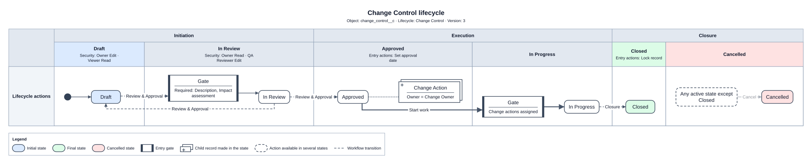

<details><summary>Source</summary>

```json
{
  "version": "1",
  "type": "lifecycle",
  "title": "Change Control lifecycle",
  "object": "change_control__c",
  "info": {
    "Lifecycle": "Change Control",
    "Version": "3"
  },
  "annotate": {
    "gates": true
  },
  "styleBy": {
    "owner": {
      "QA Reviewer": {
        "fill": "#e0f2f1",
        "stroke": "#00897b"
      },
      "Change Owner": {
        "fill": "#fdecea",
        "stroke": "#c62828"
      }
    }
  },
  "stages": [
    {
      "id": "initiation",
      "label": "Initiation",
      "states": [
        "draft",
        "in_review"
      ]
    },
    {
      "id": "execution",
      "label": "Execution",
      "states": [
        "approved",
        "in_progress"
      ]
    },
    {
      "id": "closure",
      "label": "Closure",
      "states": [
        "closed",
        "cancelled"
      ]
    }
  ],
  "states": [
    {
      "id": "draft",
      "label": "Draft",
      "stateType": "initial",
      "security": {
        "Owner": "Edit",
        "Viewer": "Read"
      }
    },
    {
      "id": "in_review",
      "label": "In Review",
      "gate": {
        "fields": [
          "Description",
          "Impact assessment"
        ]
      },
      "security": {
        "Owner": "Read",
        "QA Reviewer": "Edit"
      }
    },
    {
      "id": "approved",
      "label": "Approved",
      "entryActions": [
        "Set approval date"
      ],
      "records": [
        {
          "record": "Change Action",
          "fields": [
            "Owner = Change Owner"
          ]
        }
      ],
      "to": [
        {
          "state": "in_progress",
          "label": "Start work",
          "main": true
        }
      ]
    },
    {
      "id": "in_progress",
      "label": "In Progress",
      "gate": {
        "criteria": [
          "Change actions assigned"
        ]
      }
    },
    {
      "id": "closed",
      "label": "Closed",
      "stateType": "final",
      "entryActions": [
        "Lock record"
      ],
      "annotation": "Closed records are kept for 10 years, then archived by the retention job."
    },
    {
      "id": "cancelled",
      "label": "Cancelled",
      "stateType": "cancelled"
    }
  ],
  "sharedActions": [
    {
      "state": "cancelled",
      "label": "Cancel",
      "except": [
        "closed"
      ]
    }
  ],
  "workflows": [
    {
      "id": "review",
      "label": "Review & Approval",
      "start": {
        "state": "draft",
        "action": "Submit for review"
      },
      "steps": [
        {
          "id": "r_start",
          "kind": "start",
          "state": "draft",
          "to": [
            {
              "step": "r_submit",
              "main": true
            }
          ]
        },
        {
          "id": "r_submit",
          "kind": "stateChange",
          "target": "in_review",
          "to": [
            {
              "step": "r_review",
              "main": true
            }
          ]
        },
        {
          "id": "r_review",
          "label": "Review change",
          "owner": "QA Reviewer",
          "state": "in_review",
          "due": "5d",
          "completion": "all",
          "fields": [
            "Risk level"
          ],
          "annotation": "The reviewer must not be the change owner.",
          "verdicts": [
            {
              "name": "Approve",
              "step": "r_approve",
              "signature": true,
              "main": true
            },
            {
              "name": "Reject",
              "step": "r_return",
              "reasons": [
                "Incomplete",
                "Out of scope"
              ],
              "comment": true
            }
          ]
        },
        {
          "id": "r_approve",
          "kind": "stateChange",
          "target": "approved",
          "to": [
            {
              "step": "r_notify",
              "main": true
            }
          ]
        },
        {
          "id": "r_notify",
          "kind": "notification",
          "label": "Notify owner",
          "owner": "Change Owner",
          "state": "approved"
        },
        {
          "id": "r_return",
          "kind": "stateChange",
          "target": "draft"
        }
      ]
    },
    {
      "id": "closure",
      "label": "Closure",
      "start": {
        "state": "in_progress",
        "by": "entry"
      },
      "steps": [
        {
          "id": "c_start",
          "kind": "start",
          "state": "in_progress",
          "to": [
            {
              "step": "c_split",
              "main": true
            }
          ]
        },
        {
          "id": "c_split",
          "kind": "parallel",
          "state": "in_progress",
          "to": [
            {
              "step": "c_verify",
              "main": true
            },
            {
              "step": "c_docs"
            }
          ]
        },
        {
          "id": "c_verify",
          "label": "Verify effectiveness",
          "owner": "Change Owner",
          "state": "in_progress",
          "signature": true,
          "to": [
            {
              "step": "c_join",
              "main": true
            }
          ]
        },
        {
          "id": "c_docs",
          "label": "Update documents",
          "owner": "Document Control",
          "state": "in_progress",
          "to": [
            {
              "step": "c_join"
            }
          ]
        },
        {
          "id": "c_join",
          "kind": "join",
          "state": "in_progress",
          "to": [
            {
              "step": "c_fields",
              "main": true
            }
          ]
        },
        {
          "id": "c_fields",
          "kind": "system",
          "label": "Close record",
          "fields": [
            "Closure date = today"
          ],
          "state": "in_progress",
          "to": [
            {
              "step": "c_close",
              "main": true
            }
          ]
        },
        {
          "id": "c_close",
          "kind": "stateChange",
          "target": "closed",
          "to": [
            {
              "step": "c_end",
              "main": true
            }
          ]
        },
        {
          "id": "c_end",
          "kind": "end",
          "state": "closed"
        }
      ]
    }
  ],
  "view": "summary"
}
```

</details>

### Object lifecycle, signals and rules

`type: lifecycle` · Signals published on entry into a state, in a Signals row: a dotted arrow from the state, a dashed arrow to each subscriber, labelled with its channel. One starts a workflow; external systems go in a Subscribers row. Named rules, with how each is evaluated, referenced by id from a gate and a task.

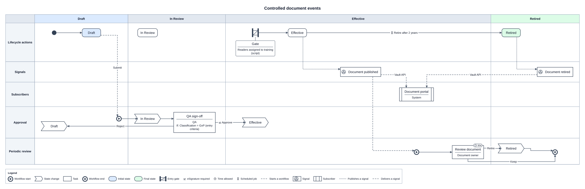

<details><summary>Source</summary>

```json
{
  "version": "1",
  "type": "lifecycle",
  "title": "Controlled document events",
  "rules": [
    {
      "id": "gxp",
      "text": "Classification = GxP",
      "via": "entry criteria"
    },
    {
      "id": "trained",
      "text": "Readers assigned to training",
      "via": "script"
    }
  ],
  "states": [
    {
      "id": "draft",
      "label": "Draft",
      "stateType": "initial"
    },
    {
      "id": "review",
      "label": "In Review"
    },
    {
      "id": "effective",
      "label": "Effective",
      "gate": {
        "rules": [
          "trained"
        ]
      },
      "to": [
        {
          "state": "retired",
          "label": "Retire",
          "by": "job",
          "after": "2 years"
        }
      ]
    },
    {
      "id": "retired",
      "label": "Retired",
      "stateType": "final"
    }
  ],
  "signals": [
    {
      "id": "published",
      "label": "Document published",
      "on": "effective",
      "to": [
        {
          "workflow": "review"
        },
        {
          "system": "Document portal",
          "channel": "Vault API"
        }
      ]
    },
    {
      "id": "withdrawn",
      "label": "Document retired",
      "on": "retired",
      "to": [
        {
          "system": "Document portal",
          "channel": "Vault API"
        }
      ]
    }
  ],
  "workflows": [
    {
      "id": "approval",
      "label": "Approval",
      "start": {
        "state": "draft",
        "action": "Submit"
      },
      "steps": [
        {
          "id": "a_start",
          "kind": "start",
          "state": "draft",
          "to": [
            {
              "step": "a_send"
            }
          ]
        },
        {
          "id": "a_send",
          "kind": "stateChange",
          "target": "review",
          "to": [
            {
              "step": "a_sign"
            }
          ]
        },
        {
          "id": "a_sign",
          "label": "QA sign-off",
          "owner": "QA",
          "state": "review",
          "rules": [
            "gxp"
          ],
          "verdicts": [
            {
              "name": "Approve",
              "step": "a_go",
              "signature": true
            },
            {
              "name": "Reject",
              "step": "a_back"
            }
          ]
        },
        {
          "id": "a_go",
          "kind": "stateChange",
          "target": "effective"
        },
        {
          "id": "a_back",
          "kind": "stateChange",
          "target": "draft"
        }
      ]
    },
    {
      "id": "review",
      "label": "Periodic review",
      "steps": [
        {
          "id": "p_start",
          "kind": "start",
          "state": "effective",
          "to": [
            {
              "step": "p_review"
            }
          ]
        },
        {
          "id": "p_review",
          "label": "Review document",
          "owner": "Document owner",
          "state": "effective",
          "due": "30d",
          "verdicts": [
            {
              "name": "Keep",
              "step": "p_end"
            },
            {
              "name": "Retire",
              "step": "p_retire"
            }
          ]
        },
        {
          "id": "p_retire",
          "kind": "stateChange",
          "target": "retired",
          "to": [
            {
              "step": "p_end"
            }
          ]
        },
        {
          "id": "p_end",
          "kind": "end",
          "state": "retired"
        }
      ]
    }
  ]
}
```

</details>

### Object lifecycle, states as rows

`type: lifecycle` · `statesAs: rows` with `direction: TB`: states run down the page and workflows across it. A scheduled job retires effective documents.

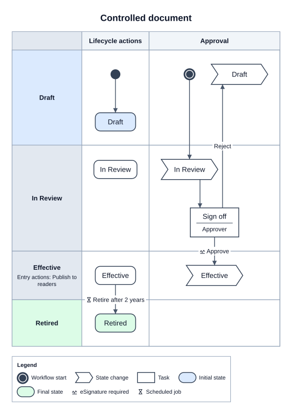

<details><summary>Source</summary>

```json
{
  "version": "1",
  "type": "lifecycle",
  "title": "Controlled document",
  "direction": "TB",
  "statesAs": "rows",
  "states": [
    {
      "id": "draft",
      "label": "Draft",
      "stateType": "initial"
    },
    {
      "id": "review",
      "label": "In Review"
    },
    {
      "id": "effective",
      "label": "Effective",
      "entryActions": [
        "Publish to readers"
      ],
      "to": [
        {
          "state": "retired",
          "label": "Retire",
          "by": "job",
          "after": "2 years"
        }
      ]
    },
    {
      "id": "retired",
      "label": "Retired",
      "stateType": "final"
    }
  ],
  "workflows": [
    {
      "id": "approval",
      "label": "Approval",
      "steps": [
        {
          "id": "a_start",
          "kind": "start",
          "state": "draft",
          "to": [
            {
              "step": "a_send"
            }
          ]
        },
        {
          "id": "a_send",
          "kind": "stateChange",
          "target": "review",
          "to": [
            {
              "step": "a_sign"
            }
          ]
        },
        {
          "id": "a_sign",
          "label": "Sign off",
          "owner": "Approver",
          "state": "review",
          "verdicts": [
            {
              "name": "Approve",
              "step": "a_go",
              "signature": true
            },
            {
              "name": "Reject",
              "step": "a_back"
            }
          ]
        },
        {
          "id": "a_go",
          "kind": "stateChange",
          "target": "effective"
        },
        {
          "id": "a_back",
          "kind": "stateChange",
          "target": "draft"
        }
      ]
    }
  ]
}
```

</details>

### Gantt chart

`type: gantt` · Phases with tasks inside (summaries roll up), finish-to-start links, an approval gate and a launch milestone. Weekends are shaded and skipped.

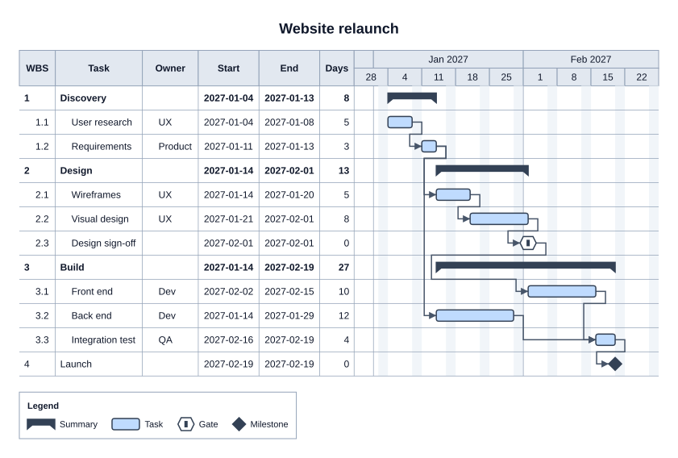

<details><summary>Source</summary>

```json
{
  "version": "1",
  "type": "gantt",
  "title": "Website relaunch",
  "start": "2027-01-04",
  "tasks": [
    {
      "id": "discovery",
      "name": "Discovery",
      "tasks": [
        {
          "id": "research",
          "name": "User research",
          "duration": 5,
          "owner": "UX"
        },
        {
          "id": "reqs",
          "name": "Requirements",
          "duration": 3,
          "owner": "Product",
          "after": [
            "research"
          ]
        }
      ]
    },
    {
      "id": "design",
      "name": "Design",
      "tasks": [
        {
          "id": "wire",
          "name": "Wireframes",
          "duration": 5,
          "owner": "UX",
          "after": [
            "reqs"
          ]
        },
        {
          "id": "visual",
          "name": "Visual design",
          "duration": 8,
          "owner": "UX",
          "after": [
            "wire"
          ]
        },
        {
          "id": "signoff",
          "name": "Design sign-off",
          "type": "gate",
          "after": [
            "visual"
          ]
        }
      ]
    },
    {
      "id": "build",
      "name": "Build",
      "tasks": [
        {
          "id": "front",
          "name": "Front end",
          "duration": 10,
          "owner": "Dev",
          "after": [
            "signoff"
          ]
        },
        {
          "id": "back",
          "name": "Back end",
          "duration": 12,
          "owner": "Dev",
          "after": [
            "reqs"
          ]
        },
        {
          "id": "test",
          "name": "Integration test",
          "duration": 4,
          "owner": "QA",
          "after": [
            "front",
            "back"
          ]
        }
      ]
    },
    {
      "id": "launch",
      "name": "Launch",
      "type": "milestone",
      "after": [
        "test"
      ]
    }
  ]
}
```

</details>

### Gantt chart, link types

`type: gantt` · All four links: finish-to-start (with a buffer), start-to-start with a lag, finish-to-finish, and start-to-finish; a deliverable at the end.

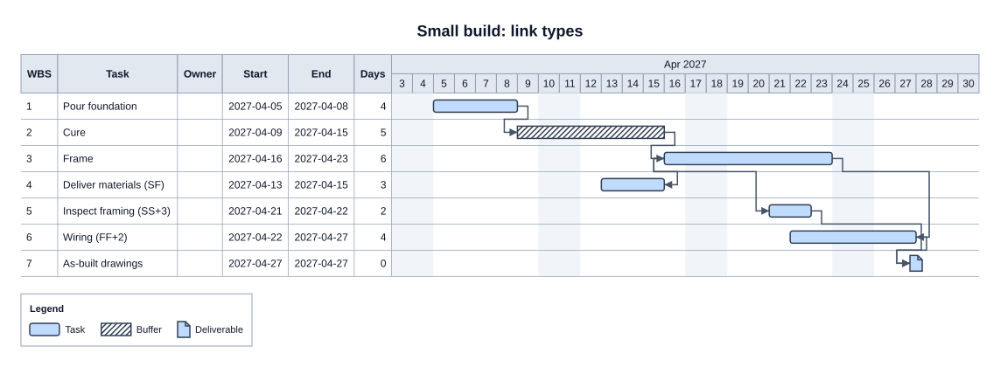

<details><summary>Source</summary>

```json
{
  "version": "1",
  "type": "gantt",
  "title": "Small build: link types",
  "start": "2027-04-05",
  "tasks": [
    {
      "id": "pour",
      "name": "Pour foundation",
      "duration": 4
    },
    {
      "id": "cure",
      "name": "Cure",
      "type": "buffer",
      "duration": 5,
      "after": [
        "pour"
      ]
    },
    {
      "id": "frame",
      "name": "Frame",
      "duration": 6,
      "after": [
        "cure"
      ]
    },
    {
      "id": "materials",
      "name": "Deliver materials (SF)",
      "duration": 3,
      "after": [
        "frame SF"
      ]
    },
    {
      "id": "inspect",
      "name": "Inspect framing (SS+3)",
      "duration": 2,
      "after": [
        "frame SS+3"
      ]
    },
    {
      "id": "wiring",
      "name": "Wiring (FF+2)",
      "duration": 4,
      "after": [
        "frame FF+2"
      ]
    },
    {
      "id": "drawings",
      "name": "As-built drawings",
      "type": "deliverable",
      "after": [
        "wiring",
        "inspect"
      ]
    }
  ]
}
```

</details>

### Gantt chart, styled

`type: gantt` · Styles by owner and type, a tag, three levels of items, external work (dashed), a buffer, a gate and a deliverable; a holiday and a deadline. The legend lists what is used.

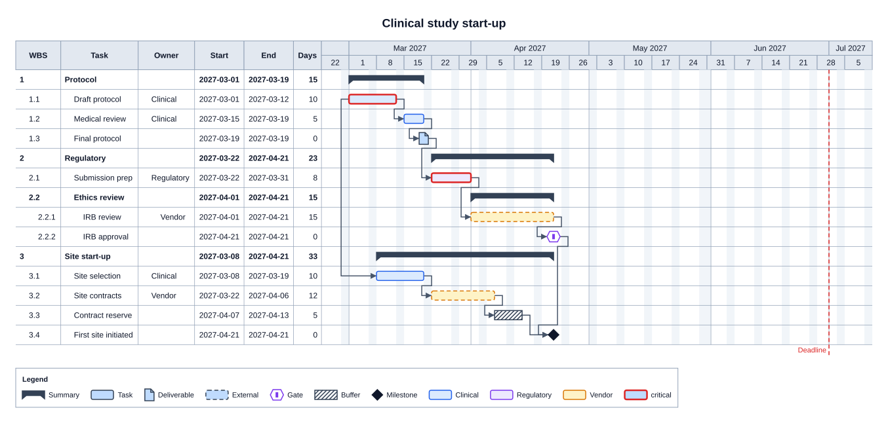

<details><summary>Source</summary>

```json
{
  "version": "1",
  "type": "gantt",
  "title": "Clinical study start-up",
  "start": "2027-03-01",
  "deadline": "2027-06-30",
  "calendar": {
    "holidays": [
      "2027-05-31"
    ]
  },
  "styleBy": {
    "type": {
      "gate": {
        "stroke": "#7c3aed"
      },
      "milestone": {
        "stroke": "#0f172a"
      }
    },
    "owner": {
      "Clinical": {
        "fill": "#dbeafe",
        "stroke": "#2563eb"
      },
      "Regulatory": {
        "fill": "#ede9fe",
        "stroke": "#7c3aed"
      },
      "Vendor": {
        "fill": "#fef3c7",
        "stroke": "#d97706"
      }
    }
  },
  "tags": {
    "critical": {
      "stroke": "#dc2626",
      "lineWidth": 2.5
    }
  },
  "tasks": [
    {
      "id": "protocol",
      "name": "Protocol",
      "tasks": [
        {
          "id": "draft",
          "name": "Draft protocol",
          "duration": 10,
          "owner": "Clinical",
          "tags": [
            "critical"
          ]
        },
        {
          "id": "review",
          "name": "Medical review",
          "duration": 5,
          "owner": "Clinical",
          "after": [
            "draft"
          ]
        },
        {
          "id": "final",
          "name": "Final protocol",
          "type": "deliverable",
          "after": [
            "review"
          ]
        }
      ]
    },
    {
      "id": "reg",
      "name": "Regulatory",
      "tasks": [
        {
          "id": "prep",
          "name": "Submission prep",
          "duration": 8,
          "owner": "Regulatory",
          "after": [
            "final"
          ],
          "tags": [
            "critical"
          ]
        },
        {
          "id": "irb",
          "name": "Ethics review",
          "tasks": [
            {
              "id": "irbreview",
              "name": "IRB review",
              "type": "external",
              "duration": 15,
              "owner": "Vendor",
              "after": [
                "prep"
              ]
            },
            {
              "id": "approval",
              "name": "IRB approval",
              "type": "gate",
              "after": [
                "irbreview"
              ]
            }
          ]
        }
      ]
    },
    {
      "id": "sites",
      "name": "Site start-up",
      "tasks": [
        {
          "id": "select",
          "name": "Site selection",
          "duration": 10,
          "owner": "Clinical",
          "after": [
            "draft SS+5"
          ]
        },
        {
          "id": "contracts",
          "name": "Site contracts",
          "type": "external",
          "duration": 12,
          "owner": "Vendor",
          "after": [
            "select"
          ]
        },
        {
          "id": "reserve",
          "name": "Contract reserve",
          "type": "buffer",
          "duration": 5,
          "after": [
            "contracts"
          ]
        },
        {
          "id": "siv",
          "name": "First site initiated",
          "type": "milestone",
          "after": [
            "approval",
            "reserve"
          ]
        }
      ]
    }
  ]
}
```

</details>

### SAP status and workflow

`type: sap` · System statuses set by business transactions over the user status profile: numbered statuses linked by their ranges, a flag, authorization keys. A flexible workflow started by an event, with start conditions, approval steps with recipients, deadlines and a step condition, rework, rejection, and the status set on release; an annotation and the legend.

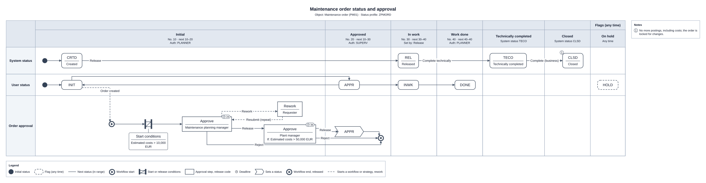

<details><summary>Source</summary>

```json
{
  "version": "1",
  "type": "sap",
  "title": "Maintenance order status and approval",
  "object": "Maintenance order (PM01)",
  "profile": "ZPMORD",
  "systemStatuses": [
    {
      "code": "CRTD",
      "label": "Created"
    },
    {
      "code": "REL",
      "label": "Released"
    },
    {
      "code": "TECO",
      "label": "Technically completed"
    },
    {
      "code": "CLSD",
      "label": "Closed",
      "annotation": "No more postings, including costs; the order is locked for changes.",
      "tags": [
        "Compliance"
      ]
    }
  ],
  "userStatuses": [
    {
      "code": "INIT",
      "label": "Initial",
      "number": 10,
      "low": 10,
      "high": 20,
      "initial": true,
      "system": "CRTD",
      "auth": "PLANNER",
      "control": {
        "release": "forbidden"
      }
    },
    {
      "code": "APPR",
      "label": "Approved",
      "number": 20,
      "low": 10,
      "high": 30,
      "system": "CRTD",
      "auth": "SUPERV",
      "control": {
        "release": "allowed"
      }
    },
    {
      "code": "INWK",
      "label": "In work",
      "number": 30,
      "low": 30,
      "high": 40,
      "system": "REL",
      "setBy": [
        "release"
      ],
      "control": {
        "confirm": "allowed",
        "teco": "warning"
      }
    },
    {
      "code": "DONE",
      "label": "Work done",
      "number": 40,
      "low": 40,
      "high": 40,
      "system": "REL",
      "auth": "PLANNER",
      "control": {
        "confirm": "warning",
        "teco": "allowed"
      }
    },
    {
      "code": "HOLD",
      "label": "On hold",
      "control": {
        "release": "forbidden",
        "confirm": "forbidden"
      },
      "deletedBy": [
        "teco"
      ]
    }
  ],
  "transactions": [
    {
      "id": "release",
      "label": "Release",
      "sets": [
        "REL"
      ]
    },
    {
      "id": "confirm",
      "label": "Enter confirmation"
    },
    {
      "id": "teco",
      "label": "Complete technically",
      "sets": [
        "TECO"
      ]
    },
    {
      "id": "close",
      "label": "Complete (business)",
      "sets": [
        "CLSD"
      ]
    }
  ],
  "workflows": [
    {
      "id": "approval",
      "label": "Order approval",
      "trigger": {
        "status": "INIT",
        "event": "Order created"
      },
      "conditions": [
        "Estimated costs > 10,000 EUR"
      ],
      "tags": [
        "Cost control"
      ],
      "steps": [
        {
          "id": "planning",
          "recipients": "Maintenance planning manager",
          "deadline": "2d",
          "rework": "repeat"
        },
        {
          "id": "plant",
          "recipients": "Plant manager",
          "conditions": [
            "Estimated costs > 50,000 EUR"
          ],
          "deadline": "3d",
          "tags": [
            "Cost control",
            "Compliance"
          ]
        }
      ],
      "released": "APPR"
    }
  ]
}
```

</details>

### SAP transaction control

`type: sap` · `matrix: true`: one row per business transaction, with a mark per user status: allowed, allowed with a warning, forbidden, sets or deletes the status. Each transaction lists the transaction codes or apps that run it (`tcodes`), as do the approval steps. `annotate: true` puts the conditions into annotations, `annotationTarget: label` names what each is attached to, and `annotationGroups: [tag]` lists the notes by tag (one with two tags under both).

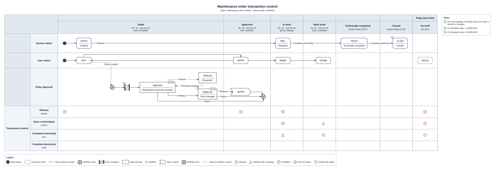

<details><summary>Source</summary>

```json
{
  "version": "1",
  "type": "sap",
  "title": "Maintenance order transaction control",
  "object": "Maintenance order (PM01)",
  "profile": "ZPMORD",
  "systemStatuses": [
    {
      "code": "CRTD",
      "label": "Created"
    },
    {
      "code": "REL",
      "label": "Released"
    },
    {
      "code": "TECO",
      "label": "Technically completed"
    },
    {
      "code": "CLSD",
      "label": "Closed",
      "annotation": "No more postings, including costs; the order is locked for changes.",
      "tags": [
        "Compliance"
      ]
    }
  ],
  "userStatuses": [
    {
      "code": "INIT",
      "label": "Initial",
      "number": 10,
      "low": 10,
      "high": 20,
      "initial": true,
      "system": "CRTD",
      "auth": "PLANNER",
      "control": {
        "release": "forbidden"
      }
    },
    {
      "code": "APPR",
      "label": "Approved",
      "number": 20,
      "low": 10,
      "high": 30,
      "system": "CRTD",
      "auth": "SUPERV",
      "control": {
        "release": "allowed"
      }
    },
    {
      "code": "INWK",
      "label": "In work",
      "number": 30,
      "low": 30,
      "high": 40,
      "system": "REL",
      "setBy": [
        "release"
      ],
      "control": {
        "confirm": "allowed",
        "teco": "warning"
      }
    },
    {
      "code": "DONE",
      "label": "Work done",
      "number": 40,
      "low": 40,
      "high": 40,
      "system": "REL",
      "auth": "PLANNER",
      "control": {
        "confirm": "warning",
        "teco": "allowed"
      }
    },
    {
      "code": "HOLD",
      "label": "On hold",
      "control": {
        "release": "forbidden",
        "confirm": "forbidden"
      },
      "deletedBy": [
        "teco"
      ]
    }
  ],
  "transactions": [
    {
      "id": "release",
      "label": "Release",
      "sets": [
        "REL"
      ],
      "tcodes": [
        "IW32"
      ]
    },
    {
      "id": "confirm",
      "label": "Enter confirmation",
      "tcodes": [
        "IW41",
        "F1606"
      ]
    },
    {
      "id": "teco",
      "label": "Complete technically",
      "sets": [
        "TECO"
      ],
      "tcodes": [
        "IW32"
      ]
    },
    {
      "id": "close",
      "label": "Complete (business)",
      "sets": [
        "CLSD"
      ],
      "tcodes": [
        "IW32"
      ]
    }
  ],
  "workflows": [
    {
      "id": "approval",
      "label": "Order approval",
      "trigger": {
        "status": "INIT",
        "event": "Order created"
      },
      "conditions": [
        "Estimated costs > 10,000 EUR"
      ],
      "tags": [
        "Cost control"
      ],
      "steps": [
        {
          "id": "planning",
          "recipients": "Maintenance planning manager",
          "deadline": "2d",
          "rework": "repeat",
          "tcodes": [
            "My Inbox"
          ]
        },
        {
          "id": "plant",
          "recipients": "Plant manager",
          "conditions": [
            "Estimated costs > 50,000 EUR"
          ],
          "deadline": "3d",
          "tags": [
            "Cost control",
            "Compliance"
          ],
          "tcodes": [
            "My Inbox"
          ]
        }
      ],
      "released": "APPR"
    }
  ],
  "matrix": true,
  "annotate": true,
  "annotationTarget": "label",
  "annotationGroups": [
    "tag"
  ]
}
```

</details>

### SAP document flow and release strategy

`type: sap` · The documents the order creates, each in the status it is created in and joined to it by a dotted line, with arrows from preceding to subsequent documents. The purchase requisition’s release strategy: release conditions as a gate, release codes released after their prerequisites (two in parallel), release indicators, and release at once when the conditions do not hold.

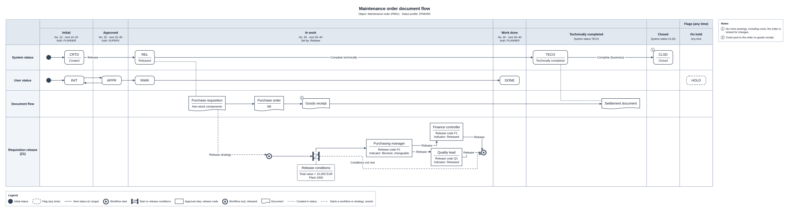

<details><summary>Source</summary>

```json
{
  "version": "1",
  "type": "sap",
  "title": "Maintenance order document flow",
  "object": "Maintenance order (PM01)",
  "profile": "ZPMORD",
  "systemStatuses": [
    {
      "code": "CRTD",
      "label": "Created"
    },
    {
      "code": "REL",
      "label": "Released"
    },
    {
      "code": "TECO",
      "label": "Technically completed"
    },
    {
      "code": "CLSD",
      "label": "Closed",
      "annotation": "No more postings, including costs; the order is locked for changes.",
      "tags": [
        "Compliance"
      ]
    }
  ],
  "userStatuses": [
    {
      "code": "INIT",
      "label": "Initial",
      "number": 10,
      "low": 10,
      "high": 20,
      "initial": true,
      "system": "CRTD",
      "auth": "PLANNER",
      "control": {
        "release": "forbidden"
      }
    },
    {
      "code": "APPR",
      "label": "Approved",
      "number": 20,
      "low": 10,
      "high": 30,
      "system": "CRTD",
      "auth": "SUPERV",
      "control": {
        "release": "allowed"
      }
    },
    {
      "code": "INWK",
      "label": "In work",
      "number": 30,
      "low": 30,
      "high": 40,
      "system": "REL",
      "setBy": [
        "release"
      ],
      "control": {
        "confirm": "allowed",
        "teco": "warning"
      }
    },
    {
      "code": "DONE",
      "label": "Work done",
      "number": 40,
      "low": 40,
      "high": 40,
      "system": "REL",
      "auth": "PLANNER",
      "control": {
        "confirm": "warning",
        "teco": "allowed"
      }
    },
    {
      "code": "HOLD",
      "label": "On hold",
      "control": {
        "release": "forbidden",
        "confirm": "forbidden"
      },
      "deletedBy": [
        "teco"
      ]
    }
  ],
  "transactions": [
    {
      "id": "release",
      "label": "Release",
      "sets": [
        "REL"
      ]
    },
    {
      "id": "confirm",
      "label": "Enter confirmation"
    },
    {
      "id": "teco",
      "label": "Complete technically",
      "sets": [
        "TECO"
      ]
    },
    {
      "id": "close",
      "label": "Complete (business)",
      "sets": [
        "CLSD"
      ]
    }
  ],
  "documents": [
    {
      "id": "pr",
      "label": "Purchase requisition",
      "kind": "Non-stock components",
      "status": "REL"
    },
    {
      "id": "po",
      "label": "Purchase order",
      "kind": "NB",
      "from": [
        "pr"
      ]
    },
    {
      "id": "gr",
      "label": "Goods receipt",
      "from": [
        "po"
      ],
      "annotation": "Costs post to the order on goods receipt."
    },
    {
      "id": "settle",
      "label": "Settlement document",
      "status": "TECO",
      "from": [
        "gr"
      ]
    }
  ],
  "releaseStrategies": [
    {
      "id": "z1",
      "label": "Requisition release (Z1)",
      "document": "pr",
      "conditions": [
        "Total value > 10,000 EUR",
        "Plant 1000"
      ],
      "codes": [
        {
          "code": "P1",
          "label": "Purchasing manager",
          "indicator": "Blocked, changeable"
        },
        {
          "code": "F1",
          "label": "Finance controller",
          "prerequisites": [
            "P1"
          ],
          "indicator": "Released"
        },
        {
          "code": "Q1",
          "label": "Quality lead",
          "prerequisites": [
            "P1"
          ],
          "indicator": "Released"
        }
      ]
    }
  ]
}
```

</details>

### SAP release without a status profile

`type: sap` · An object with no status profile, charted from its documents and release strategy: one column per document. Both release codes can reject (`reject: true`): the requester changes the requisition and resubmits, which starts the strategy again.

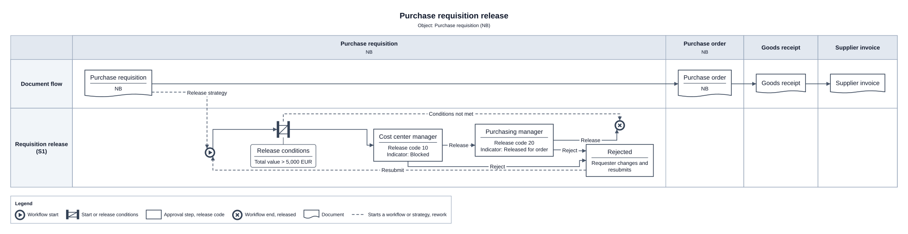

<details><summary>Source</summary>

```json
{
  "version": "1",
  "type": "sap",
  "title": "Purchase requisition release",
  "object": "Purchase requisition (NB)",
  "documents": [
    {
      "id": "pr",
      "label": "Purchase requisition",
      "kind": "NB"
    },
    {
      "id": "po",
      "label": "Purchase order",
      "kind": "NB",
      "from": [
        "pr"
      ]
    },
    {
      "id": "gr",
      "label": "Goods receipt",
      "from": [
        "po"
      ]
    },
    {
      "id": "iv",
      "label": "Supplier invoice",
      "from": [
        "gr"
      ]
    }
  ],
  "releaseStrategies": [
    {
      "id": "s1",
      "label": "Requisition release (S1)",
      "document": "pr",
      "conditions": [
        "Total value > 5,000 EUR"
      ],
      "codes": [
        {
          "code": "10",
          "label": "Cost center manager",
          "indicator": "Blocked",
          "reject": true
        },
        {
          "code": "20",
          "label": "Purchasing manager",
          "prerequisites": [
            "10"
          ],
          "indicator": "Released for order",
          "reject": true
        }
      ]
    }
  ]
}
```

</details>

### SAP events and rules

`type: sap` · Signals raised when a status is set, in a Signals row, each sent to subscribers in a Subscribers row: external systems over a channel (the arrow’s label) and a BAdI. A named rule, evaluated by BRF+, is the plant manager’s step condition.

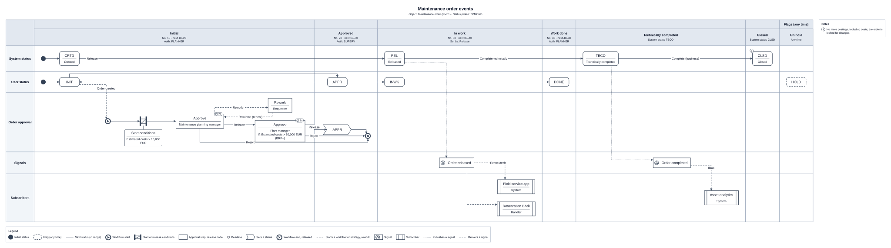

<details><summary>Source</summary>

```json
{
  "version": "1",
  "type": "sap",
  "title": "Maintenance order events",
  "object": "Maintenance order (PM01)",
  "profile": "ZPMORD",
  "systemStatuses": [
    {
      "code": "CRTD",
      "label": "Created"
    },
    {
      "code": "REL",
      "label": "Released"
    },
    {
      "code": "TECO",
      "label": "Technically completed"
    },
    {
      "code": "CLSD",
      "label": "Closed",
      "annotation": "No more postings, including costs; the order is locked for changes.",
      "tags": [
        "Compliance"
      ]
    }
  ],
  "userStatuses": [
    {
      "code": "INIT",
      "label": "Initial",
      "number": 10,
      "low": 10,
      "high": 20,
      "initial": true,
      "system": "CRTD",
      "auth": "PLANNER",
      "control": {
        "release": "forbidden"
      }
    },
    {
      "code": "APPR",
      "label": "Approved",
      "number": 20,
      "low": 10,
      "high": 30,
      "system": "CRTD",
      "auth": "SUPERV",
      "control": {
        "release": "allowed"
      }
    },
    {
      "code": "INWK",
      "label": "In work",
      "number": 30,
      "low": 30,
      "high": 40,
      "system": "REL",
      "setBy": [
        "release"
      ],
      "control": {
        "confirm": "allowed",
        "teco": "warning"
      }
    },
    {
      "code": "DONE",
      "label": "Work done",
      "number": 40,
      "low": 40,
      "high": 40,
      "system": "REL",
      "auth": "PLANNER",
      "control": {
        "confirm": "warning",
        "teco": "allowed"
      }
    },
    {
      "code": "HOLD",
      "label": "On hold",
      "control": {
        "release": "forbidden",
        "confirm": "forbidden"
      },
      "deletedBy": [
        "teco"
      ]
    }
  ],
  "transactions": [
    {
      "id": "release",
      "label": "Release",
      "sets": [
        "REL"
      ]
    },
    {
      "id": "confirm",
      "label": "Enter confirmation"
    },
    {
      "id": "teco",
      "label": "Complete technically",
      "sets": [
        "TECO"
      ]
    },
    {
      "id": "close",
      "label": "Complete (business)",
      "sets": [
        "CLSD"
      ]
    }
  ],
  "workflows": [
    {
      "id": "approval",
      "label": "Order approval",
      "trigger": {
        "status": "INIT",
        "event": "Order created"
      },
      "conditions": [
        "Estimated costs > 10,000 EUR"
      ],
      "tags": [
        "Cost control"
      ],
      "steps": [
        {
          "id": "planning",
          "recipients": "Maintenance planning manager",
          "deadline": "2d",
          "rework": "repeat"
        },
        {
          "id": "plant",
          "recipients": "Plant manager",
          "rules": [
            "major"
          ],
          "deadline": "3d"
        }
      ],
      "released": "APPR"
    }
  ],
  "rules": [
    {
      "id": "major",
      "text": "Estimated costs > 50,000 EUR",
      "via": "BRF+"
    }
  ],
  "signals": [
    {
      "id": "released",
      "label": "Order released",
      "on": "REL",
      "to": [
        {
          "system": "Field service app",
          "channel": "Event Mesh"
        },
        {
          "handler": "Reservation BAdI"
        }
      ]
    },
    {
      "id": "completed",
      "label": "Order completed",
      "on": "TECO",
      "to": [
        {
          "system": "Asset analytics",
          "channel": "IDoc"
        }
      ]
    }
  ]
}
```

</details>

### Process (generic)

`type: process` · A platform without a type of its own (IBM Maximo), written in the canonical terms with free stereotypes. Two regions (status and hold, each one row with exactly one active state); transitions fired by operation calls and by time; permissions under each state; operations called on entry. A workflow with a decision on a named rule, a merge and a send node, started by the signal published when the order is created.

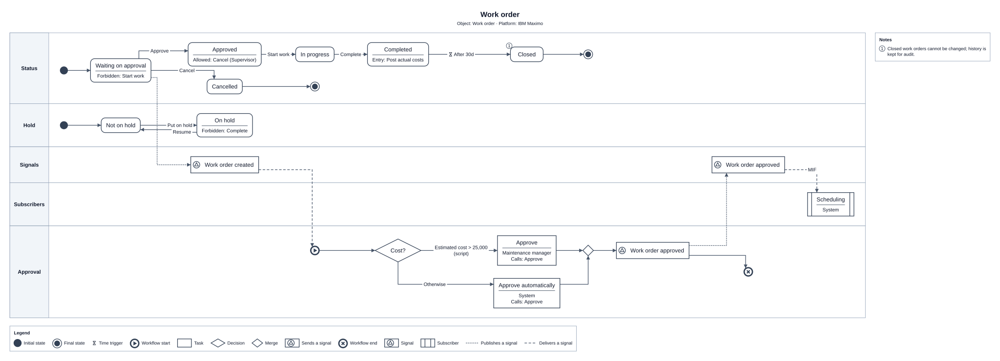

<details><summary>Source</summary>

```json
{
  "version": "1",
  "type": "process",
  "title": "Work order",
  "object": {
    "label": "Work order",
    "stereotype": "Maximo Object",
    "values": {
      "table": "WORKORDER"
    }
  },
  "info": {
    "Platform": "IBM Maximo"
  },
  "rules": [
    {
      "id": "large",
      "text": "Estimated cost > 25,000",
      "via": "script"
    }
  ],
  "regions": [
    {
      "id": "status",
      "label": "Status",
      "states": [
        {
          "id": "WAPPR",
          "label": "Waiting on approval",
          "initial": true
        },
        {
          "id": "APPR",
          "label": "Approved"
        },
        {
          "id": "INPRG",
          "label": "In progress"
        },
        {
          "id": "COMP",
          "label": "Completed",
          "entry": [
            "charge"
          ]
        },
        {
          "id": "CLOSE",
          "label": "Closed",
          "final": true,
          "annotation": "Closed work orders cannot be changed; history is kept for audit."
        },
        {
          "id": "CAN",
          "label": "Cancelled",
          "final": true
        }
      ]
    },
    {
      "id": "hold",
      "label": "Hold",
      "states": [
        {
          "id": "free",
          "label": "Not on hold",
          "initial": true
        },
        {
          "id": "held",
          "label": "On hold"
        }
      ]
    }
  ],
  "operations": [
    {
      "id": "approve",
      "label": "Approve"
    },
    {
      "id": "start",
      "label": "Start work",
      "callers": [
        "user"
      ]
    },
    {
      "id": "complete",
      "label": "Complete",
      "callers": [
        "user"
      ]
    },
    {
      "id": "cancel",
      "label": "Cancel",
      "callers": [
        "user"
      ]
    },
    {
      "id": "hold",
      "label": "Put on hold",
      "callers": [
        "user"
      ]
    },
    {
      "id": "resume",
      "label": "Resume",
      "callers": [
        "user"
      ]
    },
    {
      "id": "charge",
      "label": "Post actual costs"
    }
  ],
  "transitions": [
    {
      "from": "WAPPR",
      "to": "APPR",
      "trigger": {
        "call": "approve"
      }
    },
    {
      "from": "APPR",
      "to": "INPRG",
      "trigger": {
        "call": "start"
      }
    },
    {
      "from": "INPRG",
      "to": "COMP",
      "trigger": {
        "call": "complete"
      }
    },
    {
      "from": "COMP",
      "to": "CLOSE",
      "trigger": {
        "after": "30d"
      }
    },
    {
      "from": "WAPPR",
      "to": "CAN",
      "trigger": {
        "call": "cancel"
      }
    },
    {
      "from": "free",
      "to": "held",
      "trigger": {
        "call": "hold"
      }
    },
    {
      "from": "held",
      "to": "free",
      "trigger": {
        "call": "resume"
      }
    }
  ],
  "permissions": [
    {
      "state": "held",
      "operation": "complete",
      "outcome": "forbidden"
    },
    {
      "state": "WAPPR",
      "operation": "start",
      "outcome": "forbidden"
    },
    {
      "state": "APPR",
      "operation": "cancel",
      "role": "Supervisor",
      "outcome": "allowed"
    }
  ],
  "signals": [
    {
      "id": "created",
      "label": "Work order created",
      "on": "WAPPR",
      "to": [
        {
          "workflow": "approval"
        }
      ]
    },
    {
      "id": "approved",
      "label": "Work order approved",
      "to": [
        {
          "system": "Scheduling",
          "channel": "MIF"
        }
      ]
    }
  ],
  "workflows": [
    {
      "id": "approval",
      "label": "Approval",
      "stereotype": "Maximo Workflow",
      "nodes": [
        {
          "id": "start",
          "kind": "initial"
        },
        {
          "id": "size",
          "kind": "decision",
          "label": "Cost?"
        },
        {
          "id": "manager",
          "kind": "task",
          "label": "Approve",
          "role": "Maintenance manager",
          "calls": [
            "approve"
          ]
        },
        {
          "id": "auto",
          "kind": "task",
          "label": "Approve automatically",
          "role": "System",
          "calls": [
            "approve"
          ]
        },
        {
          "id": "merge",
          "kind": "merge"
        },
        {
          "id": "tell",
          "kind": "send",
          "signal": "approved"
        },
        {
          "id": "end",
          "kind": "final"
        }
      ],
      "flows": [
        {
          "from": "start",
          "to": "size"
        },
        {
          "from": "size",
          "to": "manager",
          "guard": "large"
        },
        {
          "from": "size",
          "to": "auto",
          "guard": "Otherwise"
        },
        {
          "from": "manager",
          "to": "merge"
        },
        {
          "from": "auto",
          "to": "merge"
        },
        {
          "from": "merge",
          "to": "tell"
        },
        {
          "from": "tell",
          "to": "end"
        }
      ]
    }
  ]
}
```

</details>

### Process in a platform profile

`type: process` · `profile: servicenow`: the stereotypes come from the ServiceNow profile and are checked against it. UI actions as operations with role permissions, a guard rule on Resolve, automatic closing after 7 days, and a signal that starts a flow and notifies a portal.

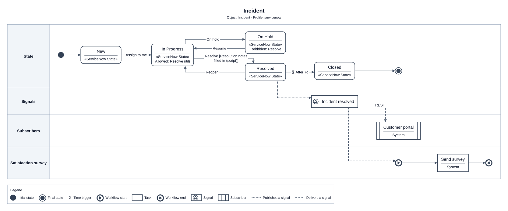

<details><summary>Source</summary>

```json
{
  "version": "1",
  "type": "process",
  "title": "Incident",
  "profile": "servicenow",
  "object": {
    "label": "Incident",
    "stereotype": "ServiceNow Record",
    "values": {
      "table": "incident"
    }
  },
  "rules": [
    {
      "id": "notes",
      "text": "Resolution notes filled in",
      "via": "script"
    }
  ],
  "regions": [
    {
      "id": "state",
      "label": "State",
      "states": [
        {
          "id": "new",
          "label": "New",
          "initial": true,
          "stereotype": "ServiceNow State",
          "values": {
            "value": "1"
          }
        },
        {
          "id": "progress",
          "label": "In Progress",
          "stereotype": "ServiceNow State",
          "values": {
            "value": "2"
          }
        },
        {
          "id": "hold",
          "label": "On Hold",
          "stereotype": "ServiceNow State",
          "values": {
            "value": "3"
          }
        },
        {
          "id": "resolved",
          "label": "Resolved",
          "stereotype": "ServiceNow State",
          "values": {
            "value": "6"
          }
        },
        {
          "id": "closed",
          "label": "Closed",
          "final": true,
          "stereotype": "ServiceNow State",
          "values": {
            "value": "7"
          }
        }
      ]
    }
  ],
  "operations": [
    {
      "id": "assign",
      "label": "Assign to me",
      "callers": [
        "user"
      ],
      "stereotype": "ServiceNow UI Action"
    },
    {
      "id": "pause",
      "label": "On hold",
      "callers": [
        "user"
      ],
      "stereotype": "ServiceNow UI Action"
    },
    {
      "id": "resume",
      "label": "Resume",
      "callers": [
        "user"
      ],
      "stereotype": "ServiceNow UI Action"
    },
    {
      "id": "resolve",
      "label": "Resolve",
      "callers": [
        "user"
      ],
      "stereotype": "ServiceNow UI Action"
    },
    {
      "id": "reopen",
      "label": "Reopen",
      "callers": [
        "user"
      ],
      "stereotype": "ServiceNow UI Action"
    }
  ],
  "transitions": [
    {
      "from": "new",
      "to": "progress",
      "trigger": {
        "call": "assign"
      }
    },
    {
      "from": "progress",
      "to": "hold",
      "trigger": {
        "call": "pause"
      }
    },
    {
      "from": "hold",
      "to": "progress",
      "trigger": {
        "call": "resume"
      }
    },
    {
      "from": "progress",
      "to": "resolved",
      "trigger": {
        "call": "resolve"
      },
      "guard": "notes"
    },
    {
      "from": "resolved",
      "to": "progress",
      "trigger": {
        "call": "reopen"
      }
    },
    {
      "from": "resolved",
      "to": "closed",
      "trigger": {
        "after": "7d"
      }
    }
  ],
  "permissions": [
    {
      "state": "progress",
      "operation": "resolve",
      "role": "itil",
      "outcome": "allowed"
    },
    {
      "state": "hold",
      "operation": "resolve",
      "outcome": "forbidden"
    }
  ],
  "signals": [
    {
      "id": "resolved",
      "label": "Incident resolved",
      "on": "resolved",
      "to": [
        {
          "workflow": "survey"
        },
        {
          "system": "Customer portal",
          "channel": "REST"
        }
      ]
    }
  ],
  "workflows": [
    {
      "id": "survey",
      "label": "Satisfaction survey",
      "stereotype": "ServiceNow Flow",
      "nodes": [
        {
          "id": "start",
          "kind": "initial"
        },
        {
          "id": "send",
          "kind": "task",
          "label": "Send survey",
          "role": "System"
        },
        {
          "id": "end",
          "kind": "final"
        }
      ],
      "flows": [
        {
          "from": "start",
          "to": "send"
        },
        {
          "from": "send",
          "to": "end"
        }
      ]
    }
  ]
}
```

</details>

### SAP MDG change request

`type: process` · `profile: sap` with the MDG stereotypes: a material change request’s statuses (01 to 06, two of them final), its actions as operations, and the rule-based workflow whose BRF+ decision tables (named rules) choose the next step and status from the previous step and action, and the agents. Activation publishes a signal for data replication.

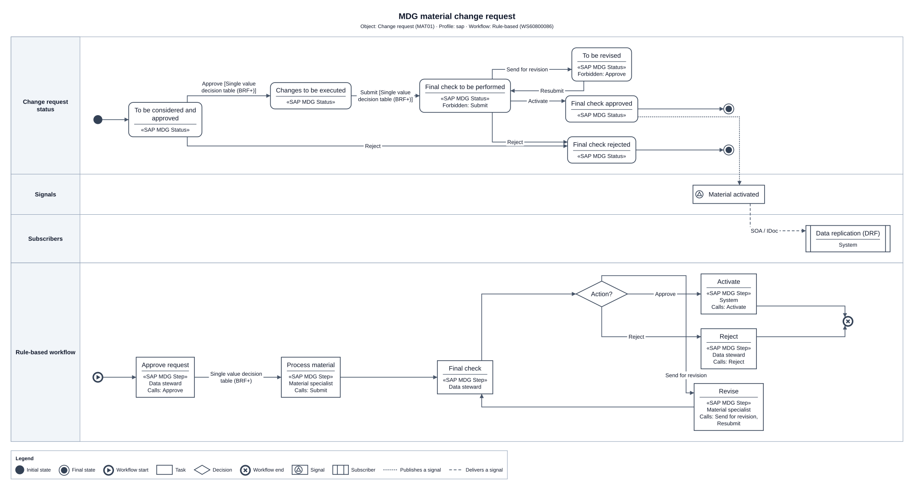

<details><summary>Source</summary>

```json
{
  "version": "1",
  "type": "process",
  "title": "MDG material change request",
  "profile": "sap",
  "object": {
    "label": "Change request (MAT01)",
    "stereotype": "SAP MDG Change Request",
    "values": {
      "crType": "MAT01",
      "entity": "MATERIAL"
    }
  },
  "info": {
    "Workflow": "Rule-based (WS60800086)"
  },
  "rules": [
    {
      "id": "route",
      "text": "Single value decision table",
      "via": "BRF+"
    },
    {
      "id": "agents",
      "text": "User agent decision table",
      "via": "BRF+"
    }
  ],
  "regions": [
    {
      "id": "status",
      "label": "Change request status",
      "states": [
        {
          "id": "s01",
          "label": "To be considered and approved",
          "initial": true,
          "stereotype": "SAP MDG Status",
          "values": {
            "code": "01"
          }
        },
        {
          "id": "s02",
          "label": "Changes to be executed",
          "stereotype": "SAP MDG Status",
          "values": {
            "code": "02"
          }
        },
        {
          "id": "s03",
          "label": "To be revised",
          "stereotype": "SAP MDG Status",
          "values": {
            "code": "03"
          }
        },
        {
          "id": "s04",
          "label": "Final check to be performed",
          "stereotype": "SAP MDG Status",
          "values": {
            "code": "04"
          }
        },
        {
          "id": "s05",
          "label": "Final check approved",
          "final": true,
          "stereotype": "SAP MDG Status",
          "values": {
            "code": "05"
          }
        },
        {
          "id": "s06",
          "label": "Final check rejected",
          "final": true,
          "stereotype": "SAP MDG Status",
          "values": {
            "code": "06"
          }
        }
      ]
    }
  ],
  "operations": [
    {
      "id": "approve",
      "label": "Approve",
      "callers": [
        "user"
      ],
      "stereotype": "SAP MDG Action",
      "values": {
        "code": "01"
      }
    },
    {
      "id": "reject",
      "label": "Reject",
      "callers": [
        "user"
      ],
      "stereotype": "SAP MDG Action",
      "values": {
        "code": "02"
      }
    },
    {
      "id": "revise",
      "label": "Send for revision",
      "callers": [
        "user"
      ],
      "stereotype": "SAP MDG Action",
      "values": {
        "code": "03"
      }
    },
    {
      "id": "submit",
      "label": "Submit",
      "callers": [
        "user"
      ],
      "stereotype": "SAP MDG Action",
      "values": {
        "code": "04"
      }
    },
    {
      "id": "resubmit",
      "label": "Resubmit",
      "callers": [
        "user"
      ],
      "stereotype": "SAP MDG Action",
      "values": {
        "code": "05"
      }
    },
    {
      "id": "activate",
      "label": "Activate",
      "stereotype": "SAP MDG Action",
      "values": {
        "code": "06"
      }
    }
  ],
  "transitions": [
    {
      "from": "s01",
      "to": "s02",
      "trigger": {
        "call": "approve"
      },
      "guard": "route"
    },
    {
      "from": "s01",
      "to": "s06",
      "trigger": {
        "call": "reject"
      }
    },
    {
      "from": "s02",
      "to": "s04",
      "trigger": {
        "call": "submit"
      },
      "guard": "route"
    },
    {
      "from": "s04",
      "to": "s03",
      "trigger": {
        "call": "revise"
      }
    },
    {
      "from": "s03",
      "to": "s04",
      "trigger": {
        "call": "resubmit"
      }
    },
    {
      "from": "s04",
      "to": "s05",
      "trigger": {
        "call": "activate"
      }
    },
    {
      "from": "s04",
      "to": "s06",
      "trigger": {
        "call": "reject"
      }
    }
  ],
  "permissions": [
    {
      "state": "s04",
      "operation": "submit",
      "outcome": "forbidden"
    },
    {
      "state": "s03",
      "operation": "approve",
      "outcome": "forbidden"
    }
  ],
  "signals": [
    {
      "id": "activated",
      "label": "Material activated",
      "on": "s05",
      "to": [
        {
          "system": "Data replication (DRF)",
          "channel": "SOA / IDoc"
        }
      ]
    }
  ],
  "workflows": [
    {
      "id": "rbwf",
      "label": "Rule-based workflow",
      "stereotype": "SAP MDG Workflow",
      "values": {
        "template": "WS60800086"
      },
      "nodes": [
        {
          "id": "start",
          "kind": "initial"
        },
        {
          "id": "approval",
          "kind": "task",
          "label": "Approve request",
          "role": "Data steward",
          "calls": [
            "approve"
          ],
          "stereotype": "SAP MDG Step",
          "values": {
            "step": "00",
            "agent": "agents"
          }
        },
        {
          "id": "process",
          "kind": "task",
          "label": "Process material",
          "role": "Material specialist",
          "calls": [
            "submit"
          ],
          "stereotype": "SAP MDG Step",
          "values": {
            "step": "01",
            "agent": "agents"
          }
        },
        {
          "id": "check",
          "kind": "task",
          "label": "Final check",
          "role": "Data steward",
          "stereotype": "SAP MDG Step",
          "values": {
            "step": "90",
            "agent": "agents"
          }
        },
        {
          "id": "verdict",
          "kind": "decision",
          "label": "Action?"
        },
        {
          "id": "revision",
          "kind": "task",
          "label": "Revise",
          "role": "Material specialist",
          "calls": [
            "revise",
            "resubmit"
          ],
          "stereotype": "SAP MDG Step",
          "values": {
            "step": "95",
            "agent": "agents"
          }
        },
        {
          "id": "activation",
          "kind": "task",
          "label": "Activate",
          "role": "System",
          "calls": [
            "activate"
          ],
          "stereotype": "SAP MDG Step",
          "values": {
            "step": "91",
            "agent": "non-user agent"
          }
        },
        {
          "id": "rejection",
          "kind": "task",
          "label": "Reject",
          "role": "Data steward",
          "calls": [
            "reject"
          ],
          "stereotype": "SAP MDG Step",
          "values": {
            "step": "92",
            "agent": "agents"
          }
        },
        {
          "id": "end",
          "kind": "final"
        }
      ],
      "flows": [
        {
          "from": "start",
          "to": "approval"
        },
        {
          "from": "approval",
          "to": "process",
          "guard": "route"
        },
        {
          "from": "process",
          "to": "check"
        },
        {
          "from": "check",
          "to": "verdict"
        },
        {
          "from": "verdict",
          "to": "activation",
          "guard": "Approve"
        },
        {
          "from": "verdict",
          "to": "revision",
          "guard": "Send for revision"
        },
        {
          "from": "verdict",
          "to": "rejection",
          "guard": "Reject"
        },
        {
          "from": "revision",
          "to": "check"
        },
        {
          "from": "activation",
          "to": "end"
        },
        {
          "from": "rejection",
          "to": "end"
        }
      ]
    }
  ]
}
```

</details>

<!-- END GENERATED: examples -->

## Writing diagrams

A diagram is a JSON document (XML and YAML files are converted to JSON when you import them). The Source pane completes field names and values as you type (Ctrl+Space) and underlines mistakes. The field tables below are generated from the same schemas the app checks against, so they always match what it accepts.

**Connections live under the node they leave from.** Each node lists its outgoing connections in `to`. Each entry names its target (`node` in flowcharts, `state` in state diagrams) and can carry its own label, side hints and style:

```json
{
  "id": "check",
  "shape": "decision",
  "label": "In stock?",
  "to": [
    { "node": "ship", "label": "Yes" },
    { "node": "notify", "label": "No", "exitSide": "S", "style": { "stroke": "#b91c1c" } }
  ]
}
```

`exitSide` and `entrySide` (N, E, S, W) choose which side of the box the line leaves and enters by. State diagrams do the same with `"to": [{ "state": "paid", "event": "pay" }]` on each state, including composite and nested ones. Lifecycle workflow steps use `"to": [{ "step": … }]`, and lifecycle states list their user actions as `"to": [{ "state": …, "label": "Cancel" }]`. Org charts link people through `manager`.

**Object lifecycles** (`type: lifecycle`): `states` are listed in lifecycle order, and `stages` group adjacent states under a shared header. `workflows` hold `steps` of kind `start`, `task` (with `role`), `decision`, `notification`, `stateChange` (with `target`) and `end`. Each step sits in the `state` the record is in during that step; a state change sits in its target state. `statesAs: "columns" | "rows"` chooses where states go, while `direction` (`LR`/`TB`) still sets the flow. A *Lifecycle actions* band appears when any state has user actions (`actionsLane` forces it on or off). `entryCriteria` and `entryActions` show under each state's header.

<!-- BEGIN GENERATED: reference (pnpm docs:build) -->

Fields every diagram has:

| Field | Type | Required | Description |
|-------|------|----------|-------------|
| `$schema` | string |  | Optional schema URL for editor tooling. |
| `version` | string | yes | Schema version; major 1 (e.g. "1", "1.2"). |
| `type` | `flowchart` \| `state` \| `orgchart` \| `lifecycle` \| `gantt` \| `sap` \| `process` | yes | Diagram type. |
| `title` | string |  | Title shown above the diagram. |
| `theme` | `default` \| `dark` |  | Colour theme; element styles override it. |

### `flowchart`

Flowcharts. Add lanes (and optional phases) for a cross-functional flowchart.

| Field | Type | Required | Description |
|-------|------|----------|-------------|
| `direction` | `LR` \| `TB` |  | Flow direction: left to right (default) or top to bottom. |
| `styles` | styles by key |  | Default style per section (`lanes`, `phases`, `nodes`, `notes`); each item’s own `style` overrides it field by field. |
| `edgeStyle` | style |  | Default style for every connection; each one’s own `style` overrides it field by field. |
| `styleBy` | object |  | Node styles by shape and by owner, e.g. `{ "owner": { "Bill": { "fill": "#fdd" } } }`. Precedence: `styles.nodes`, then shape, then owner, then the node’s own `style`. |
| `styleBy.shape` | styles by key |  | Style for every item with this `shape`, by value: `process`, `decision`, `terminator`, `document`, `data`, `subprocess`, `connector`, `hexagon`. |
| `styleBy.owner` | object |  | Style for every item with this `owner`, by value. |
| `lanes` | list of objects |  | Functional bands (rows for `LR`). Present → cross-functional flowchart. |
| `lanes[].id` | string | yes | Unique id: a letter or `_`, then letters, digits, `_`, `.` or `-`. |
| `lanes[].label` | string | yes | Header text. |
| `lanes[].style` | style |  | Colours, lines, text and node sizing (see Styling). |
| `phases` | list of objects |  | Stages across the lanes. Require lanes. |
| `phases[].id` | string | yes | Unique id: a letter or `_`, then letters, digits, `_`, `.` or `-`. |
| `phases[].label` | string | yes | Header text. |
| `phases[].style` | style |  | Colours, lines, text and node sizing (see Styling). |
| `nodes` | list of objects | yes | Steps, decisions and other shapes. |
| `nodes[].id` | string | yes | Unique id: a letter or `_`, then letters, digits, `_`, `.` or `-`. |
| `nodes[].shape` | `process` \| `decision` \| `terminator` \| `document` \| `data` \| `subprocess` \| `connector` \| `hexagon` |  | Default `process`. |
| `nodes[].label` | string |  | Defaults to the id. `\n` breaks lines; long text wraps. |
| `nodes[].owner` | string |  | Who does it; shown under a line below the label, and matched by `styleBy.owner`. |
| `nodes[].lane` | string |  | Lane id; required when the diagram has lanes. |
| `nodes[].phase` | string |  | Phase id; required when the diagram has phases. |
| `nodes[].order` | integer |  | Hint: nodes in the same column and lane are placed in ascending order. |
| `nodes[].quote` | string |  | Supporting excerpt from the source material; shown as a tooltip. |
| `nodes[].style` | style |  | Colours, lines, text and node sizing (see Styling). |
| `nodes[].to` | list of objects |  | Outgoing connections, each to one target node. |
| `nodes[].to[].node` | string | yes | Target node id. |
| `nodes[].to[].label` | string |  | Text on the connection, placed where it fits best. |
| `nodes[].to[].labels` | list of objects |  | Labels on the connection, after `label`. Each sits `at` percent of the way along it, or wherever fits best when `at` is absent. |
| `nodes[].to[].labels[].text` | string | yes | Label text; `\n` breaks lines. |
| `nodes[].to[].labels[].at` | number |  | Position along the connection in percent of its length: 0 at the start, 50 in the middle, 100 at the end. |
| `nodes[].to[].exitSide` | `N` \| `E` \| `S` \| `W` |  | Side of this node the line leaves by (N, E, S, W); default follows the flow. |
| `nodes[].to[].entrySide` | `N` \| `E` \| `S` \| `W` |  | Side of the target the line enters by; default follows the flow. |
| `nodes[].to[].id` | string |  | Optional; generated when absent. |
| `nodes[].to[].quote` | string |  | Supporting excerpt from the source material; shown as a tooltip. |
| `nodes[].to[].style` | style |  | Overrides `edgeStyle` field by field. |
| `notes` | list of objects |  | Annotations, drawn as folded-corner notes. |
| `notes[].id` | string |  | Optional; generated when absent. |
| `notes[].text` | string | yes | Note text; `\n` breaks lines. |
| `notes[].for` | string |  | Node the note is attached to (dotted line, no arrow). |
| `notes[].lane` | string |  | Lane, for a free-standing note in a cross-functional flowchart; attached notes use their node’s. |
| `notes[].phase` | string |  | Phase, likewise. |
| `notes[].style` | style |  | Colours, lines, text and node sizing (see Styling). |

### `state`

States and the transitions between them, with composite (nested) states. For lifecycles and modes.

| Field | Type | Required | Description |
|-------|------|----------|-------------|
| `direction` | `LR` \| `TB` |  | Flow direction: left to right (default) or top to bottom. |
| `styles` | styles by key |  | Default style per section (`states`); each item’s own `style` overrides it field by field. |
| `states` | list of objects | yes | Top-level states. |
| `states[].id` | string | yes | Unique id: a letter or `_`, then letters, digits, `_`, `.` or `-`. |
| `states[].kind` | `state` \| `initial` \| `final` \| `choice` |  | `state` (default) or a pseudostate; pseudostates draw no label and cannot contain states. |
| `states[].label` | string |  | Defaults to the id for ordinary states. |
| `states[].states` | list of objects |  | Nested states make this a composite state. Same fields as `states[]`. |
| `states[].quote` | string |  | Supporting excerpt from the source material; shown as a tooltip. |
| `states[].style` | style |  | Colours, lines, text and node sizing (see Styling). |
| `states[].to` | list of objects |  | Outgoing transitions; targets may be any state, composite or nested. |
| `states[].to[].state` | string | yes | Target state id. |
| `states[].to[].event` | string |  | Trigger. |
| `states[].to[].guard` | string |  | Condition, shown in brackets. |
| `states[].to[].action` | string |  | Effect, shown after a slash. |
| `states[].to[].labels` | list of objects |  | Labels on the connection, after `label`. Each sits `at` percent of the way along it, or wherever fits best when `at` is absent. |
| `states[].to[].labels[].text` | string | yes | Label text; `\n` breaks lines. |
| `states[].to[].labels[].at` | number |  | Position along the connection in percent of its length: 0 at the start, 50 in the middle, 100 at the end. |
| `states[].to[].id` | string |  | Optional; generated when absent. |
| `states[].to[].quote` | string |  | Supporting excerpt from the source material; shown as a tooltip. |
| `states[].to[].style` | style |  | Overrides `transitionStyle` field by field. |
| `transitionStyle` | style |  | Default style for every transition; each one’s own `style` overrides it field by field. |

### `orgchart`

People and who they report to. For teams and organisations.

| Field | Type | Required | Description |
|-------|------|----------|-------------|
| `direction` | `TB` \| `LR` |  | Top to bottom (default) or left to right. |
| `styles` | styles by key |  | Default style per section (`people`, `lines`, `departments`); each item’s own `style` overrides it field by field. |
| `departments` | list of objects |  | Optional: a style, or a parent department, for departments named on people. Each department is drawn as a box around its people. |
| `departments[].name` | string | yes | As written in `people[].department`. |
| `departments[].parent` | string |  | The department this one is drawn inside. |
| `departments[].style` | style |  | Colours, lines, text and node sizing (see Styling). |
| `tags` | object |  | A style per tag name, e.g. `{ "contractor": { "dash": "dashed" } }`. It decorates everyone whose `tags` include that name, over `styles.people`; a person's own `style` overrides it field by field. A tag styled here that no one has is a warning. |
| `compact` | `horizontal` \| `vertical` \| `both` |  | Save space by moving department boxes and teams: each team is laid out in a row or in balanced columns, whichever fits best. `horizontal` keeps the chart no wider than it is tall, `vertical` no taller than it is wide (neither ever longer that way than one row), `both` makes it as small as it can. Spacing is tighter that way too. Overrides the chart's `stack` and `multi`; a person's own `stack` or `multi` still wins. |
| `legend` | boolean |  | Draw a legend under the chart: a sample card in each styled tag's style, with the tag's name. Only tags someone has are shown. |
| `stack` | boolean |  | Stack each team under its manager instead of spreading it in a row: a column when top to bottom, a row when left to right. |
| `multi` | integer |  | Split each stacked team into this many columns (rows when left to right). Implies `stack`. |
| `people` | list of objects | yes | Everyone in the chart. |
| `people[].id` | string | yes | Unique id: a letter or `_`, then letters, digits, `_`, `.` or `-`. |
| `people[].name` | string | yes | Shown first, on its own line. |
| `people[].title` | string |  | Role, shown under the name. |
| `people[].manager` | string |  | Id of the person this person reports to; omit at the top. |
| `people[].quote` | string |  | Supporting excerpt from the source material; shown as a tooltip. |
| `people[].style` | style |  | Colours, lines, text and node sizing (see Styling). |
| `people[].stack` | boolean |  | This person's team: stacked (true) or in a row (false). Default: the chart's `stack`. |
| `people[].multi` | integer |  | This person's team stacked in this many columns (rows when left to right). |
| `people[].tags` | list of string |  | Tag names, e.g. `["contractor", "remote"]`. Each tag styled in the chart's `tags` decorates this person; where tags set the same field, the later one wins, and this person's own `style` wins over all of them. |
| `people[].department` | string |  | Department name. People in a department are boxed together, labelled with it; it needs no head, and their manager may be outside it. People reporting to different managers get a box under each. |

### `lifecycle`

Object states (grouped into lifecycle stages) against the workflows that move a record between them. For Veeva Vault and similar object lifecycles.

| Field | Type | Required | Description |
|-------|------|----------|-------------|
| `object` | string |  | Object API name, e.g. `change_control__c`; used as the title when there is none, else shown in the title block. |
| `info` | object |  | Title block under the title, e.g. `{ "Lifecycle": "Change Control", "Version": "3" }`. |
| `direction` | `LR` \| `TB` |  | Flow direction: left to right (default) or top to bottom. |
| `statesAs` | `columns` \| `rows` |  | States as columns (default) or rows; workflows take the other axis. Independent of `direction`. |
| `view` | `detailed` \| `summary` |  | `summary`: only the states and the transitions between them; each workflow collapses into dashed arrows. |
| `actionsLane` | boolean |  | Show the lifecycle actions band (states, user actions, workflow starts). Default: when there is something to show in it. |
| `roleLanes` | boolean |  | Split each workflow into one band per role (step owner); steps without an owner go in a System band. |
| `legend` | boolean |  | Draw a legend of the shapes, colours and markers used. |
| `styles` | styles by key |  | Default style per section (`stages`, `states`, `workflows`, `steps`); each item’s own `style` overrides it field by field. |
| `edgeStyle` | style |  | Default style for every connection and user action; each one’s own `style` overrides it field by field. |
| `annotate` | object |  | By shape type, like `styles`: `true` puts the descriptive text into annotations instead of on the chart. `gates` (label, required fields and criteria), `records` (starting values), `steps` (every step’s fields), or a step kind (`task`, `system`, …) over `steps`. Each item’s own `annotate` wins. E.g. `{ "gates": true, "task": true }`. |
| `annotate.gates` | boolean |  |  |
| `annotate.records` | boolean |  |  |
| `annotate.steps` | boolean |  |  |
| `annotate.start` | boolean |  |  |
| `annotate.task` | boolean |  |  |
| `annotate.decision` | boolean |  |  |
| `annotate.notification` | boolean |  |  |
| `annotate.system` | boolean |  |  |
| `annotate.stateChange` | boolean |  |  |
| `annotate.parallel` | boolean |  |  |
| `annotate.join` | boolean |  |  |
| `annotate.end` | boolean |  |  |
| `annotationTarget` | `none` \| `id` \| `label` |  | Name what each annotation is attached to, in bold above its note: by `id` or by `label`; `none` (default) leaves it out. |
| `annotationGroups` | list of `type` \| `owner` \| `tag` |  | Group the notes under headings, level after level: by `type` (kind of shape, e.g. Task, Gate), `owner` or `tag`. E.g. `["type", "owner"]`: by type, then by owner within each. A note with several tags is listed under each. |
| `showOwners` | boolean |  | Show each step’s owner under its label. Off, owners still pick their role band and `styleBy.owner` colour. |
| `styleBy` | object |  | Step styles by kind and owner, state styles by type, e.g. `{ "owner": { "QA": { "fill": "#dff" } } }`. Precedence: section default, then kind (or state type), then owner, then the item’s own `style`. |
| `styleBy.kind` | styles by key |  | Style for every item with this `kind`, by value: `start`, `task`, `decision`, `notification`, `system`, `stateChange`, `parallel`, `join`, `end`. |
| `styleBy.owner` | object |  | Style for every item with this `owner`, by value. |
| `styleBy.stateType` | styles by key |  | Style for every item with this `stateType`, by value: `initial`, `steady`, `final`, `cancelled`. |
| `stages` | list of objects |  | Lifecycle stage groups: a header over adjacent states. |
| `stages[].id` | string | yes | Unique id: a letter or `_`, then letters, digits, `_`, `.` or `-`. |
| `stages[].label` | string | yes | Stage name. |
| `stages[].states` | list of string | yes | Adjacent states, in lifecycle order. |
| `stages[].style` | style |  | Colours, lines, text and node sizing (see Styling). |
| `states` | list of objects | yes | Object states, in lifecycle order: one column (or row) each. |
| `states[].id` | string | yes | Unique id: a letter or `_`, then letters, digits, `_`, `.` or `-`. |
| `states[].label` | string |  | Defaults to the id. |
| `states[].stateType` | `initial` \| `steady` \| `final` \| `cancelled` |  | Exactly one state is `initial`. `final` and `cancelled` end the lifecycle. Initial, final and cancelled states are tinted. |
| `states[].entryCriteria` | list of string |  | Shown under the state header. To draw them in front of the state, use `gate`. |
| `states[].entryActions` | list of string |  | Shown under the state header. |
| `states[].security` | object |  | Access per role in this state, e.g. `{ "Owner": "Edit", "Viewer": "Read" }`; shown under the header. |
| `states[].gate` | object |  | What must hold to enter the state: a small gate in front of its pill in the actions band, its text beside it (or in an annotation); every user action, shared action and transition into the state passes it. |
| `states[].gate.label` | string |  | Defaults to "Gate". |
| `states[].gate.fields` | list of string |  | Fields that must be complete; shown as "Required: …". |
| `states[].gate.criteria` | list of string |  | Entry criteria, one per line. |
| `states[].gate.rules` | list of string |  | Rules (from the chart’s `rules`) this depends on; shown with its text. |
| `states[].gate.annotation` | string |  | Annotation: a numbered marker on the shape, with the text in the notes beside the chart, as on an engineering drawing. |
| `states[].gate.tags` | list of string |  | Tags, e.g. for grouping annotations with `annotationGroups: ["tag"]`. |
| `states[].gate.annotate` | boolean |  | Put the descriptive text in the annotation instead of on the chart. Default: the chart’s `annotate` for this shape type. |
| `states[].gate.quote` | string |  | Supporting excerpt from the source material; shown as a tooltip. |
| `states[].gate.style` | style |  | Colours, lines, text and node sizing (see Styling). |
| `states[].records` | list of objects |  | Child (related) records made in this state: drawn in the actions band next to the state, joined to it by a dotted line, not as workflow steps. |
| `states[].records[].record` | string | yes | Object of the child record, e.g. "Change Action". |
| `states[].records[].label` | string |  | Defaults to the object. |
| `states[].records[].fields` | list of string |  | Values it is created with, e.g. "Owner = Change Owner"; shown under the label. |
| `states[].records[].annotation` | string |  | Annotation: a numbered marker on the shape, with the text in the notes beside the chart, as on an engineering drawing. |
| `states[].records[].tags` | list of string |  | Tags, e.g. for grouping annotations with `annotationGroups: ["tag"]`. |
| `states[].records[].annotate` | boolean |  | Put the descriptive text in the annotation instead of on the chart. Default: the chart’s `annotate` for this shape type. |
| `states[].records[].quote` | string |  | Supporting excerpt from the source material; shown as a tooltip. |
| `states[].records[].style` | style |  | Colours, lines, text and node sizing (see Styling). |
| `states[].annotation` | string |  | Annotation: a numbered marker on the shape, with the text in the notes beside the chart, as on an engineering drawing. |
| `states[].tags` | list of string |  | Tags, e.g. for grouping annotations with `annotationGroups: ["tag"]`. |
| `states[].quote` | string |  | Supporting excerpt from the source material; shown as a tooltip. |
| `states[].style` | style |  | Colours, lines, text and node sizing (see Styling). |
| `states[].to` | list of objects |  | User actions that move the record to another state, outside workflows; drawn in the lifecycle actions band. |
| `states[].to[].state` | string | yes | Target state id. |
| `states[].to[].label` | string |  | Action name. |
| `states[].to[].labels` | list of objects |  | Labels on the connection, after `label`. Each sits `at` percent of the way along it, or wherever fits best when `at` is absent. |
| `states[].to[].labels[].text` | string | yes | Label text; `\n` breaks lines. |
| `states[].to[].labels[].at` | number |  | Position along the connection in percent of its length: 0 at the start, 50 in the middle, 100 at the end. |
| `states[].to[].by` | `user` \| `job` |  | `job`: a scheduled job makes the change (timer icon). |
| `states[].to[].after` | string |  | For a job: when, e.g. "2 years"; shown after the name. |
| `states[].to[].main` | boolean |  | On the main path: drawn bold while other connections fade. |
| `states[].to[].id` | string |  | Optional; generated when absent. |
| `states[].to[].quote` | string |  | Supporting excerpt from the source material; shown as a tooltip. |
| `states[].to[].style` | style |  | Colours, lines, text and node sizing (see Styling). |
| `sharedActions` | list of objects |  | User actions available in several states (e.g. Cancel), each drawn once. |
| `sharedActions[].state` | string | yes | Target state id. |
| `sharedActions[].label` | string |  | Action name. |
| `sharedActions[].labels` | list of objects |  | Labels on the connection, after `label`. Each sits `at` percent of the way along it, or wherever fits best when `at` is absent. |
| `sharedActions[].labels[].text` | string | yes | Label text; `\n` breaks lines. |
| `sharedActions[].labels[].at` | number |  | Position along the connection in percent of its length: 0 at the start, 50 in the middle, 100 at the end. |
| `sharedActions[].by` | `user` \| `job` |  | `job`: a scheduled job makes the change (timer icon). |
| `sharedActions[].after` | string |  | For a job: when, e.g. "2 years"; shown after the name. |
| `sharedActions[].main` | boolean |  | On the main path: drawn bold while other connections fade. |
| `sharedActions[].id` | string |  | Optional; generated when absent. |
| `sharedActions[].quote` | string |  | Supporting excerpt from the source material; shown as a tooltip. |
| `sharedActions[].style` | style |  | Colours, lines, text and node sizing (see Styling). |
| `sharedActions[].from` | list of string |  | Source states. Default: every state that is not final or cancelled. |
| `sharedActions[].except` | list of string |  | States left out of the default. |
| `sharedActions[].annotation` | string |  | Annotation: a numbered marker on the shape, with the text in the notes beside the chart, as on an engineering drawing. |
| `sharedActions[].tags` | list of string |  | Tags, e.g. for grouping annotations with `annotationGroups: ["tag"]`. |
| `rules` | list of objects |  | Named rules (decisions), e.g. "Amount > 50,000 EUR". Gates, steps and conditions refer to them by id in `rules`. |
| `rules[].id` | string | yes | Rule id. |
| `rules[].text` | string | yes | What the rule says. |
| `rules[].via` | `workflow condition` \| `classification` \| `BAdI` \| `BRF+` \| `script` \| `entry criteria` \| `other` |  | How it is evaluated. |
| `signals` | list of objects |  | Signals: facts published when a state is entered, delivered to subscribers. Drawn in a Signals row, with subscribers that are not workflows in a Subscribers row. |
| `signals[].id` | string | yes | Signal id. |
| `signals[].label` | string |  | Named in the past tense, e.g. "Order released"; defaults to the id. |
| `signals[].on` | string | yes | State whose entry publishes it. |
| `signals[].to` | list of objects |  | Subscribers: each names exactly one of `workflow`, `operation`, `handler` or `system`. |
| `signals[].to[].workflow` | string |  | Workflow it starts: a dashed arrow to its start. |
| `signals[].to[].operation` | string |  | Operation it calls. |
| `signals[].to[].handler` | string |  | Handler that receives it, e.g. a BAdI or a script. |
| `signals[].to[].system` | string |  | External system it is sent to. |
| `signals[].to[].channel` | string |  | How it is delivered, e.g. "event mesh", "IDoc"; the arrow’s label. |
| `signals[].annotation` | string |  | Annotation: a numbered marker on the shape, with the text in the notes beside the chart. |
| `signals[].tags` | list of string |  | Tags, e.g. for grouping annotations with `annotationGroups: ["tag"]`. |
| `signals[].quote` | string |  | Supporting excerpt from the source material; shown as a tooltip. |
| `signals[].style` | style |  | Colours, lines, text and node sizing (see Styling). |
| `workflows` | list of objects |  | Workflows: one row (or column) each. |
| `workflows[].id` | string | yes | Unique id: a letter or `_`, then letters, digits, `_`, `.` or `-`. |
| `workflows[].label` | string | yes | Workflow name. |
| `workflows[].style` | style |  | Colours, lines, text and node sizing (see Styling). |
| `workflows[].roles` | list of string |  | With `roleLanes`: role bands in this order; other owners follow. |
| `workflows[].start` | object |  | What starts the workflow: a dashed arrow from the state in the actions band to the start step. |
| `workflows[].start.state` | string | yes | State it is started in. |
| `workflows[].start.action` | string |  | User action name; defaults by `by`. |
| `workflows[].start.by` | `user` \| `entry` \| `job` |  | `user` action, `entry` into the state, or a scheduled `job`. |
| `workflows[].steps` | list of objects | yes |  |
| `workflows[].steps[].id` | string | yes | Unique id: a letter or `_`, then letters, digits, `_`, `.` or `-`. |
| `workflows[].steps[].kind` | `start` \| `task` \| `decision` \| `notification` \| `system` \| `stateChange` \| `parallel` \| `join` \| `end` |  | `start` (a play button in a ring), `task` (default), `decision`, `notification`, `system` (an automated action, e.g. setting field values), `stateChange`, `parallel` and `join` (a bar where branches split or meet) or `end` (an X in a ring). |
| `workflows[].steps[].label` | string |  | Defaults: the id; for a state change, the target state’s name. |
| `workflows[].steps[].owner` | string |  | Who performs the step (for a notification, who receives it); shown under a line below the label, matched by `styleBy.owner`, and its role band with `roleLanes`. |
| `workflows[].steps[].state` | string |  | State the record is in during this step. Optional for a state change (defaults to its target). |
| `workflows[].steps[].target` | string |  | For a state change: the state it moves the record to. |
| `workflows[].steps[].fields` | list of string |  | Task: fields the participant completes. System action: fields it sets, e.g. "Approval date = today". Shown under the label. |
| `workflows[].steps[].rules` | list of string |  | Rules (from the chart’s `rules`) this depends on; shown with its text. |
| `workflows[].steps[].verdicts` | list of objects |  | Task outcomes, each leading to a next step; no decision diamond needed. |
| `workflows[].steps[].verdicts[].name` | string | yes | Verdict, e.g. "Approve"; the connection’s label. |
| `workflows[].steps[].verdicts[].signature` | boolean |  | Needs an eSignature (icon on the label). |
| `workflows[].steps[].verdicts[].reasons` | list of string |  | Reasons offered; shown in the tooltip. |
| `workflows[].steps[].verdicts[].comment` | boolean |  | A comment is required; shown in the tooltip. |
| `workflows[].steps[].verdicts[].step` | string | yes | Next step id. |
| `workflows[].steps[].verdicts[].labels` | list of objects |  | Labels on the connection, after `label`. Each sits `at` percent of the way along it, or wherever fits best when `at` is absent. |
| `workflows[].steps[].verdicts[].labels[].text` | string | yes | Label text; `\n` breaks lines. |
| `workflows[].steps[].verdicts[].labels[].at` | number |  | Position along the connection in percent of its length: 0 at the start, 50 in the middle, 100 at the end. |
| `workflows[].steps[].verdicts[].exitSide` | `N` \| `E` \| `S` \| `W` |  | Side of this step the line leaves by. |
| `workflows[].steps[].verdicts[].entrySide` | `N` \| `E` \| `S` \| `W` |  | Side of the next step the line enters by. |
| `workflows[].steps[].verdicts[].main` | boolean |  | On the main path: drawn bold while other connections fade. |
| `workflows[].steps[].verdicts[].id` | string |  | Optional; generated when absent. |
| `workflows[].steps[].verdicts[].quote` | string |  | Supporting excerpt from the source material; shown as a tooltip. |
| `workflows[].steps[].verdicts[].style` | style |  | Overrides `edgeStyle` field by field. |
| `workflows[].steps[].signature` | boolean |  | Task: needs an eSignature (badge). |
| `workflows[].steps[].due` | string |  | Task: time allowed, e.g. "5d" (badge). |
| `workflows[].steps[].completion` | `all` \| `any` \| `each` |  | Task with several participants: `all` must complete, `any` one completes, or `each` gets a task (badge). |
| `workflows[].steps[].order` | integer |  | Hint: steps in the same cell are placed in ascending order. |
| `workflows[].steps[].annotation` | string |  | Annotation: a numbered marker on the shape, with the text in the notes beside the chart, as on an engineering drawing. |
| `workflows[].steps[].tags` | list of string |  | Tags, e.g. for grouping annotations with `annotationGroups: ["tag"]`. |
| `workflows[].steps[].annotate` | boolean |  | Put the descriptive text in the annotation instead of on the chart. Default: the chart’s `annotate` for this shape type. |
| `workflows[].steps[].quote` | string |  | Supporting excerpt from the source material; shown as a tooltip. |
| `workflows[].steps[].style` | style |  | Colours, lines, text and node sizing (see Styling). |
| `workflows[].steps[].to` | list of objects |  | Next steps. |
| `workflows[].steps[].to[].label` | string |  | Text on the connection, placed where it fits best. |
| `workflows[].steps[].to[].step` | string | yes | Next step id. |
| `workflows[].steps[].to[].labels` | list of objects |  | Labels on the connection, after `label`. Each sits `at` percent of the way along it, or wherever fits best when `at` is absent. |
| `workflows[].steps[].to[].labels[].text` | string | yes | Label text; `\n` breaks lines. |
| `workflows[].steps[].to[].labels[].at` | number |  | Position along the connection in percent of its length: 0 at the start, 50 in the middle, 100 at the end. |
| `workflows[].steps[].to[].exitSide` | `N` \| `E` \| `S` \| `W` |  | Side of this step the line leaves by. |
| `workflows[].steps[].to[].entrySide` | `N` \| `E` \| `S` \| `W` |  | Side of the next step the line enters by. |
| `workflows[].steps[].to[].main` | boolean |  | On the main path: drawn bold while other connections fade. |
| `workflows[].steps[].to[].id` | string |  | Optional; generated when absent. |
| `workflows[].steps[].to[].quote` | string |  | Supporting excerpt from the source material; shown as a tooltip. |
| `workflows[].steps[].to[].style` | style |  | Overrides `edgeStyle` field by field. |

### `gantt`

Tasks, milestones and their dependencies over time. For project plans.

| Field | Type | Required | Description |
|-------|------|----------|-------------|
| `start` | string | yes | Project start: items without fixed dates start no earlier. `YYYY-MM-DD`. |
| `deadline` | string |  | Finishing after this date is a warning; drawn as a red line. `YYYY-MM-DD`. |
| `calendar` | object |  | Working days. Durations and lags count working days only. |
| `calendar.workdays` | list of `sun` \| `mon` \| `tue` \| `wed` \| `thu` \| `fri` \| `sat` |  | Days of the week that are worked (default Monday to Friday). List all seven to count calendar days. |
| `calendar.holidays` | list of string |  | Days off, shaded and skipped. |
| `columns` | list of `wbs` \| `name` \| `owner` \| `start` \| `end` \| `duration` |  | Table columns, in order (default: wbs, name, owner, start, end, duration). An empty list draws no table. |
| `styles` | styles by key |  | Default style per section (`tasks`, `links`); each item’s own `style` overrides it field by field. |
| `styleBy` | object |  | Styles by item type (and `summary` for items with items inside) and by owner. Precedence: `styles.tasks`, then type, then owner, then tags, then the item's own `style`. |
| `styleBy.type` | styles by key |  | Style for every item with this `type`, by value: `task`, `milestone`, `deliverable`, `gate`, `buffer`, `external`, `summary`. |
| `styleBy.owner` | object |  | Style for every item with this `owner`, by value. |
| `tags` | object |  | A style per tag name, for every item with that tag. A tag styled here that no item has is a warning. |
| `legend` | boolean |  | Draw a legend of the item types, styled owners and styled tags used. |
| `tasks` | list of objects | yes | Top-level items; each may hold items of its own, to any depth. |
| `tasks[].id` | string | yes | Unique id: a letter or `_`, then letters, digits, `_`, `.` or `-`. |
| `tasks[].name` | string | yes | Shown in the table. |
| `tasks[].type` | `task` \| `milestone` \| `deliverable` \| `gate` \| `buffer` \| `external` |  | `task` (a bar), `milestone` (a diamond), `deliverable` (a page), `gate` (a hexagon: an approval), `buffer` (a hatched bar: reserve time) or `external` (a dashed bar: work outside your control). Milestones, deliverables and gates take no time. An item with items inside is a summary. |
| `tasks[].start` | string |  | Fixed start. The item keeps it even if a link says otherwise (that is a warning). `YYYY-MM-DD`. |
| `tasks[].end` | string |  | Fixed finish. The item keeps it even if a link says otherwise (that is a warning). `YYYY-MM-DD`. |
| `tasks[].duration` | integer |  | Working days. Without it, and without both dates, 1 day is assumed (a warning). |
| `tasks[].after` | list of string |  | Items this one depends on: `"id"` (finish-to-start), or with a link type and a lag or lead in working days: `"id SS"`, `"id FS+2"`, `"id FF-1"`, `"id SF"`. Links may point at summaries. |
| `tasks[].owner` | string |  | Who does it; shown in the table and matched by `styleBy.owner`. |
| `tasks[].tags` | list of string |  | Tag names; each tag styled in `tags` decorates the item, later tags winning. |
| `tasks[].quote` | string |  | Supporting excerpt from the source material; shown as a tooltip. |
| `tasks[].style` | style |  | Colours, lines, text and node sizing (see Styling). |
| `tasks[].tasks` | list of objects |  | Items inside this one, which makes it a summary spanning them. Same fields as `tasks[]`. |

### `sap`

An SAP object’s system and user statuses, the business transactions each allows, and the flexible workflows that approve it. For status profiles, transaction control and flexible workflow.

| Field | Type | Required | Description |
|-------|------|----------|-------------|
| `object` | string |  | Object, e.g. "Maintenance order (PM01)"; the title when there is none, else shown in the title block. |
| `profile` | string |  | Status profile, e.g. `ZPMORD`; shown in the title block. |
| `info` | object |  | More of the title block, e.g. `{ "Order type": "PM01" }`. |
| `matrix` | boolean |  | Draw transaction control as a matrix: one row per business transaction, a mark per status that allows it (✓), allows it with a warning (!), forbids it (⊘), sets it (+) or deletes it (−). |
| `transitions` | `arrows` \| `ranges` |  | `arrows`: from each numbered user status to every status in its range. `ranges`: the range written under the status instead. |
| `annotate` | boolean |  | Put start and step conditions into annotations instead of on the chart. |
| `annotationTarget` | `none` \| `id` \| `label` |  | Name what each annotation is attached to, in bold above its note: by `id` or by `label`; `none` (default) leaves it out. |
| `annotationGroups` | list of `type` \| `owner` \| `tag` |  | Group the notes under headings, level after level: by `type` (kind of shape, e.g. Task, Gate), `owner` or `tag`. E.g. `["type", "owner"]`: by type, then by owner within each. A note with several tags is listed under each. |
| `legend` | boolean |  | Draw a legend of the shapes, marks and lines used. |
| `styles` | styles by key |  | Default style per section (`systemStatuses`, `userStatuses`, `steps`); each item’s own `style` overrides it field by field. |
| `edgeStyle` | style |  | Default style for every arrow. |
| `systemStatuses` | list of objects |  | System statuses in order, e.g. CRTD, REL, TECO, CLSD: the top row. Only business transactions set them. |
| `systemStatuses[].code` | string | yes | Status code, e.g. `REL` or `INIT`; unique across system and user statuses. |
| `systemStatuses[].label` | string |  | Text, e.g. "Released". |
| `systemStatuses[].annotation` | string |  | Annotation: a numbered marker on the shape, with the text in the notes beside the chart. |
| `systemStatuses[].tags` | list of string |  | Tags, e.g. for grouping annotations with `annotationGroups: ["tag"]`. |
| `systemStatuses[].quote` | string |  | Supporting excerpt from the source material; shown as a tooltip. |
| `systemStatuses[].style` | style |  | Colours, lines, text and node sizing (see Styling). |
| `userStatuses` | list of objects |  | The status profile’s user statuses: numbered ones in sequence (one active at a time) and flags without a number (any number active). |
| `userStatuses[].code` | string | yes | Status code, e.g. `REL` or `INIT`; unique across system and user statuses. |
| `userStatuses[].label` | string |  | Text, e.g. "Approved"; the column header. |
| `userStatuses[].number` | integer |  | Status number: its place in the sequence. Without one the status is a flag. |
| `userStatuses[].low` | integer |  | Lowest number the next status may have; default its own. |
| `userStatuses[].high` | integer |  | Highest number the next status may have; default its own. |
| `userStatuses[].initial` | boolean |  | Set when the object is created. |
| `userStatuses[].system` | string |  | System status it is used in, which places its column; default the previous numbered status’s. |
| `userStatuses[].auth` | string |  | Authorization key: who may set or delete it. |
| `userStatuses[].control` | object |  | Transaction control while it is active, by business transaction id: `allowed`, `warning` (allowed with a warning) or `forbidden`. |
| `userStatuses[].setBy` | list of string |  | Business transactions that set it. |
| `userStatuses[].deletedBy` | list of string |  | Business transactions that delete it. |
| `userStatuses[].annotation` | string |  | Annotation: a numbered marker on the shape, with the text in the notes beside the chart. |
| `userStatuses[].tags` | list of string |  | Tags, e.g. for grouping annotations with `annotationGroups: ["tag"]`. |
| `userStatuses[].quote` | string |  | Supporting excerpt from the source material; shown as a tooltip. |
| `userStatuses[].style` | style |  | Colours, lines, text and node sizing (see Styling). |
| `transactions` | list of objects |  | Business transactions, e.g. Release or Complete technically. |
| `transactions[].id` | string | yes | Unique id: a letter or `_`, then letters, digits, `_`, `.` or `-`. |
| `transactions[].label` | string |  | Defaults to the id. |
| `transactions[].tcodes` | list of string |  | Transaction codes or apps that run it, e.g. `IW32`; shown after its name on arrows and under it in the matrix. |
| `transactions[].sets` | list of string |  | System statuses it sets; labels the arrow into each. |
| `transactions[].annotation` | string |  | Annotation: a numbered marker on the shape, with the text in the notes beside the chart. |
| `transactions[].tags` | list of string |  | Tags, e.g. for grouping annotations with `annotationGroups: ["tag"]`. |
| `transactions[].quote` | string |  | Supporting excerpt from the source material; shown as a tooltip. |
| `transactions[].style` | style |  | Colours, lines, text and node sizing (see Styling). |
| `workflows` | list of objects |  | Flexible workflows: one row each. |
| `workflows[].id` | string | yes | Unique id: a letter or `_`, then letters, digits, `_`, `.` or `-`. |
| `workflows[].label` | string | yes | Workflow name. |
| `workflows[].trigger` | object |  | What starts it: a dashed arrow from the status. |
| `workflows[].trigger.status` | string | yes | Status whose setting raises the event that starts it. |
| `workflows[].trigger.event` | string |  | Event, e.g. "Order created"; default "<status> set". |
| `workflows[].conditions` | list of string |  | Start conditions: the workflow is used only when they hold. Drawn as a gate. |
| `workflows[].rules` | list of string |  | Rules (from `rules`) that are start conditions too; shown with them. |
| `workflows[].steps` | list of objects | yes | Approval steps, in order: Release leads on, Reject cancels the workflow. |
| `workflows[].steps[].id` | string | yes | Unique id: a letter or `_`, then letters, digits, `_`, `.` or `-`. |
| `workflows[].steps[].label` | string |  | Defaults to "Approve". |
| `workflows[].steps[].recipients` | string |  | Who approves, e.g. a role found by agent determination; shown under the label. |
| `workflows[].steps[].conditions` | list of string |  | Step conditions: the step runs only when they hold, else it is skipped. Shown as "If: …" under the label, or in its annotation with `annotate`. |
| `workflows[].steps[].rules` | list of string |  | Rules (from `rules`) that are step conditions too; shown with them. |
| `workflows[].steps[].deadline` | string |  | Time allowed, e.g. "2d" (clock badge). |
| `workflows[].steps[].tcodes` | list of string |  | Transaction codes or apps the approver works in, e.g. "My Inbox"; shown under the recipients. |
| `workflows[].steps[].optional` | boolean |  | Optional step (dashed). |
| `workflows[].steps[].rework` | `repeat` \| `continue` \| `restart` |  | The approver can send it back to the requester for rework; after resubmission the workflow `repeat`s the step, `continue`s with the next, or `restart`s. |
| `workflows[].steps[].status` | string |  | Status the object is in during the step, which places it; default the workflow’s trigger status. |
| `workflows[].steps[].annotation` | string |  | Annotation: a numbered marker on the shape, with the text in the notes beside the chart. |
| `workflows[].steps[].tags` | list of string |  | Tags, e.g. for grouping annotations with `annotationGroups: ["tag"]`. |
| `workflows[].steps[].quote` | string |  | Supporting excerpt from the source material; shown as a tooltip. |
| `workflows[].steps[].style` | style |  | Colours, lines, text and node sizing (see Styling). |
| `workflows[].released` | string |  | Status set when it is released. |
| `workflows[].rejected` | string |  | Status set when it is rejected. |
| `workflows[].annotation` | string |  | Annotation: a numbered marker on the shape, with the text in the notes beside the chart. |
| `workflows[].tags` | list of string |  | Tags, e.g. for grouping annotations with `annotationGroups: ["tag"]`. |
| `workflows[].quote` | string |  | Supporting excerpt from the source material; shown as a tooltip. |
| `workflows[].style` | style |  | Colours, lines, text and node sizing (see Styling). |
| `releaseStrategies` | list of objects |  | Classic release strategies, e.g. for purchase requisitions: one row each. |
| `releaseStrategies[].id` | string | yes | Unique id: a letter or `_`, then letters, digits, `_`, `.` or `-`. |
| `releaseStrategies[].label` | string | yes | Strategy name, e.g. "Z1 Requisitions over 10,000 EUR". |
| `releaseStrategies[].document` | string |  | Document it releases: a dashed arrow from the document starts it. |
| `releaseStrategies[].status` | string |  | Status the object is in while it runs, which places it; default the document’s. |
| `releaseStrategies[].conditions` | list of string |  | Release conditions (classification), e.g. "Total value > 10,000 EUR": the strategy applies only when they hold, else the document is released at once. Drawn as a gate. |
| `releaseStrategies[].rules` | list of string |  | Rules (from `rules`) that are release conditions too; shown with them. |
| `releaseStrategies[].codes` | list of objects | yes | Release codes (release points), at most eight. |
| `releaseStrategies[].codes[].code` | string | yes | Two-character release code, e.g. `P1`. |
| `releaseStrategies[].codes[].label` | string |  | Who releases, e.g. "Purchasing manager". |
| `releaseStrategies[].codes[].prerequisites` | list of string |  | Codes that must release first; none: released straight away. |
| `releaseStrategies[].codes[].indicator` | string |  | Release indicator once released, e.g. "2 – Released, changeable". |
| `releaseStrategies[].codes[].reject` | boolean |  | The holder can reject: the requester changes the document and resubmits, which starts the strategy again. |
| `releaseStrategies[].codes[].annotation` | string |  | Annotation: a numbered marker on the shape, with the text in the notes beside the chart. |
| `releaseStrategies[].codes[].tags` | list of string |  | Tags, e.g. for grouping annotations with `annotationGroups: ["tag"]`. |
| `releaseStrategies[].codes[].quote` | string |  | Supporting excerpt from the source material; shown as a tooltip. |
| `releaseStrategies[].codes[].style` | style |  | Colours, lines, text and node sizing (see Styling). |
| `releaseStrategies[].annotation` | string |  | Annotation: a numbered marker on the shape, with the text in the notes beside the chart. |
| `releaseStrategies[].tags` | list of string |  | Tags, e.g. for grouping annotations with `annotationGroups: ["tag"]`. |
| `releaseStrategies[].quote` | string |  | Supporting excerpt from the source material; shown as a tooltip. |
| `releaseStrategies[].style` | style |  | Colours, lines, text and node sizing (see Styling). |
| `rules` | list of objects |  | Named rules (decisions), e.g. "Amount > 50,000 EUR". Gates, steps and conditions refer to them by id in `rules`. |
| `rules[].id` | string | yes | Rule id. |
| `rules[].text` | string | yes | What the rule says. |
| `rules[].via` | `workflow condition` \| `classification` \| `BAdI` \| `BRF+` \| `script` \| `entry criteria` \| `other` |  | How it is evaluated. |
| `signals` | list of objects |  | Signals: facts published when a state is entered, delivered to subscribers. Drawn in a Signals row, with subscribers that are not workflows in a Subscribers row. |
| `signals[].id` | string | yes | Signal id. |
| `signals[].label` | string |  | Named in the past tense, e.g. "Order released"; defaults to the id. |
| `signals[].on` | string | yes | Status code whose setting publishes it. |
| `signals[].to` | list of objects |  | Subscribers: each names exactly one of `workflow`, `operation`, `handler` or `system`. |
| `signals[].to[].workflow` | string |  | Workflow it starts: a dashed arrow to its start. |
| `signals[].to[].operation` | string |  | Operation it calls. |
| `signals[].to[].handler` | string |  | Handler that receives it, e.g. a BAdI or a script. |
| `signals[].to[].system` | string |  | External system it is sent to. |
| `signals[].to[].channel` | string |  | How it is delivered, e.g. "event mesh", "IDoc"; the arrow’s label. |
| `signals[].annotation` | string |  | Annotation: a numbered marker on the shape, with the text in the notes beside the chart. |
| `signals[].tags` | list of string |  | Tags, e.g. for grouping annotations with `annotationGroups: ["tag"]`. |
| `signals[].quote` | string |  | Supporting excerpt from the source material; shown as a tooltip. |
| `signals[].style` | style |  | Colours, lines, text and node sizing (see Styling). |
| `documents` | list of objects |  | The document flow: documents created as the object moves on, e.g. a purchase requisition on release. One row. |
| `documents[].id` | string | yes | Unique id: a letter or `_`, then letters, digits, `_`, `.` or `-`. |
| `documents[].label` | string | yes | Document, e.g. "Purchase requisition". |
| `documents[].kind` | string |  | Document type, e.g. "NB"; shown under the label. |
| `documents[].status` | string |  | Status in which it is created: its column, and a dotted line from that status. |
| `documents[].from` | list of string |  | Preceding documents: an arrow from each. |
| `documents[].annotation` | string |  | Annotation: a numbered marker on the shape, with the text in the notes beside the chart. |
| `documents[].tags` | list of string |  | Tags, e.g. for grouping annotations with `annotationGroups: ["tag"]`. |
| `documents[].quote` | string |  | Supporting excerpt from the source material; shown as a tooltip. |
| `documents[].style` | style |  | Colours, lines, text and node sizing (see Styling). |

### `process`

An object’s states (in one or more regions), the operations, signals and rules that move it, what each state permits, and its workflows, written in the canonical process terms. For platforms without a type of their own, e.g. IBM Maximo, PTC Windchill, ServiceNow.

| Field | Type | Required | Description |
|-------|------|----------|-------------|
| `profile` | string |  | A registered platform profile (`sap`, `veeva`, `servicenow`) whose stereotypes and permission outcomes the chart uses. Without one, stereotypes are free text. |
| `object` | object |  | The object whose behaviour the chart shows. |
| `object.label` | string | yes | The object, e.g. "Work order"; the title when there is none. |
| `object.stereotype` | string |  | Stereotype, e.g. "Work Order"; free text unless `profile` names a profile, which must define it. |
| `object.values` | object |  | Tagged values of the stereotype, e.g. `{ "table": "wo" }`. |
| `info` | object |  | Title block, e.g. `{ "Platform": "Maximo" }`. |
| `annotationTarget` | `none` \| `id` \| `label` |  | Name what each annotation is attached to, in bold above its note: by `id` or by `label`; `none` (default) leaves it out. |
| `annotationGroups` | list of `type` \| `owner` \| `tag` |  | Group the notes under headings, level after level: by `type` (kind of shape, e.g. Task, Gate), `owner` or `tag`. E.g. `["type", "owner"]`: by type, then by owner within each. A note with several tags is listed under each. |
| `legend` | boolean |  | Draw a legend of the shapes and lines used. |
| `styles` | styles by key |  | Default style per section (`states`, `tasks`); each item’s own `style` overrides it field by field. |
| `edgeStyle` | style |  | Default style for every arrow. |
| `regions` | list of objects | yes | Regions: independent dimensions of the object’s status, one row each; exactly one state of each is active. |
| `regions[].id` | string | yes | Unique id: a letter or `_`, then letters, digits, `_`, `.` or `-`. |
| `regions[].label` | string |  | Row label; defaults to the id. |
| `regions[].states` | list of objects | yes |  |
| `regions[].states[].id` | string | yes | Unique id: a letter or `_`, then letters, digits, `_`, `.` or `-`. |
| `regions[].states[].label` | string |  | Defaults to the id. |
| `regions[].states[].stereotype` | string |  | Stereotype, e.g. "Work Order"; free text unless `profile` names a profile, which must define it. |
| `regions[].states[].values` | object |  | Tagged values of the stereotype, e.g. `{ "table": "wo" }`. |
| `regions[].states[].annotation` | string |  | Annotation: a numbered marker on the shape, with the text in the notes beside the chart. |
| `regions[].states[].tags` | list of string |  | Tags, e.g. for grouping annotations with `annotationGroups: ["tag"]`. |
| `regions[].states[].quote` | string |  | Supporting excerpt from the source material; shown as a tooltip. |
| `regions[].states[].style` | style |  | Colours, lines, text and node sizing (see Styling). |
| `regions[].states[].initial` | boolean |  | The region starts here. |
| `regions[].states[].final` | boolean |  | Entering it ends the region. |
| `regions[].states[].entry` | list of string |  | Operations called on entry. |
| `operations` | list of objects |  | Operations: what can be invoked on the object; transitions wait for them and workflow tasks call them. |
| `operations[].id` | string | yes | Unique id: a letter or `_`, then letters, digits, `_`, `.` or `-`. |
| `operations[].label` | string |  | Defaults to the id. |
| `operations[].stereotype` | string |  | Stereotype, e.g. "Work Order"; free text unless `profile` names a profile, which must define it. |
| `operations[].values` | object |  | Tagged values of the stereotype, e.g. `{ "table": "wo" }`. |
| `operations[].annotation` | string |  | Annotation: a numbered marker on the shape, with the text in the notes beside the chart. |
| `operations[].tags` | list of string |  | Tags, e.g. for grouping annotations with `annotationGroups: ["tag"]`. |
| `operations[].quote` | string |  | Supporting excerpt from the source material; shown as a tooltip. |
| `operations[].style` | style |  | Colours, lines, text and node sizing (see Styling). |
| `operations[].callers` | list of `user` \| `job` |  | Who calls it directly, outside workflows. |
| `transitions` | list of objects |  | Moves between two states of one region. |
| `transitions[].id` | string |  | Optional; generated when absent. |
| `transitions[].from` | string | yes | State id. |
| `transitions[].to` | string | yes | State id, in the same region. |
| `transitions[].trigger` | object |  | Exactly one of `call`, `signal`, `after`, `at` or `when`. Without a trigger, the transition is reported. |
| `transitions[].trigger.call` | string |  | Operation it waits for. |
| `transitions[].trigger.signal` | string |  | Signal it waits for. |
| `transitions[].trigger.after` | string |  | Time after entering the state, e.g. "30d". |
| `transitions[].trigger.at` | string |  | A point in time, e.g. "Year end". |
| `transitions[].trigger.when` | string |  | Rule whose becoming true fires it. |
| `transitions[].guard` | string |  | Rule that must hold. |
| `transitions[].label` | string |  | Arrow label; defaults to the trigger. |
| `transitions[].quote` | string |  | Supporting excerpt from the source material; shown as a tooltip. |
| `transitions[].style` | style |  | Colours, lines, text and node sizing (see Styling). |
| `permissions` | list of objects |  | What each state allows: state × operation [× role] → outcome. Forbidden wins over allowed across the active states. |
| `permissions[].state` | string | yes | State id. |
| `permissions[].operation` | string | yes | Operation id. |
| `permissions[].role` | string |  | Role it applies to; any when absent. |
| `permissions[].outcome` | string | yes | `allowed`, `forbidden`, or an outcome the profile adds (e.g. `warning` for `sap`). |
| `rules` | list of objects |  | Named rules (decisions), e.g. "Amount > 50,000 EUR". Gates, steps and conditions refer to them by id in `rules`. |
| `rules[].id` | string | yes | Rule id. |
| `rules[].text` | string | yes | What the rule says. |
| `rules[].via` | `workflow condition` \| `classification` \| `BAdI` \| `BRF+` \| `script` \| `entry criteria` \| `other` |  | How it is evaluated. |
| `signals` | list of objects |  | Signals: facts published when a state is entered, delivered to subscribers. Drawn in a Signals row, with subscribers that are not workflows in a Subscribers row. |
| `signals[].id` | string | yes | Signal id. |
| `signals[].label` | string |  | Named in the past tense, e.g. "Order released"; defaults to the id. |
| `signals[].on` | string |  | State whose entry publishes it; or leave it out when only workflows send it. |
| `signals[].to` | list of objects |  | Subscribers: each names exactly one of `workflow`, `operation`, `handler` or `system`. |
| `signals[].to[].workflow` | string |  | Workflow it starts: a dashed arrow to its start. |
| `signals[].to[].operation` | string |  | Operation it calls. |
| `signals[].to[].handler` | string |  | Handler that receives it, e.g. a BAdI or a script. |
| `signals[].to[].system` | string |  | External system it is sent to. |
| `signals[].to[].channel` | string |  | How it is delivered, e.g. "event mesh", "IDoc"; the arrow’s label. |
| `signals[].annotation` | string |  | Annotation: a numbered marker on the shape, with the text in the notes beside the chart. |
| `signals[].tags` | list of string |  | Tags, e.g. for grouping annotations with `annotationGroups: ["tag"]`. |
| `signals[].quote` | string |  | Supporting excerpt from the source material; shown as a tooltip. |
| `signals[].style` | style |  | Colours, lines, text and node sizing (see Styling). |
| `workflows` | list of objects |  | Workflows (activities): one row each. |
| `workflows[].id` | string | yes | Unique id: a letter or `_`, then letters, digits, `_`, `.` or `-`. |
| `workflows[].label` | string | yes | Workflow name. |
| `workflows[].stereotype` | string |  | Stereotype, e.g. "Work Order"; free text unless `profile` names a profile, which must define it. |
| `workflows[].values` | object |  | Tagged values of the stereotype, e.g. `{ "table": "wo" }`. |
| `workflows[].annotation` | string |  | Annotation: a numbered marker on the shape, with the text in the notes beside the chart. |
| `workflows[].tags` | list of string |  | Tags, e.g. for grouping annotations with `annotationGroups: ["tag"]`. |
| `workflows[].quote` | string |  | Supporting excerpt from the source material; shown as a tooltip. |
| `workflows[].style` | style |  | Colours, lines, text and node sizing (see Styling). |
| `workflows[].nodes` | list of objects | yes |  |
| `workflows[].nodes[].id` | string | yes | Unique id: a letter or `_`, then letters, digits, `_`, `.` or `-`. |
| `workflows[].nodes[].label` | string |  | Defaults to the id. |
| `workflows[].nodes[].stereotype` | string |  | Stereotype, e.g. "Work Order"; free text unless `profile` names a profile, which must define it. |
| `workflows[].nodes[].values` | object |  | Tagged values of the stereotype, e.g. `{ "table": "wo" }`. |
| `workflows[].nodes[].annotation` | string |  | Annotation: a numbered marker on the shape, with the text in the notes beside the chart. |
| `workflows[].nodes[].tags` | list of string |  | Tags, e.g. for grouping annotations with `annotationGroups: ["tag"]`. |
| `workflows[].nodes[].quote` | string |  | Supporting excerpt from the source material; shown as a tooltip. |
| `workflows[].nodes[].style` | style |  | Colours, lines, text and node sizing (see Styling). |
| `workflows[].nodes[].kind` | `initial` \| `final` \| `task` \| `decision` \| `merge` \| `fork` \| `join` \| `send` | yes | `initial`, `final`, `task`, `decision` and `merge` (exclusive), `fork` and `join` (parallel), or `send` (publishes a signal). |
| `workflows[].nodes[].role` | string |  | Who performs it; shown under the label. |
| `workflows[].nodes[].calls` | list of string |  | Operations it calls. |
| `workflows[].nodes[].signal` | string |  | For `send`: the signal it publishes. |
| `workflows[].flows` | list of objects | yes |  |
| `workflows[].flows[].from` | string | yes | Node id. |
| `workflows[].flows[].to` | string | yes | Node id. |
| `workflows[].flows[].guard` | string |  | Outcome or rule id it is taken on; the arrow label. |

<!-- END GENERATED: reference -->

**XML** uses attributes for scalars and child elements for objects and lists, with any item name:

```xml
<diagram version="1" type="flowchart" title="Refunds">
  <lanes><lane id="cs" label="Support"/></lanes>
  <nodes>
    <node id="ask" shape="terminator" label="Request" lane="cs">
      <style fill="#dbeafe"/>
      <to><link node="pay" label="approved"/></to>
    </node>
    <node id="pay" label="Pay" lane="cs"/>
  </nodes>
</diagram>
```

**YAML** is the JSON structure written as YAML.

Flowchart rules: with lanes, every node needs a `lane`; with phases, every node also needs a `phase`. State rules: at most one `initial` per region (the top level or a composite), with no incoming transitions; `final` states have no outgoing transitions; pseudostates cannot contain states. Ids are unique across all levels.

### Styling

Every node, edge, lane, phase, note, state, transition and person can take a `style`:

```json
{ "fill": "#dcfce7", "stroke": "#14532d", "text": "#14532d", "dash": "dashed", "lineWidth": 2, "fontSize": 13, "bold": true }
```

| Field | Values | Applies to |
|-------|--------|------------|
| `fill`, `stroke`, `text` | hex colour (`#rgb` or `#rrggbb`) | all; `fill` colours lane and phase headers |
| `dash` | `solid`, `dashed`, `dotted` | outlines and lines |
| `lineWidth` | 0.5–8 px (default 1.5; 1 for lane and phase borders) | outlines and lines; arrowheads grow with thicker lines |
| `fontSize` | 8–32 px | text; nodes and headers resize to fit |
| `bold`, `italic` | `true` / `false` | text |
| `opacity` | 0.1–1 | the whole element |
| `arrowhead` | `triangle` (default), `open`, `diamond`, `circle`, `none` | edges |
| `labelFill` | hex colour | edge label and callout backgrounds |
| `label` | `inside` (default), `callout`, `auto` | nodes, see below |
| `width`, `height` | px | nodes: a fixed size |

**Defaults.** A top-level `styles` object sets a default for a whole section. Connections, which live inside their nodes, get their own top-level default: `edgeStyle` for flowcharts and `transitionStyle` for state diagrams. An item's own `style` overrides any default field by field:

```json
"styles": {
  "nodes": { "fill": "#eff6ff", "stroke": "#1d4ed8", "label": "auto" },
  "lanes": { "fill": "#f1f5f9" }
},
"edgeStyle": { "stroke": "#475569", "arrowhead": "open" }
```

Sections are `lanes`, `phases`, `nodes` and `notes` for flowcharts; `states` for state diagrams; `stages`, `states`, `workflows` and `steps` for lifecycles (with `edgeStyle` for connections and user actions); `people` and `lines` (reporting lines) for org charts.

**Style rules.** `styleBy` styles every node of a shape (flowcharts) or step of a kind (lifecycles), and every one with a given owner. Precedence, lowest first: section default, shape or kind, owner, the item's own `style`:

```json
"styleBy": {
  "kind": { "system": { "fill": "#f1f5f9", "dash": "dashed" } },
  "owner": { "Bill": { "fill": "#fee2e2", "stroke": "#b91c1c" }, "Martha": { "fill": "#ccfbf1", "stroke": "#0f766e" } }
}
```

**Owners.** A flowchart node's or lifecycle step's `owner` is drawn under the label, below a thin line.

**Edge labels.** `label` is placed wherever it fits best. `labels` adds more, each pinned at `at` percent of the connection's length (`50` is the exact middle) or, without `at`, placed automatically clear of everything else:

```json
"to": [{ "node": "ship", "label": "Yes", "labels": [{ "text": "same day", "at": 85 }] }]
```

**Standard-size nodes and callouts.** By default a node grows to fit its label. To keep nodes the same size, set `label`:

- `callout`: the node keeps its shape's standard size (or `width`/`height`), and the label sits in a callout beside it, joined by a short leader line.
- `auto`: the label goes inside if it fits the standard size, otherwise into a callout.

The layout reserves room for each callout, below the node in `LR` diagrams and beside it in `TB` diagrams, within the node's lane, phase and composite state. If that spot is blocked, the callout moves to the clearest nearby spot. `inside` with a fixed `width`/`height` wraps the label to fit. Initial, final and choice pseudostates always keep their own size.

Set `"theme": "dark"` on the diagram for the dark palette; styles override either theme.

### Object lifecycles

The `lifecycle` type is built for Veeva Vault-style object lifecycles. Beyond states, stages and workflows (see the examples above), it has:

| Field | Draws |
|-------|-------|
| `verdicts: [{ name, step, signature, reasons, comment }]` on a task | One labelled connection per outcome, no decision diamond. An eSignature icon marks verdicts that need one; reasons and comment rules show in the tooltip. |
| `owner`, `fields` on a step | Under the label, below a line. For a task, the fields to complete; for a `system` action, the fields it sets (`"Closure date = today"`). For a notification, `owner` is the recipient. |
| `signature`, `due`, `completion` on a task | Badges on the task's top edge: eSignature, time allowed (`"5d"`), and whether `all` participants, `any` one, or `each` (one task per participant) must complete. |
| `kind: parallel` / `join` | A bar where branches split and meet. |
| `sharedActions: [{ state, label, from, except }]` | A user action available in many states (e.g. Cancel), drawn once from a dashed pill naming its source states. |
| `by: job`, `after` on a user action | A scheduled change, with a timer icon: `Retire after 2 years`. |
| `start: { state, action, by }` on a workflow | A dashed arrow from the state to the workflow's start: a user action, `entry` into the state, or a `job`. |
| `main: true` on connections, verdicts and actions | The main path, drawn bold; everything else fades. |
| `security: { "Owner": "Edit" }` on a state | A line under the state header. |
| `stateType: initial \| final \| cancelled` | Tinted headers and pills; `styleBy.stateType` overrides. |
| `view: summary` | Only the states and the transitions between them; each workflow becomes dashed arrows. |
| `roleLanes: true` | Each workflow becomes a group with one band per role (step owner), in the order of `roles` and then as owners appear; steps without an owner go in System. |
| `info: { "Version": "3" }` | A title block under the title (with `object`). |
| `legend` (default `true`) | A legend of the shapes, colours, markers and lines the chart uses. |

Validation also checks the lifecycle as a whole, with warnings for:
- states no transition reaches from the initial state;
- states that are not final or cancelled but have no way out;
- workflows that never change the record's state;
- decisions with fewer than two ways out;
- verdicts on anything but a task.

### Problems

The app reports **every** problem, not only the first, underlined in the Source pane and listed below it; click one to jump to it. Each carries a path to its place in the source:

```json
{ "severity": "error", "code": "ref.lane", "message": "node 'ship' references unknown lane 'wh'", "path": "/nodes/3" }
```

## Licence

[MIT](LICENSE). Font metrics are derived from Liberation Sans (SIL Open Font License 1.1); no font files are distributed.
