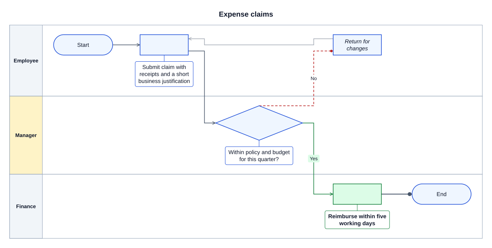
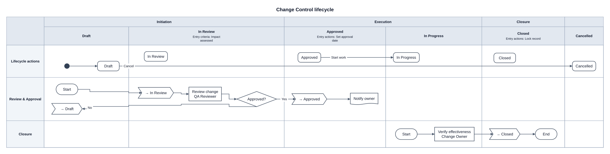
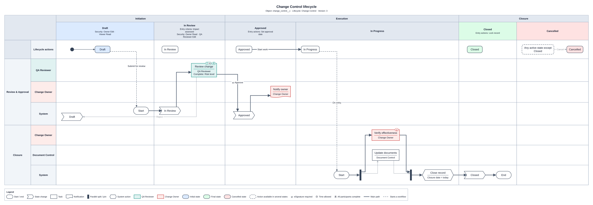
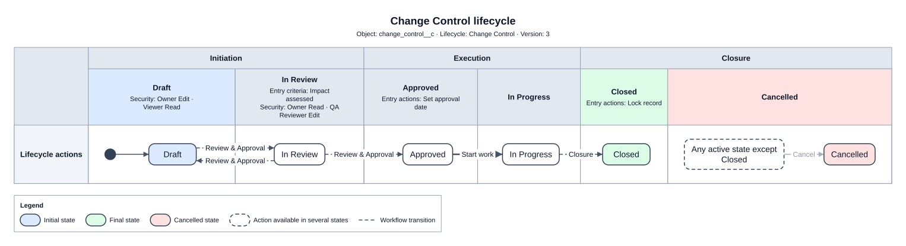
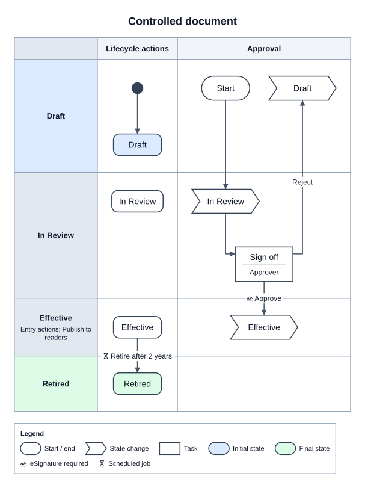

# JTDDiagrammar

Diagrams as structured text. Write JSON and get SVG back, from an API or a web app. You can also let Claude draft the diagram from a document.

The main target is the **cross-functional flowchart** (lanes × phases, as in Visio). The engine is built for multiple diagram types: each type is a plugin, and everything downstream of the plugin is type-agnostic.

## Status

| Phase | Scope | State |
|-------|-------|-------|
| P0 | Monorepo, CI, type registry, Graph IR, schemas, validation, README pipeline | **Done** |
| P1 | Flowchart layout + SVG rendering, README images | **Done** |
| P2 | Cross-functional layout (lanes × phases) | **Done** |
| P3 | REST API + web app (editor, live preview, SVG export) | **Done** |
| P4 | AI generation from documents (Claude) | **Done** |
| P5 | State diagrams (composite states) | **Done** |
| P6 | Layout quality, styling and themes | **Done** |
| P7 | Extras: XML/YAML, hints, notes, org chart, refine, provenance, streaming, autocomplete, share links, PNG | **Done** |

Today you can write **state diagrams** (with composite states), **org charts**, **object lifecycles** (e.g. Veeva Vault: states grouped by lifecycle stage against the workflows that move a record) and flowcharts, including **cross-functional flowcharts** (lanes × phases, `LR` or `TB`), in a web editor with autocomplete, live preview, pan/zoom, share links and SVG/PNG export, or render them through the REST API. You can also have Claude draft one from documents or notes. Layouts avoid running edges through nodes and keep labels off nodes and each other; colours and a dark theme are available.

## Diagram types

The examples and images below are generated from the registered types (`pnpm docs:build`) by the same renderer the API will use. CI fails if any of them go stale, and each example also has to pass validation.

<!-- BEGIN GENERATED: examples (pnpm docs:build) -->

### Flowchart

`type: flowchart` · A plain flowchart: nodes, each listing the nodes it connects `to`.


<details><summary>Source</summary>

```json
{
  "version": "1",
  "type": "flowchart",
  "title": "Password reset",
  "direction": "TB",
  "nodes": [
    {
      "id": "start",
      "shape": "terminator",
      "label": "Start",
      "to": [
        {
          "node": "request"
        }
      ]
    },
    {
      "id": "request",
      "label": "Request reset link",
      "to": [
        {
          "node": "known"
        }
      ]
    },
    {
      "id": "known",
      "shape": "decision",
      "label": "Email known?",
      "to": [
        {
          "node": "send",
          "label": "Yes"
        },
        {
          "node": "end",
          "label": "No"
        }
      ]
    },
    {
      "id": "send",
      "label": "Send link",
      "to": [
        {
          "node": "end"
        }
      ]
    },
    {
      "id": "end",
      "shape": "terminator",
      "label": "End"
    }
  ]
}
```

</details>

### Cross-functional flowchart

`type: flowchart` · The same flowchart type with `lanes` (functions) and `phases`.


<details><summary>Source</summary>

```json
{
  "version": "1",
  "type": "flowchart",
  "title": "Order fulfilment",
  "direction": "LR",
  "lanes": [
    {
      "id": "customer",
      "label": "Customer"
    },
    {
      "id": "sales",
      "label": "Sales"
    },
    {
      "id": "warehouse",
      "label": "Warehouse"
    }
  ],
  "phases": [
    {
      "id": "order",
      "label": "Order"
    },
    {
      "id": "fulfil",
      "label": "Fulfil"
    }
  ],
  "nodes": [
    {
      "id": "start",
      "shape": "terminator",
      "label": "Start",
      "lane": "customer",
      "phase": "order",
      "to": [
        {
          "node": "place"
        }
      ]
    },
    {
      "id": "place",
      "label": "Place order",
      "lane": "customer",
      "phase": "order",
      "to": [
        {
          "node": "stock"
        }
      ]
    },
    {
      "id": "stock",
      "shape": "decision",
      "label": "In stock?",
      "lane": "sales",
      "phase": "order",
      "to": [
        {
          "node": "ship",
          "label": "Yes"
        },
        {
          "node": "notify",
          "label": "No"
        }
      ]
    },
    {
      "id": "ship",
      "label": "Ship order",
      "lane": "warehouse",
      "phase": "fulfil",
      "to": [
        {
          "node": "end"
        }
      ]
    },
    {
      "id": "notify",
      "label": "Notify backorder",
      "lane": "sales",
      "phase": "fulfil",
      "to": [
        {
          "node": "end"
        }
      ]
    },
    {
      "id": "end",
      "shape": "terminator",
      "label": "End",
      "lane": "customer",
      "phase": "fulfil"
    }
  ]
}
```

</details>

### Section styles and callout labels

`type: flowchart` · Defaults per section in `styles` and for every connection in `edgeStyle`, overridden per item. Nodes keep a standard size; labels that do not fit go into callouts (`label: auto`).



<details><summary>Source</summary>

```json
{
  "version": "1",
  "type": "flowchart",
  "title": "Expense claims",
  "styles": {
    "nodes": {
      "label": "auto",
      "fill": "#eff6ff",
      "stroke": "#1d4ed8"
    },
    "lanes": {
      "fill": "#f1f5f9"
    }
  },
  "edgeStyle": {
    "stroke": "#475569",
    "arrowhead": "open"
  },
  "lanes": [
    {
      "id": "emp",
      "label": "Employee"
    },
    {
      "id": "mgr",
      "label": "Manager",
      "style": {
        "fill": "#fef3c7"
      }
    },
    {
      "id": "fin",
      "label": "Finance"
    }
  ],
  "nodes": [
    {
      "id": "start",
      "shape": "terminator",
      "label": "Start",
      "lane": "emp",
      "to": [
        {
          "node": "submit"
        }
      ]
    },
    {
      "id": "submit",
      "label": "Submit claim with receipts and a short business justification",
      "lane": "emp",
      "to": [
        {
          "node": "check"
        }
      ]
    },
    {
      "id": "check",
      "shape": "decision",
      "label": "Within policy and budget for this quarter?",
      "lane": "mgr",
      "to": [
        {
          "node": "pay",
          "label": "Yes",
          "style": {
            "stroke": "#15803d",
            "labelFill": "#dcfce7"
          }
        },
        {
          "node": "return",
          "label": "No",
          "style": {
            "stroke": "#b91c1c",
            "dash": "dashed",
            "arrowhead": "diamond"
          }
        }
      ]
    },
    {
      "id": "return",
      "label": "Return for changes",
      "lane": "emp",
      "style": {
        "italic": true
      },
      "to": [
        {
          "node": "submit",
          "style": {
            "opacity": 0.5
          }
        }
      ]
    },
    {
      "id": "pay",
      "label": "Reimburse within five working days",
      "lane": "fin",
      "style": {
        "bold": true,
        "fill": "#dcfce7",
        "stroke": "#15803d"
      },
      "to": [
        {
          "node": "end",
          "style": {
            "arrowhead": "circle",
            "lineWidth": 2
          }
        }
      ]
    },
    {
      "id": "end",
      "shape": "terminator",
      "label": "End",
      "lane": "fin"
    }
  ]
}
```

</details>

### State diagram

`type: state` · States, pseudostates and transitions (each state lists its outgoing ones in `to`), labelled `event [guard] / action`.


<details><summary>Source</summary>

```json
{
  "version": "1",
  "type": "state",
  "title": "Support ticket",
  "states": [
    {
      "id": "start",
      "kind": "initial",
      "to": [
        {
          "state": "open"
        }
      ]
    },
    {
      "id": "open",
      "label": "Open",
      "to": [
        {
          "state": "progress",
          "event": "assign"
        }
      ]
    },
    {
      "id": "progress",
      "label": "In progress",
      "to": [
        {
          "state": "waiting",
          "event": "ask",
          "action": "notify customer"
        },
        {
          "state": "closed",
          "event": "resolve",
          "guard": "fix verified"
        }
      ]
    },
    {
      "id": "waiting",
      "label": "Waiting on customer",
      "to": [
        {
          "state": "progress",
          "event": "reply"
        }
      ]
    },
    {
      "id": "closed",
      "label": "Closed",
      "to": [
        {
          "state": "end"
        }
      ]
    },
    {
      "id": "end",
      "kind": "final"
    }
  ]
}
```

</details>

### Composite state diagram

`type: state` · Nested states, a transition out of an inner state, and a self-transition.


<details><summary>Source</summary>

```json
{
  "version": "1",
  "type": "state",
  "title": "Media player",
  "states": [
    {
      "id": "init",
      "kind": "initial",
      "to": [
        {
          "state": "stopped"
        }
      ]
    },
    {
      "id": "stopped",
      "label": "Stopped",
      "to": [
        {
          "state": "active",
          "event": "play"
        }
      ]
    },
    {
      "id": "active",
      "label": "Active",
      "states": [
        {
          "id": "a0",
          "kind": "initial",
          "to": [
            {
              "state": "playing"
            }
          ]
        },
        {
          "id": "playing",
          "label": "Playing",
          "to": [
            {
              "state": "paused",
              "event": "pause"
            },
            {
              "state": "playing",
              "event": "tick",
              "action": "advance"
            },
            {
              "state": "error",
              "event": "decode failure"
            }
          ]
        },
        {
          "id": "paused",
          "label": "Paused",
          "to": [
            {
              "state": "playing",
              "event": "resume"
            }
          ]
        }
      ],
      "to": [
        {
          "state": "stopped",
          "event": "stop"
        }
      ]
    },
    {
      "id": "error",
      "label": "Error"
    }
  ]
}
```

</details>

### Org chart

`type: orgchart` · People and reporting lines, top to bottom.


<details><summary>Source</summary>

```json
{
  "version": "1",
  "type": "orgchart",
  "title": "Product team",
  "people": [
    {
      "id": "ceo",
      "name": "Avery Chen",
      "title": "CEO"
    },
    {
      "id": "cto",
      "name": "Sam Patel",
      "title": "CTO",
      "manager": "ceo"
    },
    {
      "id": "cpo",
      "name": "Jordan Lee",
      "title": "Head of Product",
      "manager": "ceo"
    },
    {
      "id": "eng1",
      "name": "Riley Kim",
      "title": "Engineer",
      "manager": "cto"
    },
    {
      "id": "eng2",
      "name": "Morgan Diaz",
      "title": "Engineer",
      "manager": "cto"
    },
    {
      "id": "pm",
      "name": "Casey Ford",
      "title": "Product Manager",
      "manager": "cpo"
    }
  ]
}
```

</details>

### Object lifecycle

`type: lifecycle` · States as columns grouped by lifecycle stage, workflows as rows. Task verdicts with eSignature, due time and participants; a parallel split and join; a system action setting fields; a shared Cancel action; what starts each workflow; the main path in bold; security, title block and legend.



<details><summary>Source</summary>

```json
{
  "version": "1",
  "type": "lifecycle",
  "title": "Change Control lifecycle",
  "object": "change_control__c",
  "info": {
    "Lifecycle": "Change Control",
    "Version": "3"
  },
  "styleBy": {
    "owner": {
      "QA Reviewer": {
        "fill": "#e0f2f1",
        "stroke": "#00897b"
      },
      "Change Owner": {
        "fill": "#fdecea",
        "stroke": "#c62828"
      }
    }
  },
  "stages": [
    {
      "id": "initiation",
      "label": "Initiation",
      "states": [
        "draft",
        "in_review"
      ]
    },
    {
      "id": "execution",
      "label": "Execution",
      "states": [
        "approved",
        "in_progress"
      ]
    },
    {
      "id": "closure",
      "label": "Closure",
      "states": [
        "closed",
        "cancelled"
      ]
    }
  ],
  "states": [
    {
      "id": "draft",
      "label": "Draft",
      "stateType": "initial",
      "security": {
        "Owner": "Edit",
        "Viewer": "Read"
      }
    },
    {
      "id": "in_review",
      "label": "In Review",
      "entryCriteria": [
        "Impact assessed"
      ],
      "security": {
        "Owner": "Read",
        "QA Reviewer": "Edit"
      }
    },
    {
      "id": "approved",
      "label": "Approved",
      "entryActions": [
        "Set approval date"
      ],
      "to": [
        {
          "state": "in_progress",
          "label": "Start work",
          "main": true
        }
      ]
    },
    {
      "id": "in_progress",
      "label": "In Progress"
    },
    {
      "id": "closed",
      "label": "Closed",
      "stateType": "final",
      "entryActions": [
        "Lock record"
      ]
    },
    {
      "id": "cancelled",
      "label": "Cancelled",
      "stateType": "cancelled"
    }
  ],
  "sharedActions": [
    {
      "state": "cancelled",
      "label": "Cancel",
      "except": [
        "closed"
      ]
    }
  ],
  "workflows": [
    {
      "id": "review",
      "label": "Review & Approval",
      "start": {
        "state": "draft",
        "action": "Submit for review"
      },
      "steps": [
        {
          "id": "r_start",
          "kind": "start",
          "state": "draft",
          "to": [
            {
              "step": "r_submit",
              "main": true
            }
          ]
        },
        {
          "id": "r_submit",
          "kind": "stateChange",
          "target": "in_review",
          "to": [
            {
              "step": "r_review",
              "main": true
            }
          ]
        },
        {
          "id": "r_review",
          "label": "Review change",
          "owner": "QA Reviewer",
          "state": "in_review",
          "due": "5d",
          "completion": "all",
          "fields": [
            "Risk level"
          ],
          "verdicts": [
            {
              "name": "Approve",
              "step": "r_approve",
              "signature": true,
              "main": true
            },
            {
              "name": "Reject",
              "step": "r_return",
              "reasons": [
                "Incomplete",
                "Out of scope"
              ],
              "comment": true
            }
          ]
        },
        {
          "id": "r_approve",
          "kind": "stateChange",
          "target": "approved",
          "to": [
            {
              "step": "r_notify",
              "main": true
            }
          ]
        },
        {
          "id": "r_notify",
          "kind": "notification",
          "label": "Notify owner",
          "owner": "Change Owner",
          "state": "approved"
        },
        {
          "id": "r_return",
          "kind": "stateChange",
          "target": "draft"
        }
      ]
    },
    {
      "id": "closure",
      "label": "Closure",
      "start": {
        "state": "in_progress",
        "by": "entry"
      },
      "steps": [
        {
          "id": "c_start",
          "kind": "start",
          "state": "in_progress",
          "to": [
            {
              "step": "c_split",
              "main": true
            }
          ]
        },
        {
          "id": "c_split",
          "kind": "parallel",
          "state": "in_progress",
          "to": [
            {
              "step": "c_verify",
              "main": true
            },
            {
              "step": "c_docs"
            }
          ]
        },
        {
          "id": "c_verify",
          "label": "Verify effectiveness",
          "owner": "Change Owner",
          "state": "in_progress",
          "signature": true,
          "to": [
            {
              "step": "c_join",
              "main": true
            }
          ]
        },
        {
          "id": "c_docs",
          "label": "Update documents",
          "owner": "Document Control",
          "state": "in_progress",
          "to": [
            {
              "step": "c_join"
            }
          ]
        },
        {
          "id": "c_join",
          "kind": "join",
          "state": "in_progress",
          "to": [
            {
              "step": "c_fields",
              "main": true
            }
          ]
        },
        {
          "id": "c_fields",
          "kind": "system",
          "label": "Close record",
          "fields": [
            "Closure date = today"
          ],
          "state": "in_progress",
          "to": [
            {
              "step": "c_close",
              "main": true
            }
          ]
        },
        {
          "id": "c_close",
          "kind": "stateChange",
          "target": "closed",
          "to": [
            {
              "step": "c_end",
              "main": true
            }
          ]
        },
        {
          "id": "c_end",
          "kind": "end",
          "state": "closed"
        }
      ]
    }
  ]
}
```

</details>

### Object lifecycle, workflows split by role

`type: lifecycle` · `roleLanes: true`: each workflow is a group over one band per role, in the order owners appear; steps without an owner go in System.



<details><summary>Source</summary>

```json
{
  "version": "1",
  "type": "lifecycle",
  "title": "Change Control lifecycle",
  "object": "change_control__c",
  "info": {
    "Lifecycle": "Change Control",
    "Version": "3"
  },
  "styleBy": {
    "owner": {
      "QA Reviewer": {
        "fill": "#e0f2f1",
        "stroke": "#00897b"
      },
      "Change Owner": {
        "fill": "#fdecea",
        "stroke": "#c62828"
      }
    }
  },
  "stages": [
    {
      "id": "initiation",
      "label": "Initiation",
      "states": [
        "draft",
        "in_review"
      ]
    },
    {
      "id": "execution",
      "label": "Execution",
      "states": [
        "approved",
        "in_progress"
      ]
    },
    {
      "id": "closure",
      "label": "Closure",
      "states": [
        "closed",
        "cancelled"
      ]
    }
  ],
  "states": [
    {
      "id": "draft",
      "label": "Draft",
      "stateType": "initial",
      "security": {
        "Owner": "Edit",
        "Viewer": "Read"
      }
    },
    {
      "id": "in_review",
      "label": "In Review",
      "entryCriteria": [
        "Impact assessed"
      ],
      "security": {
        "Owner": "Read",
        "QA Reviewer": "Edit"
      }
    },
    {
      "id": "approved",
      "label": "Approved",
      "entryActions": [
        "Set approval date"
      ],
      "to": [
        {
          "state": "in_progress",
          "label": "Start work",
          "main": true
        }
      ]
    },
    {
      "id": "in_progress",
      "label": "In Progress"
    },
    {
      "id": "closed",
      "label": "Closed",
      "stateType": "final",
      "entryActions": [
        "Lock record"
      ]
    },
    {
      "id": "cancelled",
      "label": "Cancelled",
      "stateType": "cancelled"
    }
  ],
  "sharedActions": [
    {
      "state": "cancelled",
      "label": "Cancel",
      "except": [
        "closed"
      ]
    }
  ],
  "workflows": [
    {
      "id": "review",
      "label": "Review & Approval",
      "start": {
        "state": "draft",
        "action": "Submit for review"
      },
      "steps": [
        {
          "id": "r_start",
          "kind": "start",
          "state": "draft",
          "to": [
            {
              "step": "r_submit",
              "main": true
            }
          ]
        },
        {
          "id": "r_submit",
          "kind": "stateChange",
          "target": "in_review",
          "to": [
            {
              "step": "r_review",
              "main": true
            }
          ]
        },
        {
          "id": "r_review",
          "label": "Review change",
          "owner": "QA Reviewer",
          "state": "in_review",
          "due": "5d",
          "completion": "all",
          "fields": [
            "Risk level"
          ],
          "verdicts": [
            {
              "name": "Approve",
              "step": "r_approve",
              "signature": true,
              "main": true
            },
            {
              "name": "Reject",
              "step": "r_return",
              "reasons": [
                "Incomplete",
                "Out of scope"
              ],
              "comment": true
            }
          ]
        },
        {
          "id": "r_approve",
          "kind": "stateChange",
          "target": "approved",
          "to": [
            {
              "step": "r_notify",
              "main": true
            }
          ]
        },
        {
          "id": "r_notify",
          "kind": "notification",
          "label": "Notify owner",
          "owner": "Change Owner",
          "state": "approved"
        },
        {
          "id": "r_return",
          "kind": "stateChange",
          "target": "draft"
        }
      ]
    },
    {
      "id": "closure",
      "label": "Closure",
      "start": {
        "state": "in_progress",
        "by": "entry"
      },
      "steps": [
        {
          "id": "c_start",
          "kind": "start",
          "state": "in_progress",
          "to": [
            {
              "step": "c_split",
              "main": true
            }
          ]
        },
        {
          "id": "c_split",
          "kind": "parallel",
          "state": "in_progress",
          "to": [
            {
              "step": "c_verify",
              "main": true
            },
            {
              "step": "c_docs"
            }
          ]
        },
        {
          "id": "c_verify",
          "label": "Verify effectiveness",
          "owner": "Change Owner",
          "state": "in_progress",
          "signature": true,
          "to": [
            {
              "step": "c_join",
              "main": true
            }
          ]
        },
        {
          "id": "c_docs",
          "label": "Update documents",
          "owner": "Document Control",
          "state": "in_progress",
          "to": [
            {
              "step": "c_join"
            }
          ]
        },
        {
          "id": "c_join",
          "kind": "join",
          "state": "in_progress",
          "to": [
            {
              "step": "c_fields",
              "main": true
            }
          ]
        },
        {
          "id": "c_fields",
          "kind": "system",
          "label": "Close record",
          "fields": [
            "Closure date = today"
          ],
          "state": "in_progress",
          "to": [
            {
              "step": "c_close",
              "main": true
            }
          ]
        },
        {
          "id": "c_close",
          "kind": "stateChange",
          "target": "closed",
          "to": [
            {
              "step": "c_end",
              "main": true
            }
          ]
        },
        {
          "id": "c_end",
          "kind": "end",
          "state": "closed"
        }
      ]
    }
  ],
  "roleLanes": true
}
```

</details>

### Object lifecycle, summary view

`type: lifecycle` · `view: summary`: the states and every transition between them; each workflow collapses into dashed arrows.



<details><summary>Source</summary>

```json
{
  "version": "1",
  "type": "lifecycle",
  "title": "Change Control lifecycle",
  "object": "change_control__c",
  "info": {
    "Lifecycle": "Change Control",
    "Version": "3"
  },
  "styleBy": {
    "owner": {
      "QA Reviewer": {
        "fill": "#e0f2f1",
        "stroke": "#00897b"
      },
      "Change Owner": {
        "fill": "#fdecea",
        "stroke": "#c62828"
      }
    }
  },
  "stages": [
    {
      "id": "initiation",
      "label": "Initiation",
      "states": [
        "draft",
        "in_review"
      ]
    },
    {
      "id": "execution",
      "label": "Execution",
      "states": [
        "approved",
        "in_progress"
      ]
    },
    {
      "id": "closure",
      "label": "Closure",
      "states": [
        "closed",
        "cancelled"
      ]
    }
  ],
  "states": [
    {
      "id": "draft",
      "label": "Draft",
      "stateType": "initial",
      "security": {
        "Owner": "Edit",
        "Viewer": "Read"
      }
    },
    {
      "id": "in_review",
      "label": "In Review",
      "entryCriteria": [
        "Impact assessed"
      ],
      "security": {
        "Owner": "Read",
        "QA Reviewer": "Edit"
      }
    },
    {
      "id": "approved",
      "label": "Approved",
      "entryActions": [
        "Set approval date"
      ],
      "to": [
        {
          "state": "in_progress",
          "label": "Start work",
          "main": true
        }
      ]
    },
    {
      "id": "in_progress",
      "label": "In Progress"
    },
    {
      "id": "closed",
      "label": "Closed",
      "stateType": "final",
      "entryActions": [
        "Lock record"
      ]
    },
    {
      "id": "cancelled",
      "label": "Cancelled",
      "stateType": "cancelled"
    }
  ],
  "sharedActions": [
    {
      "state": "cancelled",
      "label": "Cancel",
      "except": [
        "closed"
      ]
    }
  ],
  "workflows": [
    {
      "id": "review",
      "label": "Review & Approval",
      "start": {
        "state": "draft",
        "action": "Submit for review"
      },
      "steps": [
        {
          "id": "r_start",
          "kind": "start",
          "state": "draft",
          "to": [
            {
              "step": "r_submit",
              "main": true
            }
          ]
        },
        {
          "id": "r_submit",
          "kind": "stateChange",
          "target": "in_review",
          "to": [
            {
              "step": "r_review",
              "main": true
            }
          ]
        },
        {
          "id": "r_review",
          "label": "Review change",
          "owner": "QA Reviewer",
          "state": "in_review",
          "due": "5d",
          "completion": "all",
          "fields": [
            "Risk level"
          ],
          "verdicts": [
            {
              "name": "Approve",
              "step": "r_approve",
              "signature": true,
              "main": true
            },
            {
              "name": "Reject",
              "step": "r_return",
              "reasons": [
                "Incomplete",
                "Out of scope"
              ],
              "comment": true
            }
          ]
        },
        {
          "id": "r_approve",
          "kind": "stateChange",
          "target": "approved",
          "to": [
            {
              "step": "r_notify",
              "main": true
            }
          ]
        },
        {
          "id": "r_notify",
          "kind": "notification",
          "label": "Notify owner",
          "owner": "Change Owner",
          "state": "approved"
        },
        {
          "id": "r_return",
          "kind": "stateChange",
          "target": "draft"
        }
      ]
    },
    {
      "id": "closure",
      "label": "Closure",
      "start": {
        "state": "in_progress",
        "by": "entry"
      },
      "steps": [
        {
          "id": "c_start",
          "kind": "start",
          "state": "in_progress",
          "to": [
            {
              "step": "c_split",
              "main": true
            }
          ]
        },
        {
          "id": "c_split",
          "kind": "parallel",
          "state": "in_progress",
          "to": [
            {
              "step": "c_verify",
              "main": true
            },
            {
              "step": "c_docs"
            }
          ]
        },
        {
          "id": "c_verify",
          "label": "Verify effectiveness",
          "owner": "Change Owner",
          "state": "in_progress",
          "signature": true,
          "to": [
            {
              "step": "c_join",
              "main": true
            }
          ]
        },
        {
          "id": "c_docs",
          "label": "Update documents",
          "owner": "Document Control",
          "state": "in_progress",
          "to": [
            {
              "step": "c_join"
            }
          ]
        },
        {
          "id": "c_join",
          "kind": "join",
          "state": "in_progress",
          "to": [
            {
              "step": "c_fields",
              "main": true
            }
          ]
        },
        {
          "id": "c_fields",
          "kind": "system",
          "label": "Close record",
          "fields": [
            "Closure date = today"
          ],
          "state": "in_progress",
          "to": [
            {
              "step": "c_close",
              "main": true
            }
          ]
        },
        {
          "id": "c_close",
          "kind": "stateChange",
          "target": "closed",
          "to": [
            {
              "step": "c_end",
              "main": true
            }
          ]
        },
        {
          "id": "c_end",
          "kind": "end",
          "state": "closed"
        }
      ]
    }
  ],
  "view": "summary"
}
```

</details>

### Object lifecycle, states as rows

`type: lifecycle` · `statesAs: rows` with `direction: TB`: states run down the page and workflows across it. A scheduled job retires effective documents.



<details><summary>Source</summary>

```json
{
  "version": "1",
  "type": "lifecycle",
  "title": "Controlled document",
  "direction": "TB",
  "statesAs": "rows",
  "states": [
    {
      "id": "draft",
      "label": "Draft",
      "stateType": "initial"
    },
    {
      "id": "review",
      "label": "In Review"
    },
    {
      "id": "effective",
      "label": "Effective",
      "entryActions": [
        "Publish to readers"
      ],
      "to": [
        {
          "state": "retired",
          "label": "Retire",
          "by": "job",
          "after": "2 years"
        }
      ]
    },
    {
      "id": "retired",
      "label": "Retired",
      "stateType": "final"
    }
  ],
  "workflows": [
    {
      "id": "approval",
      "label": "Approval",
      "steps": [
        {
          "id": "a_start",
          "kind": "start",
          "state": "draft",
          "to": [
            {
              "step": "a_send"
            }
          ]
        },
        {
          "id": "a_send",
          "kind": "stateChange",
          "target": "review",
          "to": [
            {
              "step": "a_sign"
            }
          ]
        },
        {
          "id": "a_sign",
          "label": "Sign off",
          "owner": "Approver",
          "state": "review",
          "verdicts": [
            {
              "name": "Approve",
              "step": "a_go",
              "signature": true
            },
            {
              "name": "Reject",
              "step": "a_back"
            }
          ]
        },
        {
          "id": "a_go",
          "kind": "stateChange",
          "target": "effective"
        },
        {
          "id": "a_back",
          "kind": "stateChange",
          "target": "draft"
        }
      ]
    }
  ]
}
```

</details>

<!-- END GENERATED: examples -->

## Language

Diagrams are JSON, XML or YAML documents describing the same model. The tables below are generated from the schemas (`pnpm docs:build`), so they always match what the validator accepts.

**Connections live under the node they leave from.** Each node lists its outgoing connections in `to`. Each entry names its target (`node` in flowcharts, `state` in state diagrams) and can carry its own label, side hints and style:

```json
{
  "id": "check",
  "shape": "decision",
  "label": "In stock?",
  "to": [
    { "node": "ship", "label": "Yes" },
    { "node": "notify", "label": "No", "exitSide": "S", "style": { "stroke": "#b91c1c" } }
  ]
}
```

`exitSide` and `entrySide` (N, E, S, W) choose which side of the box the line leaves and enters by. State diagrams do the same with `"to": [{ "state": "paid", "event": "pay" }]` on each state, including composite and nested ones. Lifecycle workflow steps use `"to": [{ "step": … }]`, and lifecycle states list their user actions as `"to": [{ "state": …, "label": "Cancel" }]`. Org charts link people through `manager`.

**Object lifecycles** (`type: lifecycle`): `states` are listed in lifecycle order, and `stages` group adjacent states under a shared header. `workflows` hold `steps` of kind `start`, `task` (with `role`), `decision`, `notification`, `stateChange` (with `target`) and `end`. Each step sits in the `state` the record is in during that step; a state change sits in its target state. `statesAs: "columns" | "rows"` chooses where states go, while `direction` (`LR`/`TB`) still sets the flow. A *Lifecycle actions* band appears when any state has user actions (`actionsLane` forces it on or off). `entryCriteria` and `entryActions` show under each state's header.

<!-- BEGIN GENERATED: reference (pnpm docs:build) -->

Fields every diagram has:

| Field | Type | Required | Description |
|-------|------|----------|-------------|
| `$schema` | string |  | Optional schema URL for editor tooling. |
| `version` | string | yes | Schema version; major 1 (e.g. "1", "1.2"). |
| `type` | `flowchart` \| `state` \| `orgchart` \| `lifecycle` | yes | Diagram type. |
| `title` | string |  | Title shown above the diagram. |
| `theme` | `default` \| `dark` |  | Colour theme; element styles override it. |

### `flowchart`

Flowcharts. Add lanes (and optional phases) for a cross-functional flowchart.

| Field | Type | Required | Description |
|-------|------|----------|-------------|
| `direction` | `LR` \| `TB` |  | Flow direction: left to right (default) or top to bottom. |
| `styles` | styles by key |  | Default style per section (`lanes`, `phases`, `nodes`, `notes`); each item’s own `style` overrides it field by field. |
| `edgeStyle` | style |  | Default style for every connection; each one’s own `style` overrides it field by field. |
| `styleBy` | object |  | Node styles by shape and by owner, e.g. `{ "owner": { "Bill": { "fill": "#fdd" } } }`. Precedence: `styles.nodes`, then shape, then owner, then the node’s own `style`. |
| `styleBy.shape` | styles by key |  | Style for every item with this `shape`, by value: `process`, `decision`, `terminator`, `document`, `data`, `subprocess`, `connector`, `hexagon`. |
| `styleBy.owner` | object |  | Style for every item with this `owner`, by value. |
| `lanes` | list of objects |  | Functional bands (rows for `LR`). Present → cross-functional flowchart. |
| `lanes[].id` | string | yes | Unique id: a letter or `_`, then letters, digits, `_`, `.` or `-`. |
| `lanes[].label` | string | yes | Header text. |
| `lanes[].style` | style |  | Colours, lines, text and node sizing (see Styling). |
| `phases` | list of objects |  | Stages across the lanes. Require lanes. |
| `phases[].id` | string | yes | Unique id: a letter or `_`, then letters, digits, `_`, `.` or `-`. |
| `phases[].label` | string | yes | Header text. |
| `phases[].style` | style |  | Colours, lines, text and node sizing (see Styling). |
| `nodes` | list of objects | yes | Steps, decisions and other shapes. |
| `nodes[].id` | string | yes | Unique id: a letter or `_`, then letters, digits, `_`, `.` or `-`. |
| `nodes[].shape` | `process` \| `decision` \| `terminator` \| `document` \| `data` \| `subprocess` \| `connector` \| `hexagon` |  | Default `process`. |
| `nodes[].label` | string |  | Defaults to the id. `\n` breaks lines; long text wraps. |
| `nodes[].owner` | string |  | Who does it; shown under a line below the label, and matched by `styleBy.owner`. |
| `nodes[].lane` | string |  | Lane id; required when the diagram has lanes. |
| `nodes[].phase` | string |  | Phase id; required when the diagram has phases. |
| `nodes[].order` | integer |  | Hint: nodes in the same column and lane are placed in ascending order. |
| `nodes[].quote` | string |  | Supporting excerpt from the source material; shown as a tooltip. |
| `nodes[].style` | style |  | Colours, lines, text and node sizing (see Styling). |
| `nodes[].to` | list of objects |  | Outgoing connections, each to one target node. |
| `nodes[].to[].node` | string | yes | Target node id. |
| `nodes[].to[].label` | string |  | Text on the connection, placed where it fits best. |
| `nodes[].to[].labels` | list of objects |  | Labels on the connection, after `label`. Each sits `at` percent of the way along it, or wherever fits best when `at` is absent. |
| `nodes[].to[].labels[].text` | string | yes | Label text; `\n` breaks lines. |
| `nodes[].to[].labels[].at` | number |  | Position along the connection in percent of its length: 0 at the start, 50 in the middle, 100 at the end. |
| `nodes[].to[].exitSide` | `N` \| `E` \| `S` \| `W` |  | Side of this node the line leaves by (N, E, S, W); default follows the flow. |
| `nodes[].to[].entrySide` | `N` \| `E` \| `S` \| `W` |  | Side of the target the line enters by; default follows the flow. |
| `nodes[].to[].id` | string |  | Optional; generated when absent. |
| `nodes[].to[].quote` | string |  | Supporting excerpt from the source material; shown as a tooltip. |
| `nodes[].to[].style` | style |  | Overrides `edgeStyle` field by field. |
| `notes` | list of objects |  | Annotations, drawn as folded-corner notes. |
| `notes[].id` | string |  | Optional; generated when absent. |
| `notes[].text` | string | yes | Note text; `\n` breaks lines. |
| `notes[].for` | string |  | Node the note is attached to (dotted line, no arrow). |
| `notes[].lane` | string |  | Lane, for a free-standing note in a cross-functional flowchart; attached notes use their node’s. |
| `notes[].phase` | string |  | Phase, likewise. |
| `notes[].style` | style |  | Colours, lines, text and node sizing (see Styling). |

### `state`

States and the transitions between them, with composite (nested) states. For lifecycles and modes.

| Field | Type | Required | Description |
|-------|------|----------|-------------|
| `direction` | `LR` \| `TB` |  | Flow direction: left to right (default) or top to bottom. |
| `styles` | styles by key |  | Default style per section (`states`); each item’s own `style` overrides it field by field. |
| `states` | list of objects | yes | Top-level states. |
| `states[].id` | string | yes | Unique id: a letter or `_`, then letters, digits, `_`, `.` or `-`. |
| `states[].kind` | `state` \| `initial` \| `final` \| `choice` |  | `state` (default) or a pseudostate; pseudostates draw no label and cannot contain states. |
| `states[].label` | string |  | Defaults to the id for ordinary states. |
| `states[].states` | list of objects |  | Nested states make this a composite state. Same fields as `states[]`. |
| `states[].quote` | string |  | Supporting excerpt from the source material; shown as a tooltip. |
| `states[].style` | style |  | Colours, lines, text and node sizing (see Styling). |
| `states[].to` | list of objects |  | Outgoing transitions; targets may be any state, composite or nested. |
| `states[].to[].state` | string | yes | Target state id. |
| `states[].to[].event` | string |  | Trigger. |
| `states[].to[].guard` | string |  | Condition, shown in brackets. |
| `states[].to[].action` | string |  | Effect, shown after a slash. |
| `states[].to[].labels` | list of objects |  | Labels on the connection, after `label`. Each sits `at` percent of the way along it, or wherever fits best when `at` is absent. |
| `states[].to[].labels[].text` | string | yes | Label text; `\n` breaks lines. |
| `states[].to[].labels[].at` | number |  | Position along the connection in percent of its length: 0 at the start, 50 in the middle, 100 at the end. |
| `states[].to[].id` | string |  | Optional; generated when absent. |
| `states[].to[].quote` | string |  | Supporting excerpt from the source material; shown as a tooltip. |
| `states[].to[].style` | style |  | Overrides `transitionStyle` field by field. |
| `transitionStyle` | style |  | Default style for every transition; each one’s own `style` overrides it field by field. |

### `orgchart`

People and who they report to. For teams and organisations.

| Field | Type | Required | Description |
|-------|------|----------|-------------|
| `direction` | `TB` \| `LR` |  | Top to bottom (default) or left to right. |
| `styles` | styles by key |  | Default style per section (`people`, `lines`); each item’s own `style` overrides it field by field. |
| `people` | list of objects | yes | Everyone in the chart. |
| `people[].id` | string | yes | Unique id: a letter or `_`, then letters, digits, `_`, `.` or `-`. |
| `people[].name` | string | yes | Shown first, on its own line. |
| `people[].title` | string |  | Role, shown under the name. |
| `people[].manager` | string |  | Id of the person this person reports to; omit at the top. |
| `people[].quote` | string |  | Supporting excerpt from the source material; shown as a tooltip. |
| `people[].style` | style |  | Colours, lines, text and node sizing (see Styling). |

### `lifecycle`

Object states (grouped into lifecycle stages) against the workflows that move a record between them. For Veeva Vault and similar object lifecycles.

| Field | Type | Required | Description |
|-------|------|----------|-------------|
| `object` | string |  | Object API name, e.g. `change_control__c`; used as the title when there is none, else shown in the title block. |
| `info` | object |  | Title block under the title, e.g. `{ "Lifecycle": "Change Control", "Version": "3" }`. |
| `direction` | `LR` \| `TB` |  | Flow direction: left to right (default) or top to bottom. |
| `statesAs` | `columns` \| `rows` |  | States as columns (default) or rows; workflows take the other axis. Independent of `direction`. |
| `view` | `detailed` \| `summary` |  | `summary`: only the states and the transitions between them; each workflow collapses into dashed arrows. |
| `actionsLane` | boolean |  | Show the lifecycle actions band (states, user actions, workflow starts). Default: when there is something to show in it. |
| `roleLanes` | boolean |  | Split each workflow into one band per role (step owner); steps without an owner go in a System band. |
| `legend` | boolean |  | Draw a legend of the shapes, colours and markers used. |
| `styles` | styles by key |  | Default style per section (`stages`, `states`, `workflows`, `steps`); each item’s own `style` overrides it field by field. |
| `edgeStyle` | style |  | Default style for every connection and user action; each one’s own `style` overrides it field by field. |
| `styleBy` | object |  | Step styles by kind and owner, state styles by type, e.g. `{ "owner": { "QA": { "fill": "#dff" } } }`. Precedence: section default, then kind (or state type), then owner, then the item’s own `style`. |
| `styleBy.kind` | styles by key |  | Style for every item with this `kind`, by value: `start`, `task`, `decision`, `notification`, `system`, `stateChange`, `parallel`, `join`, `end`. |
| `styleBy.owner` | object |  | Style for every item with this `owner`, by value. |
| `styleBy.stateType` | styles by key |  | Style for every item with this `stateType`, by value: `initial`, `steady`, `final`, `cancelled`. |
| `stages` | list of objects |  | Lifecycle stage groups: a header over adjacent states. |
| `stages[].id` | string | yes | Unique id: a letter or `_`, then letters, digits, `_`, `.` or `-`. |
| `stages[].label` | string | yes | Stage name. |
| `stages[].states` | list of string | yes | Adjacent states, in lifecycle order. |
| `stages[].style` | style |  | Colours, lines, text and node sizing (see Styling). |
| `states` | list of objects | yes | Object states, in lifecycle order: one column (or row) each. |
| `states[].id` | string | yes | Unique id: a letter or `_`, then letters, digits, `_`, `.` or `-`. |
| `states[].label` | string |  | Defaults to the id. |
| `states[].stateType` | `initial` \| `steady` \| `final` \| `cancelled` |  | Exactly one state is `initial`. `final` and `cancelled` end the lifecycle. Initial, final and cancelled states are tinted. |
| `states[].entryCriteria` | list of string |  | Shown under the state header. |
| `states[].entryActions` | list of string |  | Shown under the state header. |
| `states[].security` | object |  | Access per role in this state, e.g. `{ "Owner": "Edit", "Viewer": "Read" }`; shown under the header. |
| `states[].quote` | string |  | Supporting excerpt from the source material; shown as a tooltip. |
| `states[].style` | style |  | Colours, lines, text and node sizing (see Styling). |
| `states[].to` | list of objects |  | User actions that move the record to another state, outside workflows; drawn in the lifecycle actions band. |
| `states[].to[].state` | string | yes | Target state id. |
| `states[].to[].label` | string |  | Action name. |
| `states[].to[].labels` | list of objects |  | Labels on the connection, after `label`. Each sits `at` percent of the way along it, or wherever fits best when `at` is absent. |
| `states[].to[].labels[].text` | string | yes | Label text; `\n` breaks lines. |
| `states[].to[].labels[].at` | number |  | Position along the connection in percent of its length: 0 at the start, 50 in the middle, 100 at the end. |
| `states[].to[].by` | `user` \| `job` |  | `job`: a scheduled job makes the change (timer icon). |
| `states[].to[].after` | string |  | For a job: when, e.g. "2 years"; shown after the name. |
| `states[].to[].main` | boolean |  | On the main path: drawn bold while other connections fade. |
| `states[].to[].id` | string |  | Optional; generated when absent. |
| `states[].to[].quote` | string |  | Supporting excerpt from the source material; shown as a tooltip. |
| `states[].to[].style` | style |  | Colours, lines, text and node sizing (see Styling). |
| `sharedActions` | list of objects |  | User actions available in several states (e.g. Cancel), each drawn once. |
| `sharedActions[].state` | string | yes | Target state id. |
| `sharedActions[].label` | string |  | Action name. |
| `sharedActions[].labels` | list of objects |  | Labels on the connection, after `label`. Each sits `at` percent of the way along it, or wherever fits best when `at` is absent. |
| `sharedActions[].labels[].text` | string | yes | Label text; `\n` breaks lines. |
| `sharedActions[].labels[].at` | number |  | Position along the connection in percent of its length: 0 at the start, 50 in the middle, 100 at the end. |
| `sharedActions[].by` | `user` \| `job` |  | `job`: a scheduled job makes the change (timer icon). |
| `sharedActions[].after` | string |  | For a job: when, e.g. "2 years"; shown after the name. |
| `sharedActions[].main` | boolean |  | On the main path: drawn bold while other connections fade. |
| `sharedActions[].id` | string |  | Optional; generated when absent. |
| `sharedActions[].quote` | string |  | Supporting excerpt from the source material; shown as a tooltip. |
| `sharedActions[].style` | style |  | Colours, lines, text and node sizing (see Styling). |
| `sharedActions[].from` | list of string |  | Source states. Default: every state that is not final or cancelled. |
| `sharedActions[].except` | list of string |  | States left out of the default. |
| `workflows` | list of objects |  | Workflows: one row (or column) each. |
| `workflows[].id` | string | yes | Unique id: a letter or `_`, then letters, digits, `_`, `.` or `-`. |
| `workflows[].label` | string | yes | Workflow name. |
| `workflows[].style` | style |  | Colours, lines, text and node sizing (see Styling). |
| `workflows[].roles` | list of string |  | With `roleLanes`: role bands in this order; other owners follow. |
| `workflows[].start` | object |  | What starts the workflow: a dashed arrow from the state in the actions band to the start step. |
| `workflows[].start.state` | string | yes | State it is started in. |
| `workflows[].start.action` | string |  | User action name; defaults by `by`. |
| `workflows[].start.by` | `user` \| `entry` \| `job` |  | `user` action, `entry` into the state, or a scheduled `job`. |
| `workflows[].steps` | list of objects | yes |  |
| `workflows[].steps[].id` | string | yes | Unique id: a letter or `_`, then letters, digits, `_`, `.` or `-`. |
| `workflows[].steps[].kind` | `start` \| `task` \| `decision` \| `notification` \| `system` \| `stateChange` \| `parallel` \| `join` \| `end` |  | `start`, `task` (default), `decision`, `notification`, `system` (an automated action, e.g. setting field values), `stateChange`, `parallel` and `join` (a bar where branches split or meet) or `end`. |
| `workflows[].steps[].label` | string |  | Defaults: the id; for a state change, the target state’s name. |
| `workflows[].steps[].owner` | string |  | Who performs the step (for a notification, who receives it); shown under a line below the label, matched by `styleBy.owner`, and its role band with `roleLanes`. |
| `workflows[].steps[].state` | string |  | State the record is in during this step. Optional for a state change (defaults to its target). |
| `workflows[].steps[].target` | string |  | For a state change: the state it moves the record to. |
| `workflows[].steps[].fields` | list of string |  | Task: fields the participant completes. System action: fields it sets, e.g. "Approval date = today". Shown under the label. |
| `workflows[].steps[].verdicts` | list of objects |  | Task outcomes, each leading to a next step; no decision diamond needed. |
| `workflows[].steps[].verdicts[].name` | string | yes | Verdict, e.g. "Approve"; the connection’s label. |
| `workflows[].steps[].verdicts[].signature` | boolean |  | Needs an eSignature (icon on the label). |
| `workflows[].steps[].verdicts[].reasons` | list of string |  | Reasons offered; shown in the tooltip. |
| `workflows[].steps[].verdicts[].comment` | boolean |  | A comment is required; shown in the tooltip. |
| `workflows[].steps[].verdicts[].step` | string | yes | Next step id. |
| `workflows[].steps[].verdicts[].labels` | list of objects |  | Labels on the connection, after `label`. Each sits `at` percent of the way along it, or wherever fits best when `at` is absent. |
| `workflows[].steps[].verdicts[].labels[].text` | string | yes | Label text; `\n` breaks lines. |
| `workflows[].steps[].verdicts[].labels[].at` | number |  | Position along the connection in percent of its length: 0 at the start, 50 in the middle, 100 at the end. |
| `workflows[].steps[].verdicts[].exitSide` | `N` \| `E` \| `S` \| `W` |  | Side of this step the line leaves by. |
| `workflows[].steps[].verdicts[].entrySide` | `N` \| `E` \| `S` \| `W` |  | Side of the next step the line enters by. |
| `workflows[].steps[].verdicts[].main` | boolean |  | On the main path: drawn bold while other connections fade. |
| `workflows[].steps[].verdicts[].id` | string |  | Optional; generated when absent. |
| `workflows[].steps[].verdicts[].quote` | string |  | Supporting excerpt from the source material; shown as a tooltip. |
| `workflows[].steps[].verdicts[].style` | style |  | Overrides `edgeStyle` field by field. |
| `workflows[].steps[].signature` | boolean |  | Task: needs an eSignature (badge). |
| `workflows[].steps[].due` | string |  | Task: time allowed, e.g. "5d" (badge). |
| `workflows[].steps[].completion` | `all` \| `any` \| `each` |  | Task with several participants: `all` must complete, `any` one completes, or `each` gets a task (badge). |
| `workflows[].steps[].order` | integer |  | Hint: steps in the same cell are placed in ascending order. |
| `workflows[].steps[].quote` | string |  | Supporting excerpt from the source material; shown as a tooltip. |
| `workflows[].steps[].style` | style |  | Colours, lines, text and node sizing (see Styling). |
| `workflows[].steps[].to` | list of objects |  | Next steps. |
| `workflows[].steps[].to[].label` | string |  | Text on the connection, placed where it fits best. |
| `workflows[].steps[].to[].step` | string | yes | Next step id. |
| `workflows[].steps[].to[].labels` | list of objects |  | Labels on the connection, after `label`. Each sits `at` percent of the way along it, or wherever fits best when `at` is absent. |
| `workflows[].steps[].to[].labels[].text` | string | yes | Label text; `\n` breaks lines. |
| `workflows[].steps[].to[].labels[].at` | number |  | Position along the connection in percent of its length: 0 at the start, 50 in the middle, 100 at the end. |
| `workflows[].steps[].to[].exitSide` | `N` \| `E` \| `S` \| `W` |  | Side of this step the line leaves by. |
| `workflows[].steps[].to[].entrySide` | `N` \| `E` \| `S` \| `W` |  | Side of the next step the line enters by. |
| `workflows[].steps[].to[].main` | boolean |  | On the main path: drawn bold while other connections fade. |
| `workflows[].steps[].to[].id` | string |  | Optional; generated when absent. |
| `workflows[].steps[].to[].quote` | string |  | Supporting excerpt from the source material; shown as a tooltip. |
| `workflows[].steps[].to[].style` | style |  | Overrides `edgeStyle` field by field. |

<!-- END GENERATED: reference -->

**XML** uses attributes for scalars and child elements for objects and lists, with any item name:

```xml
<diagram version="1" type="flowchart" title="Refunds">
  <lanes><lane id="cs" label="Support"/></lanes>
  <nodes>
    <node id="ask" shape="terminator" label="Request" lane="cs">
      <style fill="#dbeafe"/>
      <to><link node="pay" label="approved"/></to>
    </node>
    <node id="pay" label="Pay" lane="cs"/>
  </nodes>
</diagram>
```

**YAML** is the JSON structure written as YAML.

Flowchart rules: with lanes, every node needs a `lane`; with phases, every node also needs a `phase`. State rules: at most one `initial` per region (the top level or a composite), with no incoming transitions; `final` states have no outgoing transitions; pseudostates cannot contain states. Ids are unique across all levels.

### Styling

Every node, edge, lane, phase, note, state, transition and person can take a `style`:

```json
{ "fill": "#dcfce7", "stroke": "#14532d", "text": "#14532d", "dash": "dashed", "lineWidth": 2, "fontSize": 13, "bold": true }
```

| Field | Values | Applies to |
|-------|--------|------------|
| `fill`, `stroke`, `text` | hex colour (`#rgb` or `#rrggbb`) | all; `fill` colours lane and phase headers |
| `dash` | `solid`, `dashed`, `dotted` | outlines and lines |
| `lineWidth` | 0.5–8 px (default 1.5; 1 for lane and phase borders) | outlines and lines; arrowheads grow with thicker lines |
| `fontSize` | 8–32 px | text; nodes and headers resize to fit |
| `bold`, `italic` | `true` / `false` | text |
| `opacity` | 0.1–1 | the whole element |
| `arrowhead` | `triangle` (default), `open`, `diamond`, `circle`, `none` | edges |
| `labelFill` | hex colour | edge label and callout backgrounds |
| `label` | `inside` (default), `callout`, `auto` | nodes, see below |
| `width`, `height` | px | nodes: a fixed size |

**Defaults.** A top-level `styles` object sets a default for a whole section. Connections, which live inside their nodes, get their own top-level default: `edgeStyle` for flowcharts and `transitionStyle` for state diagrams. An item's own `style` overrides any default field by field:

```json
"styles": {
  "nodes": { "fill": "#eff6ff", "stroke": "#1d4ed8", "label": "auto" },
  "lanes": { "fill": "#f1f5f9" }
},
"edgeStyle": { "stroke": "#475569", "arrowhead": "open" }
```

Sections are `lanes`, `phases`, `nodes` and `notes` for flowcharts; `states` for state diagrams; `stages`, `states`, `workflows` and `steps` for lifecycles (with `edgeStyle` for connections and user actions); `people` and `lines` (reporting lines) for org charts.

**Style rules.** `styleBy` styles every node of a shape (flowcharts) or step of a kind (lifecycles), and every one with a given owner. Precedence, lowest first: section default, shape or kind, owner, the item's own `style`:

```json
"styleBy": {
  "kind": { "system": { "fill": "#f1f5f9", "dash": "dashed" } },
  "owner": { "Bill": { "fill": "#fee2e2", "stroke": "#b91c1c" }, "Martha": { "fill": "#ccfbf1", "stroke": "#0f766e" } }
}
```

**Owners.** A flowchart node's or lifecycle step's `owner` is drawn under the label, below a thin line.

**Edge labels.** `label` is placed wherever it fits best. `labels` adds more, each pinned at `at` percent of the connection's length (`50` is the exact middle) or, without `at`, placed automatically clear of everything else:

```json
"to": [{ "node": "ship", "label": "Yes", "labels": [{ "text": "same day", "at": 85 }] }]
```

**Standard-size nodes and callouts.** By default a node grows to fit its label. To keep nodes the same size, set `label`:

- `callout`: the node keeps its shape's standard size (or `width`/`height`), and the label sits in a callout beside it, joined by a short leader line.
- `auto`: the label goes inside if it fits the standard size, otherwise into a callout.

The layout reserves room for each callout, below the node in `LR` diagrams and beside it in `TB` diagrams, within the node's lane, phase and composite state. If that spot is blocked, the callout moves to the clearest nearby spot. `inside` with a fixed `width`/`height` wraps the label to fit. Initial, final and choice pseudostates always keep their own size.

Set `"theme": "dark"` on the diagram for the dark palette; styles override either theme.

### Object lifecycles

The `lifecycle` type is built for Veeva Vault-style object lifecycles. Beyond states, stages and workflows (see the examples above), it has:

| Field | Draws |
|-------|-------|
| `verdicts: [{ name, step, signature, reasons, comment }]` on a task | One labelled connection per outcome, no decision diamond. An eSignature icon marks verdicts that need one; reasons and comment rules show in the tooltip. |
| `owner`, `fields` on a step | Under the label, below a line. For a task, the fields to complete; for a `system` action, the fields it sets (`"Closure date = today"`). For a notification, `owner` is the recipient. |
| `signature`, `due`, `completion` on a task | Badges on the task's top edge: eSignature, time allowed (`"5d"`), and whether `all` participants, `any` one, or `each` (one task per participant) must complete. |
| `kind: parallel` / `join` | A bar where branches split and meet. |
| `sharedActions: [{ state, label, from, except }]` | A user action available in many states (e.g. Cancel), drawn once from a dashed pill naming its source states. |
| `by: job`, `after` on a user action | A scheduled change, with a timer icon: `Retire after 2 years`. |
| `start: { state, action, by }` on a workflow | A dashed arrow from the state to the workflow's start: a user action, `entry` into the state, or a `job`. |
| `main: true` on connections, verdicts and actions | The main path, drawn bold; everything else fades. |
| `security: { "Owner": "Edit" }` on a state | A line under the state header. |
| `stateType: initial \| final \| cancelled` | Tinted headers and pills; `styleBy.stateType` overrides. |
| `view: summary` | Only the states and the transitions between them; each workflow becomes dashed arrows. |
| `roleLanes: true` | Each workflow becomes a group with one band per role (step owner), in the order of `roles` and then as owners appear; steps without an owner go in System. |
| `info: { "Version": "3" }` | A title block under the title (with `object`). |
| `legend` (default `true`) | A legend of the shapes, colours, markers and lines the chart uses. |

Validation also checks the lifecycle as a whole, with warnings for:
- states no transition reaches from the initial state;
- states that are not final or cancelled but have no way out;
- workflows that never change the record's state;
- decisions with fewer than two ways out;
- verdicts on anything but a task.

### Diagnostics

Validation reports **every** problem, not only the first. Each one carries a JSON Pointer to its location in the source:

```json
{ "severity": "error", "code": "ref.lane", "message": "node 'ship' references unknown lane 'wh'", "path": "/nodes/3" }
```

## Install

### Windows

In PowerShell (no admin rights needed):

```powershell
irm https://github.com/jtddigital/JTDDiagrammar/releases/latest/download/install.ps1 | iex
```

If Node.js 22.18+ is missing, the installer installs the current Node.js LTS with `winget` first. Then it downloads the latest release, checks its SHA-256 and installs it to `%LOCALAPPDATA%\jtddiagrammar`. It also adds **JTDDiagrammar** shortcuts to the Start Menu and the desktop, and a `jtddiagrammar` command to your PATH.

**To start:** double-click the **JTDDiagrammar** shortcut. A console window starts the app on http://localhost:8080 (local only) and opens your browser. Close the window to stop it.

**Private repository:** the link above needs a signed-in browser. Download `install.ps1` from the [releases page](https://github.com/jtddigital/JTDDiagrammar/releases/latest) and run it with a token that can read the repository (or after `gh auth login`):

```powershell
$env:GITHUB_TOKEN = '<token>'; powershell -ExecutionPolicy Bypass -File .\install.ps1
```

### Linux and macOS

Needs Node.js 22.18+.

```bash
curl -fsSL https://github.com/jtddigital/JTDDiagrammar/releases/latest/download/install.sh | bash
```

Then run `jtddiagrammar` to start the app and open your browser; Ctrl+C stops it. On Linux there's also a desktop entry.

### Commands

| Command | Does |
|---------|------|
| `jtddiagrammar` | Start the app and open the browser |
| `jtddiagrammar --port 9000 --no-open` | Another port; don't open the browser |
| `jtddiagrammar update` | Install the latest release (or `update v1.2.3`) |
| `jtddiagrammar restart` | Stop the running app and start it again, e.g. after changing `config.env` |
| `jtddiagrammar stop` | Stop the running app |
| `jtddiagrammar version` | Show the installed version |
| `jtddiagrammar uninstall` | Windows: remove the app, its shortcuts and PATH entry (`--keep-config` keeps your settings) |

**Settings**, including `ANTHROPIC_API_KEY` for AI generation, go in `config.env` in the install folder. Updates keep it. If the app is already running, `jtddiagrammar` reuses it, unless it is an older version or `config.env` has changed since it started: then it restarts it. A server started by a release before v1.0.13 can't be restarted this way; close its window (or press Ctrl+C there) and run `jtddiagrammar` again. Installing also needs access to the npm registry, because dependencies are installed from the release's lockfile.

**Publishing a release:** every merge to `main` publishes the next patch version automatically (v1.0.5 → v1.0.6), with release notes from the merged PRs, so `jtddiagrammar update` picks it up. Put `[skip release]` in the PR title to merge without releasing. For a minor or major version, push a tag such as `v1.1.0`, or create the release on the releases page. Either way the `Release` workflow runs the checks, then attaches the bundle, its checksum and both installers. You can also open **Actions → Release → Run workflow** and enter a version such as `v1.2.3`. If the tag doesn't exist yet, it is created on the branch you run from (normally `main`); if it does, its files are rebuilt and re-attached. GitHub's own "Source code" archives are not the app bundle. On every push, CI installs, launches, updates and uninstalls a packed release on Windows (Windows PowerShell 5.1 and PowerShell 7) and Linux (`pnpm release:e2e`).

## Quick start

To work on the code instead, you need Node ≥ 22.18 and pnpm 10.

```bash
pnpm install
```

Build the web app and start the API, which also serves the web app, at http://localhost:8080:

```bash
pnpm --filter @jtd/web build
```

```bash
pnpm dev:api
```

For web development with hot reload (Vite, http://localhost:5173), run this alongside the API:

```bash
pnpm dev:web
```

Or run everything in one container:

```bash
docker build -t jtd .
```

```bash
docker run -p 8080:8080 jtd
```

Configuration is through environment variables; see [`.env.example`](.env.example).

### Web app


Three panes: **AI**, **Source** and **Diagram**. Drag the lines between them to resize (or focus a line and use the arrow keys), and hide or show each from the toolbar. The layout is remembered. Light and dark themes follow your system. Rendering happens in the browser with the same core library the API uses.

- **AI:** a conversation. Ask for a change to the diagram in the editor, or switch to **New diagram** and paste notes or attach documents. Every change the AI makes has a **Step back** button that restores the diagram from before it; stepping back can itself be stepped back. See [AI generation](#ai-generation).
- **Source:** JSON with autocomplete (Ctrl+Space) for the fields and values of the document's `type`. Problems are underlined and listed below; click one to jump to it. The diagram keeps the last valid version until they are fixed.
- **Diagram:** scroll to zoom, drag to pan, or use **Fit** and **1:1**. Click an element to find its source. The element your editor cursor is in is outlined, and hovering a node highlights its connections. Double-click a label to edit it in place. Hover a generated element to see the quote it came from. Layout is automatic, so nodes can't be dragged to a position.
- **Open** (Ctrl+O) reads JSON, YAML or XML; YAML and XML are converted to JSON. **Save** (Ctrl+S) writes JSON back to the opened file in browsers that allow it (Chrome, Edge), and downloads it elsewhere. Shift-click or Ctrl+Shift+S saves as a new file.
- **SVG** export downloads exactly what the API would return for the same source. **PNG** rasterises it at 2× in the browser.
- **Share link** copies a URL that carries the source itself (compressed into the `#fragment`, never sent to the server). The editor also restores your last session.
- **Examples** loads every registered example.

### Library

```ts
import { createRegistry, parseJson, render } from '@jtd/core';

const { value } = parseJson(text);
const { svg, diagnostics } = render(value, createRegistry()); // svg is undefined if there are errors
```

Output is standalone SVG 1.1. Text uses `Arial, Liberation Sans, Helvetica, sans-serif`; the first two have identical metrics, so text fits its boxes without embedding a font. Elements carry ids and classes for styling and scripting: `n-<id>` / `jtd-node jtd-shape-<shape>` for nodes, and `e-<id>` / `jtd-edge` for edges.

## API

| Method | Path | Returns |
|--------|------|---------|
| POST | `/v1/render` | `image/svg+xml`, or `{ svg, diagnostics }` with `Accept: application/json`. Body as JSON, XML (`application/xml`) or YAML (`application/yaml`) |
| GET | `/v1/render?src=…` | SVG for `` embedding; `src` is the JSON document, base64url-encoded |
| POST | `/v1/validate` | `{ valid, diagnostics }`; JSON, XML or YAML |
| GET | `/v1/types` | Registered diagram types and their examples |
| GET | `/v1/schema`, `/v1/schema/{type}` | JSON Schema (2020-12), combined or per type |
| POST | `/v1/refine` | Changes an existing diagram from an instruction (see [AI generation](#ai-generation)) |
| POST | `/v1/generate` | Diagram source generated by Claude from text and/or documents (see [AI generation](#ai-generation)) |
| GET | `/v1/ai` | `{ enabled, model? }`: whether AI generation is configured |
| GET | `/v1/openapi.json` | OpenAPI 3.1, generated from the route table |
| GET | `/health` | `{ status: "ok" }` |

```bash
curl -X POST localhost:8080/v1/render -H 'content-type: application/json' --data @diagram.json -o diagram.svg
```

Errors come back as `{ diagnostics: [...] }` (shape as in [Diagnostics](#diagnostics)):

| Status | When |
|--------|------|
| 400 | Invalid JSON or invalid diagram |
| 413 | Body over `BODY_LIMIT`, or more than `MAX_NODES` / `MAX_EDGES` |
| 415 | Body is not `application/json` |
| 422 | Rendering took longer than `RENDER_TIMEOUT_MS`, so the render was stopped |

Rendering runs in worker threads, so one slow diagram can't stall the server. Request bodies are never logged. SVG responses carry `Content-Security-Policy: default-src 'none'`.

## AI generation

Give it a process description, meeting notes or a procedure, as pasted text or as PDF, DOCX, HTML, TXT or MD files. The AI drafts the diagram source, and you review and edit it like anything else. Two AI providers are supported: **Claude** (the default) and **Microsoft 365 Copilot**; see [Microsoft 365 Copilot](#microsoft-365-copilot).


```bash
curl -X POST localhost:8080/v1/generate -F type=auto -F files=@procedure.pdf -F 'text=Focus on the approval steps'
```

Images (PNG, JPEG, GIF, WebP: whiteboard photos, screenshots of old diagrams) work too.

The response is `{ type, reason?, source, valid, diagnostics, attempts, usage, svg? }`. `usage` includes token counts and an estimated `costUsd` (published prices; override with `AI_PRICES`).

**Refine** an existing diagram with a plain-language instruction. The AI edits the source itself, with the full language schema and examples, so it can change anything the language allows (content, layout options, styles, colours, hints) and keeps what you did not ask to change. If it changes nothing, the result carries the warning `ai.unchanged`:

```bash
curl -X POST localhost:8080/v1/refine -H 'content-type: application/json' --data '{"source": {...}, "instruction": "Add a manager approval step before payment"}'
```

**Progress:** send `Accept: text/event-stream` to either endpoint for `progress` events (`ingest`, `select`, `generate`, `validate`, `repair`), then one `result` or `error` event.

**Provenance:** generated nodes and edges carry a short `quote` from the material; it shows as a tooltip when you hover the element in the SVG.

**How it stays correct:**
1. Claude's reply is constrained to the diagram type's generation schema (structured outputs).
2. The reply then passes the **same validation as hand-written source**: schema, references, lanes and phases, and a real layout.
3. If anything fails, the diagnostics go back to Claude for correction, up to `AI_MAX_REPAIRS` times (default 2).
4. If it still fails, you get the best attempt with `valid: false` and its diagnostics. A failed attempt is never presented as valid.

**Setup:**
- Set `ANTHROPIC_API_KEY` on the server. Without it, generation returns `503` and the web panel says it's unavailable.
- The default model is `claude-opus-5-5` (`AI_MODEL`), at effort `high` (`AI_EFFORT`).
- Each client IP gets `AI_RATE_LIMIT` AI requests per minute (default 10); then `429` with `Retry-After`.
- Server-side refusal fallbacks are on; set `AI_FALLBACKS=off` to disable them.
- Limits on file count, file size, total size and input tokens are in [`.env.example`](.env.example). Input is checked with token counting *before* any generation spend.

**Safety:**
- The key is read only by the SDK on the server. The browser never sees it, and lint rules stop the web app from importing AI code. A Microsoft Graph token for Copilot stays in the browser's session storage and goes only to this app's API, for the request it is for; the server never stores or logs it.
- Uploaded material is treated as data. It's wrapped and can't close its own wrapper, Claude gets no tools, and the server fixes the type and schema. Any text that ends up in the diagram is escaped when rendered.
- Material and results are not logged or stored.
- Closing the request (or **Stop** in the web app) aborts the Claude call.

In the web app, the AI pane shows each stage as it happens and can stop a job. In **Edit diagram** mode a message refines whatever is in the editor; each change can be stepped back.

**Status:** CI tests generation end to end against a deterministic mock, never the live API. `pnpm ai:live` runs three real cases (cross-functional, plain, prompt injection) with pass/fail checks; its first run (2026-11-11, `claude-opus-5-5`) passed all three, each valid on the first attempt, with the cached prefix read on repeat calls. A full accuracy evaluation with reference diagrams (URS-AI-018) is still to do.

### Microsoft 365 Copilot

Copilot works on behalf of the person using the app: they sign in with their Microsoft work account in the browser, and the server calls the Microsoft Graph Copilot Chat API with their token. There is no server secret.

1. In the Microsoft Entra admin center, register an application (**App registrations → New registration**). Add a **Single-page application** platform with the redirect URI `https://<your host>/auth-redirect.html` (and `http://localhost:8080/auth-redirect.html` for local use).
2. Under **API permissions**, add these Microsoft Graph *delegated* permissions and grant admin consent: `Sites.Read.All`, `Mail.Read`, `People.Read.All`, `OnlineMeetingTranscript.Read.All`, `Chat.Read`, `ChannelMessage.Read.All`, `ExternalItem.Read.All`. The Copilot Chat API needs all of them.
3. Set `COPILOT_CLIENT_ID` (the application id) and `COPILOT_TENANT_ID` (your tenant id or domain) where the server runs. `COPILOT_GRAPH_URL` and `COPILOT_SCOPES` override the endpoint and permissions if Microsoft changes them.
4. Each user needs a Microsoft 365 Copilot licence.

**Without registering an app.** If you can't register one, sign in with a device code instead, the way `Connect-MgGraph -UseDeviceCode` does. Set `COPILOT_SIGNIN=device` and point `COPILOT_CLIENT_ID` at a public client app your tenant already allows. Microsoft Graph PowerShell's own app, *Microsoft Graph Command Line Tools*, is the one `Connect-MgGraph` uses:

```
COPILOT_SIGNIN=device
COPILOT_CLIENT_ID=14d82eec-204b-4c2f-b7e8-296a70dab67e
COPILOT_TENANT_ID=<your tenant id or domain>
```

Sign-ins then show in your tenant's logs as that app, and your organisation's policies for it apply: the Copilot permissions still need consent (yours, or an admin's where the tenant requires it). **Sign in with Microsoft** shows a code in the conversation; enter it at the Microsoft page it links to. The token stays in that browser tab and is refreshed as needed; the server only relays the sign-in requests (Microsoft refuses them from a browser for this kind of app) and keeps nothing.

In the web app, pick **Microsoft 365 Copilot** in the list at the top of the AI pane, then **Sign in**. If it shows *(not set up)*, the running server hasn't read `COPILOT_CLIENT_ID`: check `config.env` and run `jtddiagrammar restart`. The choice is remembered. Over the API, send `"provider": "copilot"` (a form field for multipart requests) and the user's Graph token in `X-Graph-Token`.

Copilot has no structured outputs, so the schema is sent as instructions and every reply is checked and repaired like Claude's. It takes text only, so PDFs and images need Claude, and it does not report token usage or cost.

**Status:** tested against a stand-in for Graph, not yet against a live tenant. The request shape follows Microsoft's Graph beta reference for the Copilot Chat API, which is a preview API and may change.

## Architecture

```
packages/core/src
  registry/     DiagramType + LayoutEngine contracts, Registry
  diagrams/     one folder per diagram type (the only type-specific code)
  ir/           shared Graph IR
  schema/       shared schema fragments, combined schema
  validate/     envelope, JSON Schema (Ajv), common IR rules
  adapters/     source formats (JSON)
  measure/      text metrics from a generated font table (no DOM)
  shapes/       shape library: size, outline, ports
  layout/       layered engine: cycles → rank → order → place → route, then polish (fewer bends) and labels
  render/svg/   geometry → SVG string
packages/ai/src    Claude client (SDK + mock), ingest, prompts, generate + repair loop
packages/api/src   Fastify server: route table → routes + OpenAPI, worker-thread render pool
packages/web/src   Vite + React + CodeMirror: editor, live preview, export
scripts/docs/   README generation + checks
scripts/fonts/  font metrics generator
```

Pipeline: `parse → envelope → type schema → type rules + IR + common rules → layout engine → geometry → SVG`.

Enforced boundaries (lint + tests):
- `core` has no DOM and no Node built-ins, so it runs in the browser and on the server.
- `layout/` and `render/` never import diagram types.
- Only `packages/ai` imports the Anthropic SDK, and the web app never imports AI code.

Full design: [docs/ARCHITECTURE.md](docs/ARCHITECTURE.md). Requirements: [docs/URS.md](docs/URS.md).

## Development

| Script | Does |
|--------|------|
| `pnpm check` | lint + typecheck + tests + docs check (what CI runs) |
| `pnpm test` | Vitest (unit, layout invariants, golden SVGs) |
| `pnpm test -u` | Accept changed golden SVGs. Review the diff first. |
| `pnpm e2e` | Playwright tests: built web app against the real API, and every generated SVG opened in Chromium and Firefox (`playwright install firefox` once) |
| `pnpm licences` | Production dependency licences against the permissive allowlist |
| `pnpm docs:build` | Regenerate README examples and `docs/img/*.svg` |
| `pnpm docs:screens` | Regenerate web app screenshots (`docs/img/*.png`) |
| `pnpm quality` | Layout quality table (crossings, overlaps, label collisions, timing) over all fixtures; `--update` lowers the baseline that CI enforces |
| `pnpm ai:eval` | Accuracy evaluation over a 6-document corpus (valid rate, node/edge recall, lane accuracy). Needs `ANTHROPIC_API_KEY`; writes `.live/eval.json` |
| `pnpm ai:live` | Live check of AI generation against the real API. Needs `ANTHROPIC_API_KEY`, costs a few cents, never runs in CI; outputs go to `.live/` |
| `pnpm fonts:metrics` | Regenerate `measure/font-metrics.ts` from Liberation Sans |

Every change cites URS IDs and includes an impact assessment in the commit body ([URS §5](docs/URS.md)).

### Adding a diagram type

1. Create `packages/core/src/diagrams/<type>/` with a schema (unique `$id`), model, `toIR`, optional `validate`, ≥ 1 example, and AI assets: a generation schema in the structured-outputs subset, `fromGenerated`, a guide and few-shot examples.
2. Register it in `packages/core/src/builtins.ts`.
3. Run `pnpm docs:build`.

Nothing else changes. The test-only `checklist` type (`packages/core/test/fixture-type.ts`) proves it.

To ship types from a separate package instead, point `REGISTRY_MODULE` at a module that exports `createRegistry()`. The API reads it at startup; the web app reads it when built (`REGISTRY_MODULE=@acme/diagrams pnpm --filter @jtd/web build`).

## Licence

[MIT](LICENSE). Font metrics are derived from Liberation Sans (SIL Open Font License 1.1); no font files are distributed.
